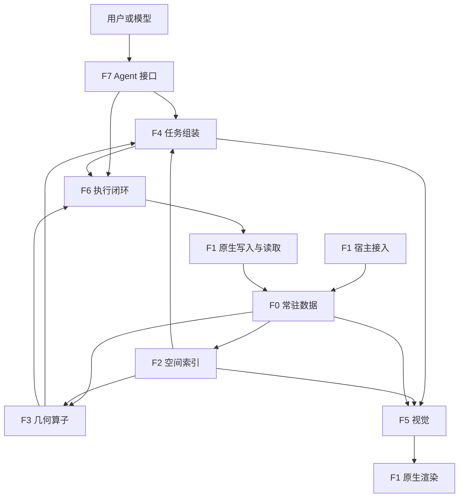

# Human Eye 激进版本整体架构与模块推进表

日期：2026-11-05。当前集成分支 `codex/aggressive-v1`，快速链第一版基线 `0e380bc7c135c2d1bb9533e9d9d7a3a4b3377121`。

本文件落实用户“整体架构明确、分模块逐步推进”的要求，是本分支后续模块边界、顺序和分工的主入口。[激进优化方案](AGGRESSIVE_V1_PLAN.md)保留重写原则，[第一版结果](AGGRESSIVE_V1_RESULTS.md)保留已完成内容与实测。这里的拟定接口和目录是后续实现约定，不代表已经存在。

## 1. 整体设计

采用一个常驻运行时、共享连续数组、直接函数调用。模块是代码与数据责任边界；默认同进程运行。Blender 接入、CLI 或 MCP 只在实际宿主边界增加适配。跨进程需求出现时再选共享内存或原生传输，模块之间不逐层转 JSON。

新路径继续采用可信输入，移除来源认证、重复校验、授权/配额/期限守卫、持久账本和保守回退。输入索引、对象身份及变更列表由调用者提供。几何数值、索引对应和算法终止条件仍需定义，正确性在开发测试中核对。



箭头表示数据或调用流。模块导入关系保持下层独立：F0 不导入 F1–F7；F2/F3 接收数组或数据视图；F4/F5/F6 通过注入的宿主函数调用 F1。执行后的新数据进入下一轮，不要求形成相互 import 的环。

## 2. 八个模块

新模块使用 F0–F7 编号（Fast），与历史主计划的 M1–M4 阶段编号区分。

| 模块 | 负责什么 | 输入 → 输出 | 激进优化重点 | v1 实际状态 |
| --- | --- | --- | --- | --- |
| **F0 常驻数据** | 拓扑、参考、帧、变换的所有权与生命周期；显式变更 | 原始数组/变更 → MeshHandle、FrameView | 常驻列数组、明确借用、局部更新、共享索引 | `FastSession` 已有单网格多帧和自有数组；多对象场景待做 |
| **F1 宿主接入** | Blender/文件采集、宿主求值、原生渲染、setter 和实际回读 | 宿主对象/操作 → 数组、图片、实际状态 | 常驻连接、批量读取、减少重复求值和复制 | NPZ 可运行；Blender 适配器存在但未真实运行验收 |
| **F2 空间索引** | AABB、BVH/refit、区域筛选、近邻候选、射线候选 | FrameView/查询 → 候选索引 | 脏面 refit、层级剪枝、批量查询、连通网格邻接 | 已有缓存 AABB、CSR 和区域 SAT；尚无 BVH |
| **F3 几何算子** | 形变、距离/接触/碰撞、结构及表面几何的数值事实 | 数组+候选 → 列式数值与见证索引 | 批量解析公式、SIMD/JIT、并行/多帧计算 | 批量表面伸长与面积已做；通用距离/碰撞等待替换 |
| **F4 任务组装** | 对象/选区绑定、调用算子、完整范围统计、见证选择、任务结果 | 显式任务+数据视图 → TaskResult | 按任务选事实、减少补查、同面跨帧连接、出口才构造对象 | 同面双阈值题型已有；通用任务类型待做 |
| **F5 视觉** | 任务区域到视向/窗口/分辨率、几何投影、原生图像编排 | TaskResult+场景 → ViewPlan、ImageResult | 任务细节驱动取景、复用场景、遮挡批量计算、保留材质 | 快速路径尚未实现 |
| **F6 执行闭环** | 有限动作候选、求解、宿主执行、回读、残差与后续步 | 明确目标+当前状态 → StepResult、更新后的状态 | 数值内循环、本地多步、复用数据、减少模型往返 | 快速路径尚未实现 |
| **F7 Agent 接口** | CLI/JSONL/MCP/Hook 薄封装、操作分派、模型实际结果交付 | 外部请求 → 紧凑文字/图片/动作结果 | 少工具往返、句柄复用、一次序列化、直接图像输入 | CLI/JSONL 已有；新 MCP/Hook 和实际图片交付待做 |

边界细则：

- F2 负责找候选，F3 负责算数值；第一版 `triangle_box_mask` 可仍在 kernels 中实现，逻辑上归 F2 区域查询。
- F1 执行具体宿主调用；F5 决定怎样看；F6 决定怎样改。三者不会各自再建一个 Blender 连接管理器。
- F4 接收明确的任务类型、对象和区域。自然语言含义由外部模型先转换为任务参数；后续引入任务识别也必须有真实使用结果。
- 缓存分布在所有者中：F0 保存场景，F2 保存索引，F3 保存参考基，F5 保存渲染状态。不会新增一个拥有全部业务数据的“通用缓存平台”。
- 测试、基准、分析器是横向开发工具，运行时按需记录普通计时；它们不构成第九个服务，也不阻断每次产品请求。

## 3. 先约定的共享数据接口

这部分是下一批 F0 的交付目标。协议使用 Python 记录和 ndarray；不增加运行时 schema 验证器。

| 数据 | 必需内容与语义 | 谁拥有 |
| --- | --- | --- |
| `MeshHandle` | 进程内 mesh_id；固定原始三角索引；拓扑和参考数据 | F0 |
| `FrameView` | mesh_id、frame_id、positions、world_from_local、revision；数据视图在下一次更新前有效 | F0 |
| `ChangeSet` | changed_vertices、transform_changed、topology_replaced、appearance_changed；None 表示全量更新 | F1/调用者给出，F0 应用 |
| `GeometryResult` | 指标列、对应面/对象索引；数学未定义值保持明确 | F3 |
| `TaskResult` | 任务类型、涉及句柄与帧、选区统计、数值、可追问见证；完整数组留在内存 | F4 |
| `ViewPlan` / `ImageResult` | 视向、窗口、尺寸；实际图片数据、相机/对象关联 | F5 决策，F1 实现原生读取 |
| `StepResult` | 实际执行量、实际回读状态、目标残差、数值停止原因 | F6 |

坐标约定：当前 v1 全部使用 mesh-local 米坐标。F0 扩展保留该本地数组，并增加 local-metres → world-metres 变换；跨对象距离、区域与射线统一消费 world-metres 视图。世界查询涉及非均匀缩放时在世界度量空间求解，不能把局部欧氏距离直接乘一个任意尺度。只有刚体变换改变时复用本地拓扑/参考基，更新世界包围界即可。

拓扑替换是显式数据操作，会重新建立关联索引；变换、顶点和外观变化分别通知对应缓存。revision 用于标记计算结果需要重算，不进行来源认证或逐请求比较哈希。漏报变更按调用者接口错误处理，运行时不会扫描全部内容替其推断。

F0 给 F2/F3 借用只读约定的数组视图；F1/F6 通过更新接口改变状态。异步并行需要调用者明确固定快照或同步完成。第一版先同线程完成一次更新/查询；不会为了未来并行提前建立锁、消息总线和事务系统。

建议的窄接口如下，签名属于计划：

```text
F0: add_mesh(reference, triangles) -> MeshHandle
    put_frame(mesh, label, positions, transform, changes) -> FrameView
    frame(mesh, label) -> FrameView; drop(mesh)
F1: capture(objects, frame) -> mesh/frame arrays + changes
    render(view_plan) -> ImageResult; apply(action) -> actual state
F2: build(frame); refit(changes); region(bounds); candidates(query)
F3: evaluate(operator, frames, indices) -> GeometryResult
F4: query(task_spec) -> TaskResult
F5: plan(task_result, scene) -> ViewPlan; render(plan) -> ImageResult
F6: step(goal, frame) -> StepResult; run(goal) -> final StepResult
F7: dispatch(operation, arguments) -> serializable result / image blocks
```

F6 的收敛、无改进、迭代次数等是算法停止定义；由使用的求解器和用户参数决定，不恢复原授权账本、任务期限或隐式重试体系。有限步调试入口先于自动多步。

## 4. 对现有文件的映射

| 文件 | 现有内容属于哪个模块 | 演进方式 |
| --- | --- | --- |
| `human_eye_fast/engine.py` | F0 帧所有权；F2 邻接/AABB；F4 归约与见证 | 保留 `FastSession` 外观；在相关模块开发时提取，不做无收益的全量搬家 |
| `human_eye_fast/kernels.py` | F2 SAT；F3 参考基与形变 | 数值接口保持可直接基准；索引扩展可新增 `spatial.py` |
| `human_eye_fast/blender.py` | F1 | 扩展到多对象、变换/外观和真实生命周期测量 |
| `human_eye_fast/cli.py` | F7 与少量应用组装 | 保持 `demo/analyze/serve`，新外部协议只做薄适配 |
| `verification/test_fast_*.py` / `benchmark_fast_v1.py` | 横向测试/比较 | 每新增模块带自身公开输入、oracle、计时及一条集成示例 |

后续可新增 `scene.py`（F0）、`spatial.py`（F2）、`tasks.py`（F4）、`vision.py`（F5）、`control.py`（F6）、`gateway.py`（F7）。这是职责映射，不要求一开始创建全部空文件、抽象工厂或插件框架。

## 5. 模块推进顺序

| 批次 | 架构端 A 主责 | 算法端 B 主责 | 合并后可直接运行的结果 |
| --- | --- | --- | --- |
| **R0：当前方案** | 共享数据/坐标/所有权约定 | 共同基准与 oracle 范围 | 本文，模块清单，v1 基线 |
| **R1：基础双线** | F0 多对象数据核心 + F1 常驻 Blender 读取 | F2 连通网格邻接 + BVH/refit，复用 v1 F3 | 连续多对象场景的区域查询；位姿和局部顶点变化后结果一致 |
| **R2：观察闭环** | F4 任务入口 + F7 最小真实工具交付 | F3 距离/接触等首个空间算子，继续形变批处理 | 模型能够选对象、查事实、追问同一常驻场景 |
| **R3：视觉** | F1 原生渲染与 F7 实际图像交付 | F5 视向/局部窗口及遮挡算法 | 同一任务返回必要数值和实际图片，支持真实消费比较 |
| **R4：有限执行** | F6 宿主执行、回读、数据刷新和接入 | F6 候选求解 + F3 相关数值内核 | 一个明确目标的 step，再组成本地多步闭环 |
| **R5：扩大吞吐** | 宿主局部读取/共享内存/长期会话 | SIMD/JIT/GPU、多帧并行与大场景索引 | 根据已接通任务比较冷/热、变化率、规模和完整成本 |

每批接通一条使用链，交付后再扩充下一个模块；不要求一个模块的所有未来算法全部做完才集成。R1 的算法端使用公开数组夹具即可开始，不等待真实 Blender。R2 可先由 CLI 验证任务接口，随后接入实际模型宿主。架构与算法改动分别测试，再测组合版本。

**下一批明确从 R1 开始：我方先负责 F0+F1，另一端负责 F2。** 这是建议派工，另一端尚未在此聊天中接单。第一版已有 F3 形变和 F4 同面见证作为集成样例，避免两端各写一套 session。模块内的实现可以激进重写，但维持共享数据语义，接口变化随提交一并说明。

## 6. 每个模块做到什么程度可交付

| 模块 | 必须给出的可观察结果 |
| --- | --- |
| F0 | 多对象/多帧正确查询；局部变更与完整重建一致；释放后内存可回收；记录实际复制和占用 |
| F1 | 一次真实宿主连续读取示例；同进程复用；实际捕获/求值/转换成本；明确全量与局部读取范围 |
| F2 | 区域/候选结果与直接计算一致；连通网格局部更新；冷构建、refit、查询及内存对比 |
| F3 | 与独立数学或直接算法对照；包含普通、退化、极端尺度样例；标明浮点语义变化及真实速度 |
| F4 | 完整任务答案有相应事实和见证；原面/对象索引可追问；多个具体任务而非只换问题措辞 |
| F5 | 实际输出图像可被消费；任务细节、遮挡、颜色/材质和全景足够案例；计算和渲染分账 |
| F6 | 实际执行与回读一致；目标残差、停滞或失败按实际返回；单步/多步有具体可运行任务 |
| F7 | 工具确实调用新路径；文字/图像实际到达模型；调用、模型往返和完整任务结果可复核 |

这是开发交付清单，不是产品请求必须逐次通过的运行时门。没有实际运行的条目保留“未运行”，即可明确下一批工作。可比较收益包括更快、同成本更完整或更少模型调用；按真实任务选择主指标。

## 7. 分支和两端比较

以共同集成提交开短期模块分支，如 `codex/fast-f0-f1-runtime`、`codex/fast-f2-spatial`。模块完成后带测试与结果提交，分别集成到 `codex/aggressive-v1`，再从新集成点开展下一批。当前文档更新不创建这些未来分支。

这细化了旧方案中的架构/算法两条长期分支：A/B 仍是主责分工，实际提交按模块形成短周期。避免两端长期各自修改 `engine.py` 后才首次合并。

每批记录四种可复跑组合：共同基线、仅 A 改动、仅 B 改动、A+B 集成。输入、问题、坐标、输出语义和计时范围写明；直接比较各版本实测值，不把两个速度倍数相乘。执行域、图像域或数值合同不同的结果分别说明。

模块提交说明固定为：模块/基线提交；改动接口；可运行命令；结果与原始数据；实际未覆盖项；下一模块需要的输入。公开夹具和计量结果放 `verification/` 与文档，真实资产按用户选择的共享位置提供；不要求把全部历史素材放入 Git。
