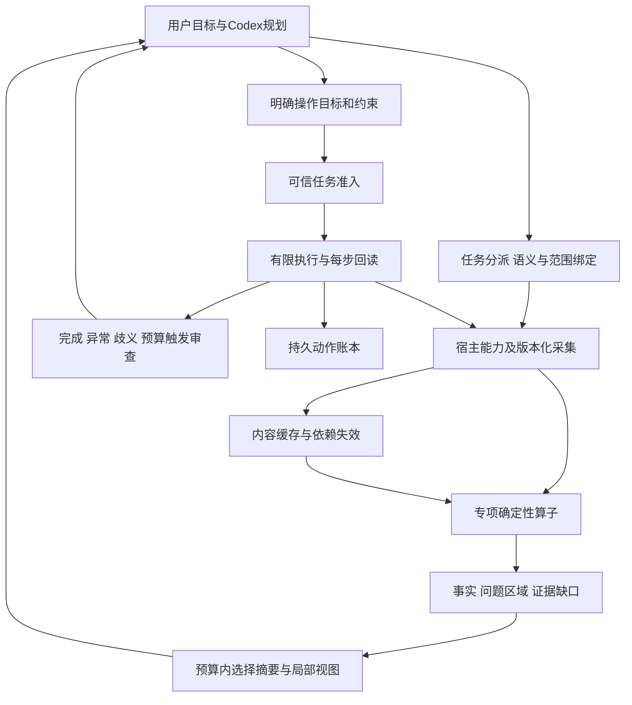

# Human Eye 架构与功能可行性分析

审查日期：2026-10-31。基线为 `9.7.2+20261031.dense.focus.r1`，源码摘要 `22fb2523bdbfb68d6e7227ea3df3b4373daa1a76461344bc1755406c5feeec8a`、78个运行时文件。2026-10-31初次审查核对源文件、调用路径及既有产物；后续候选与实测增量见文末分节。2026-11-01已完成首个私有平面边界观察候选，正式基线与模型试次状态未变。本文解释技术判断，**不另行安排任务顺序**；唯一排期文件是 [PRODUCT_ROADMAP](PRODUCT_ROADMAP.md)，当前交付状态是 [PROGRESS](PROGRESS.md)。

## 1. 总判断：基础可复用，完整产品还缺什么

适合继续建设的产品是“面向Codex的任务驱动三维感知与受控操作引擎”。插件和Hook承担接入，引擎处理可核验的几何、局部观察及有限执行，Codex处理语义目标、全局规划和必要审查。这条路线不依赖改动基础模型的视觉编码器，也不以模型无条件信任工具为验收目标。

现有基础足以增量扩展，尚不足以承诺任意复杂模型的自动诊断与修复。主要缺口表现为：精确任务表达仍偏对象对；原始来源已有有限核验但不足以覆盖完整专业诊断；局部观察仍偏包围界或特定间隙；有界控制器与默认Codex完整任务入口之间存在接入缺口；真实资产规模和模型整任务价值尚未证明。优先补任务证据链是依据这些缺口作出的工程判断，尚不是完整链路性能分析证明的最大热点。这些缺口应串成少量可验收的纵向交付，不能分别发展成长期独立研究。

2026-11-01可信基础增量：发现并修复认证表面/测距点集不一致，以及提交后异常执行回执和最终完成保存语义。继续复用geometry_safety、既有scheduler/授权/账本，不新建并行执行平台。实体距离明确为三角面边界，孤立原始几何保持但不参与此量测；物理执行事实、对账下界、任务完成与提交确认分别表达。当前源码85文件/47729357候选，正式安装仍78文件/22fb；验收与限制见[可信基础规范](TRUST_FOUNDATION_ACCEPTANCE.md)和[进度](PROGRESS.md)，本文原表的正式基线能力不因此自动扩域。

同日NV增量与主线融合：用户规范WP0–WP5已映射到唯一队列，反射/记忆沿M3-A1至A4，小模型为R-ML条件项。非平面verification采用源绑定的有限曲面连通证据、实际命中胶囊及严格几何特征采样；原生薄带并不严格共面，因此保留严格模式失败，另以1/8像素偏离界的显式视觉模式验证。31项相关检查和42次原生判断通过，完整规划/复核增加约6–9ms；这是有成本的正确性候选，不是尺寸精度放宽或生产consumer已完成。下一工作仍由主计划决定，证据见[NV局部验收](NONPLANAR_LOCAL_SURFACE_ACCEPTANCE.md)。

“小脑”的数值闭环可先用确定性算法完成；学习网络不是它的前置条件。“人眼机制”先落实为任务特征定位、必要证据选择和预算控制，不追求生物学结构逐项仿制。用户所说的凹陷、裂开、手臂扭曲是不同缺陷域，不能只靠多视图或一个曲率阈值统一解决。

## 2. 真实运行架构与模块实现等级

以下“已验”只指对应支持域，不能跨列相互代替：代码存在、正式入口可达、真实宿主通过、真实模型受益是四种证据。78文件被纳入构建身份不代表78文件中的每项算法都参与正式请求。

| 模块 | 源码与实际作用 | 当前成立的能力 | 缺口及架构判断 |
| --- | --- | --- | --- |
| 入口与自动路由 | `production_server.py`、`live_spatial_mcp.py`、`live_hooks.py`、`task_intent.py` | 正式入口连接LiveSpatialService；四个MCP工具；Hook可做提示前文字观察及受支持动作检查；历史真实消息入口已验 | 规则分类不是通用任务理解。当前Hook文字交付不能冒称前置图片注入；新增缺陷任务须分别验证分类、对象解析、实际交付 |
| 任务绑定 | `prompt_pairing.py`、`request_context.py`、`query_policy.py` | 精确名称/ID的对象对、有限查询、关联ID；单对象/未配对概览也已存在 | 缺的是单对象专业诊断和对应原生任务证据，不是单对象完全不能读。`task_context`只是计量关联；查询模式仍为overview/exact_pairs/nearest/top1 |
| 宿主采集 | `blender_host.py`、`blender_mcp_host.py`、`blender_worker.py` | 求值网格、世界坐标米制、身份/版本、有限原始姿态证据与原生图；正式固定MCP已验 | 普通求值读取宽于严格原生证据，后者仍限定静态独立刚体。原始面/边及来源映射不能靠求值三角网格猜回 |
| 场景能力与几何事实 | `geometry_safety.py`、`orthogonal_solid.py`、`scene_capabilities.py`、spatial_sniffer | 支持域内距离/接触/分离量、精确/界限/unknown，有限凸分量及正交实体；原支撑面发现；已有边关联、顶点link连通检查 | 通用凹形、开放面、自交网格不是自动可执行实体。实体准入拒绝不能当作缺陷定位结果；新诊断应复用已有内核并扩展结果语义 |
| 暂存与增量 | `scene_cache.py`、`scene_delta.py`、MeshEntity缓存 | 不可变内容快照、几何/变换变化区分、严格命中复用、基准错误时重同步 | 仍需捕获/验证当前输入；delta较小不代表省去了全量捕获与编码。可信编辑世代、增量BVH未形成完整产品路径；不含遮挡补全或长期语义世界模型 |
| 分析投影视觉 | `attention_policy.py`、`attention_rendering.py`、`auto_router.py`、标签/回填模块 | 按正间隙采样收益提案、渲染后验证、有预算回退、有限短标和诊断剖面 | 收益是屏幕采样代理量，不是已校准的信息增益/模型正确率；诊断图与自然可见性须分开 |
| 原生观察 | `episode_gateway.py`、`native_observation.py`、Blender原生渲染 | V1多尺度、V2轴盒亚像素任务间隙、V3有限高顶点目标局部；图片与实际相机/来源核对 | 两条视觉链并存。V3用投影AABB上界，中央射线只检查一个样本；不等于问题区域定位。SCENE新分支仍未开放 |
| 有限执行与监督 | `goal_segment.py`、`goal_execution.py`、`goal_scheduler.py`、`goal_supervision.py`、`task_authority.py`、宿主账本 | 可信owned worker内确定性目标、预算、接续、逐步回读、未知停止已有实证；默认MCP有单步/有限段接口 | OwnedGoalScheduler依赖可信任务批准和完整宿主计数；默认四工具没有等价的整任务自动入口。共享GUI允许外部编辑，不能继承独占worker保证 |
| 数据交付与计量 | `task_brief.py`、`result_contract.py`、`telemetry.py`、`task_metrics.py` | 精简事实/图片分离、关联与预算计量；未知usage不等于零 | 减少UTF8/PNG字节不是实测token或费用下降。仍需把完整任务成本和实际消费连接起来 |
| 历史扩展算子 | 顶层`module_2_*`、`module_3_*`、legacy facade及重导出 | 存在二进制编解码、轨迹、控制、曲率等实现 | 默认production路径不同于legacy demo。必须证明调用、合同、真实质量和收益后才可晋升为产品能力，不能照抄历史docstring的性能与精度声明 |
| 学习与异构计算 | 当前无已验的HE学习策略/GPU几何调度主链 | 可复用确定性回放与计量基础 | Agent Learning是工作知识服务，不是引擎中的学习小脑；Blender自身的图形渲染也不等于引擎CPU/GPU算子调度已经完成 |

已核对的直接入口包括：[`LiveSpatialService.observe`](../human_eye_plugin/live_service.py#L808)、[`_native_visual_policy`](../human_eye_plugin/live_service.py#L350)、[`BlenderSceneHost._capture`](../human_eye_plugin/blender_host.py#L420)、[`OwnedGoalScheduler`](../human_eye_plugin/goal_scheduler.py#L112)、[`validate_task_context`](../human_eye_plugin/request_context.py#L12)、[`validate_query`](../human_eye_plugin/query_policy.py#L39)。行号仅对应本次源码基线。

## 3. 三条实际流程，不把它们混称为一个已完成闭环

**自动文字观察**：真实用户消息 → Hook本地分类 → LiveSpatialService → 新鲜场景 → 对象对解析 → 量测/概览 → 有界文字。Hook调用`observe(..., include_image=False)`；执行前后Hook与用户消息入口的验收也各自独立。当前用户是在讨论架构，不应因提到Blender便读取或修改场景。

**显式原生图观察**：MCP observe → 来源/身份/请求检查 → 捕获与对象对 → 量测 → 原生能力协商 → 宿主再读/取景/渲染 → 独立消费端核验 → 输出文字和PNG。捕获、重读和消费端校验有不同职责；不能仅因“重复”就删去。可以在声明明确的新鲜快照范围内复用纯派生结果，不能把上次观察令牌变成写入许可。

**受控自动执行**：可信嵌入方验证稳定任务事件 → 固定目标、对象、原支撑面、原期限和总预算 → 调度器发现/预览 → 实际setter边界检查 → 新鲜回读和独立计数 → 继续/完成/停止。该路径目前有owned工程实证；默认Codex请求还缺完整产品接入。把模型JSON直接转为TrustedTaskAuthority会破坏它，而不是完成它。

现在的代码组织是“历史算子库＋生产服务与宿主边界＋多次纵向增量”。auto_router约1722行，blender_host约1819行；复杂度集中值得留意，但行数本身不是重写理由。新增第二个任务时，抽取小的任务分派和证据投影接口；保留旧入口回归，避免再往对象对分支加入所有未来专业逻辑。

## 4. 建议的融合架构与最小共同合同

采用模块化单体内核、薄Codex适配器和独立宿主worker。现阶段不增加微服务、常驻队列或训练服务。观察与执行可共用身份和快照，能力准入及授权分别处理。

以下是**需统一或增量补齐的最小语义要求**，其中身份、快照、回执等已有实现；该表不是“全部未实现”的清单，也不要求创建一个包揽所有专业的庞大schema：

| 共同对象 | 应表达什么 | 不应承担什么 |
| --- | --- | --- |
| TaskSpec | 观察/诊断/动作种类，单对象或对象对，用户目标、单位、指定参考、保护范围、完成条件 | 不从任意提示词推断编辑授权；不与现有仅作关联的task_context混名 |
| SourceSnapshot | 文档/实例/版本，raw或evaluated来源、坐标与单位、捕获范围、原始索引和必要映射 | 不把当前内容hash当完整编辑历史；不把未采集对象当已删除 |
| Evidence | 算子与版本、事实类别、原始索引/区域、测量精度/范围、覆盖/省略、unknown原因 | 不用一个“置信度0.99”掩盖事实与语义判断差异 |
| TaskFeature / PatchRef | 间隙见证点或缺陷边/面集合、局部包围、支持它的快照、为什么与任务相关 | 不把物体AABB中心等同于任务中心；不把局部图变成证据来源 |
| ViewRequest / ViewResult | 为补哪项证据取图、相机、采样范围、实际可见性、成本、是否仍有缺口 | 不隐去遮挡物后标作自然观察；每次双图额度不等于整任务可无限重复 |
| ActionGoal / Receipt | 可信准入、域、允许修改对象/区域、约束、固定预算、逐步真实结果和未知 | 不允许复用观察缓存授权，不允许换任务ID续额度 |

用既有间隙和新增网格诊断两个任务检验这些共性。只抽取实际复用的数据和服务；当前V1/V2/V3图片合同继续兼容，新任务采用明确的能力版本，不强行塞进旧字段。

缓存、动作账本、任务结果引用和学习轨迹的生命周期不同：缓存可淘汰；未决动作不可因淘汰而消失；引用失效必须回查当前来源；学习只能消费经过核验且注明支持域的轨迹。不要为了“统一记忆”把这些合成一个可任意覆盖的字典。

## 5. 复杂模型功能的可行性与失败边界

| 需求 | 可行性判断 | 最低必需数据与算法 | 关键限制 |
| --- | --- | --- | --- |
| 边界/裂口候选定位 | 结构事实高可行，语义损伤判定有条件 | 原始顶点、边、多边形索引；边面关联、边界连通簇、参考开口/设计约束 | 边界可能是袖口、嘴口、薄片或合法拆件；闭合裂纹/重叠壳并不一定新增边界 |
| 非流形、退化 | 有限静态域高可行 | 原始关联、边的面关联数、顶点link连通、重复索引、面积与数值界限 | 只查每边两面会漏掉bow-tie顶点；近退化阈值依赖尺度；不能检查前自动焊接 |
| 自交、近重合双层 | 中等，需独立几何域 | 有界空间筛选、三角形相交、邻接排除与稳健谓词 | 最坏候选数可很大；合法接触不等于穿插；拓扑完整不保证无自交 |
| 凹陷/鼓包定位 | 有参考时较高，无参考时只能给形状候选 | 冻结参考、同拓扑对应优先、局部法线和有符号残差、多尺度区域 | 正常凹槽与损伤不能仅由当前曲率区分；对应或参考不可信则不输出确定损伤结论 |
| 手臂姿态异常 | 限定角色和约束可行，任意角色不成立 | 骨架rest/pose、局部坐标、父子关系、角色角度/动作约束 | 固定通用角度不能覆盖不同角色；轴向扭转、屈伸和镜像需区分；IK奇异附近不自动翻转 |
| 蒙皮扭结/坍缩 | 中高难度，先诊断 | 原始绑定网格、求值网格、顶点对应、骨骼权重/姿态；局部面积/形变/截面或厚度变化 | 曲面本身没有唯一三维体积Jacobian；正常褶皱、自交和权重错误不能用单一缩放指标区分 |
| 自动局部修复 | 限定操作可行，通用修复高风险 | 明确期望形状、固定patch/保护区、域内求解、实际回读、撤销/失败停止 | 检测到问题不提供唯一修复方案；焊接/补洞改变索引、UV/材质/权重，不能继承仅平移的回滚合同 |

**首个新增域仍选原始静态网格的只读结构诊断。** 原因是拓扑事实有明确真值、能产生可回查的局部特征、无需先建骨骼和权重系统，最适合验证共同链路。它不是承诺先解决所有裂缝，也不是把拓扑诊断提升为唯一产品目标。

### 当前原始三角证据可复用，完整拓扑来源仍需补齐

`_capture`把求值网格三角化，`edges`由三角面重新生成；原生证据比对原始与求值顶点及多边形，却没有交付完整原始多边形/松散边或triangle→polygon映射。必须分两层判断：已核验原始索引对应的三角网格可支持部分边界/邻接事实；完整的原始多边形定位、松散边、原始与派生缺陷区分仍不充分。不能把后一缺口写成“当前所有拓扑数据都不可用”。

反证探针中，一个四边形的两种表示具有相同边界，三角化新增对角线关联数为2；加入一条松散边却不会改变由三角形重建的边集合。它同时说明可复用部分和信息损失的边界。`orthogonal_solid._closed_manifold`已经检查有向边、面连通和每个顶点link，包括pinched顶点；但其正常合同要求单个闭合实体，直接调用会拒绝合法开放面，不能把返回拒绝当损伤诊断。应复用关系计算，新增有位置、类别和覆盖的诊断结果，而不是复制一套闭合实体规则。

新增只读采集应增量保留缺少的来源，先检查分配/索引/有限数值边界，再进行诊断；保留正常的重复位置而不同索引、松散几何与合法开口。诊断事实路径不能先调用会修复/焊接/抹除缺陷的归一化步骤。图像路径若只能渲染部分几何，必须标作不完整/诊断视图或停止自然图交付；不能因删除了未知遮挡物而证明可见。Blender的Mesh API将vertices/edges/loops/polygons分别暴露，说明原始数据读取有直接入口；具体目标版本仍要用本地宿主验证。[Blender Mesh API](https://docs.blender.org/api/current/bpy.types.Mesh.html?highlight=transform)

边的关联数和顶点link应分别检查；自交是另一类几何问题。CGAL也将组合结构、几何缺陷与修复区分，说明不能把“非流形拒绝”包装成全域修复。这里采用的是问题分解，不在本轮引入CGAL依赖；若以后采用外部库，再验证构建、许可证、数值合同和成本。[CGAL网格处理](https://doc.cgal.org/latest/Polygon_mesh_processing/index.html)、[CGAL网格修复](https://doc.cgal.org/latest/PMP_Mesh_repair/index.html)

### 曲率与凹陷的区别

当前`estimate_local_principal_curvatures_and_gauss_bonnet`先按`1e7`量化合并位置；其平均曲率使用Laplacian向量的模，不保留朝向符号。对78个运行源的静态检查未找到该函数的直接调用，尚无已接入生产凹陷诊断的证据；静态检索不能证明一切动态调用均不存在。内部合并用于计算，不等于修改了Blender网格，也不能用其计算拓扑替代原始裂点事实。镜像凹/凸patch探针得到相同平均曲率，说明单靠该量无法完成这项区分，不意味着该算子毫无复用价值。

同拓扑且已对齐参考的首个表面变化量可设计为 `r_i = dot(p_current_i - p_reference_i, n_reference_i)`，同时报告切向变化和法线可靠性；这是对参考的有符号局部位移，**不能直接叫全局最近距离或损伤概率**。不同拓扑先解决对应/配准；重复形状、薄壳两侧或镜像可能错配。无参考时只输出局部曲率/形状异常候选，保留用户意图判断。

### 部分遮挡与人眼聚焦

聚焦优先级应由“任务缺什么证据”决定。中心被挡而裂口边缘可见时，需要边界簇上的代表点；物体中心可见而关键缝隙被挡时，物体中央射线为真没有帮助。对每个有限候选视向，先以几何上界排除不可能获益者，再检查少量任务见证点与完整捕获遮挡几何，最后核验实际输出。样本可见不能声称整个patch可见。

原生视图保持全景上下文，新增局部图须比当前证据补充有效信息；完全遮挡可以只交付精确结构事实和“视觉不足”，不为满足双图数量而强行出图。另一视向、深度/法线图和诊断剖面均可作为后续候选，但来源与适用任务要分开，不一次性全部开启。

### 规模可用性不能藏在“高顶点”一词里

当前一般采集上限为500000顶点/1000000三角形；V3原生聚焦的总场景上限仅4096顶点/2048三角形，且新分支只限XY/XZ。前者说明允许接收的上限，后者说明一个观察算法的有限工作域，两者都不是在这个规模上达到实际交互速度的保证。

还须纳入路径内其他准入：原生取景`_native_view_frame`限制总顶点100000；默认BlenderMCP桥响应上限64MiB；owned episode的`_native`证据限制2MiB；scene_delta默认8MiB；场景缓存默认8MiB保留数据预算不等于进程RSS或临时分配上限。这些限制属于不同路径，不能简单合成一个全产品面数上限；M1-01要画出所选任务实际经过的链再取交集，大小均在序列化和重复证据计入后检查。

单对象也是跨层合同：已有概览可用，但`_native_visual_policy`要求对象对，`BlenderSceneHost.observe_readonly_native`要求两个不同ID，消费端`_public_query`要求至少两个对象，`validate_readonly_observation`核验同一对象对绑定。因此不能只在query增加一个枚举便宣布支持。新的单对象诊断能力应贯穿生产者、宿主传输和消费者，旧动作/对象对合同保持；不创建虚假第二物体绕过限制。

面数、拓扑类型、遮挡、细节尺寸、数值尺度、依赖修饰器是不同维度。必须测采集/校验/扫描/图片/传输各段，明确“只能概览”“事实可用但无局部图”“预算停止”。引入局部BVH/邻接复用前要先确认数据所有权和失效；简化网格不能替代原始缺陷真值，尤其不能把细裂口简化掉。

## 6. 小脑的职责、审查时机与接入选择

采用“每步本地核验＋事件驱动Codex审查”。引擎负责在明确目标下生成有限候选、数值修正、计数与读回。Codex负责选择目标、参考、期望修复方向及遇歧义时重新规划。普通有限步无需让模型重新计算所有几何，完成、特征切换、停滞/振荡、外部修改、数值不可达、预算不足和未知结果必须交回复核。

默认不每N步强制发图；使用任务期限/步数上限和确定性事件，尚不引入未经校准的置信度阈值。调度器不能为一条失败或未回执动作另开任务重试；碰撞终态检查也不等于连续扫掠路径认证。

Codex产品化优先把现有调度器接到受控owned任务宿主，先明确任务归属、入口和结果交付。共享GUI自动写入单独评估：如果无法约束其他写入通道，继续提供新鲜预览和有限单段检查，明确不能继承独占宿主的完整性。**不为追求“自动”牺牲原有未知停止，也不把拥有一个任务授权回调当作整个Codex接入已经完成。**

接入的最高不确定项是可信任务事件从哪里来：当前测试嵌入方可以注入批准回调，默认MCP请求本身没有证明等价能力。应先验证真实任务来源能否绑定到冻结目标；若缺可靠宿主事件，就使用用户可核对的本机受信入口一次登记目标，再由Codex调用该任务。不能从模型可写的event_id/目标JSON补造可信批准。这一接入可行性仍待实证，不能承诺只加一个MCP工具即可完成。

## 7. 性能、传输与学习的取舍

完整时间按 `T = 捕获 + 几何/验证 + 观察/渲染 + 编解码/传输 + 等待 + 模型往返 + 动作/回读/审查` 核算，并区分不重叠关键路径与嵌套span，不能直接把所有span相加。最可能的价值来自减少无必要的模型往返与证据搬运；是否成立仍需实测，不能预报固定提速倍数。

| 选择 | 当前判断及理由 | 触发重新评估的证据 |
| --- | --- | --- |
| 小型模块化内核 vs 整体重写 | 选择增量提取任务分派和证据合同；保留已有几何/权限/回读证据 | 两个真实任务证明重复与耦合导致可测成本或错误，再局部抽取 |
| 内容校验 vs 只信编辑事件 | 保留内容/来源核验；宿主事件可作加速提示，不独立放行写入 | 可信对象所有权、完整编辑世代和同版本冷/热对照成立 |
| JSON/紧凑摘要 vs 新二进制总线 | 先减少不必要字段/图片/回查，内部全几何保持 | 完整链路证明序列化/搬运为主热点，真实跨进程所有权/失效/回收方案可验 |
| CPU vs GPU | CPU作参考与小任务默认；按批量/常驻数据评估候选 | 算法、上传/下载、同步、首次初始化、重用和回退总成本有收益；数值质量同门 |
| 确定性 vs 学习控制 | 确定性主干先可用；学习仅为候选排序/视角或残差建议 | 有足量正确失败轨迹、外部修改标记、训练/确认分离和影子评测；不能改变授权或成功判据 |
| 对每次任务都用引擎 vs 能力路由 | 有三维尺寸/拓扑/变形依据且宿主可读时用引擎；简单常识/图片外观可走原有模型路线 | 按具体任务与成本矩阵调整，不按场景对象数或“大模型应信任”强制调用 |

`BinarySharedMemoryFrameBus`当前代码用类级bytearray、内存视图和复制打包；解码view不等于整个跨进程链零拷贝，更不自动证明页锁内存。默认BlenderMCP桥仍是JSON传输。历史微秒/0ULP文案不能作为新后端采用依据。

学习型小脑接入在技术上可行，但模型只能提出建议；执行前仍走确定性域、预算和回读。对凹陷或角色意图的语义判断，可能需要参考资产/用户约束或学习数据，不能指望小网络从几何里还原不存在的意图。模型内视觉融合需要可控制模型及训练条件，当前不在Codex产品关键路径。

## 8. 对旧主计划的必要修正

保留M1任务证据闭环优先；将它拆为可执行的任务/来源合同、raw只读诊断、patch观察、Codex交付与有限出口，避免“先统一所有接口”变成新平台工程。真实资产规模作为明确门，不能隐藏到GPU研究以后。

M2必须分工程价值门和正式模型门。正常顺序是在有限证据链与工程价值评估之后收口已有Codex刚体任务；但新拓扑候选的成功不是旧间隙调度器的技术前置。若候选无收益或被宿主能力阻断，须明确冻结该候选，并按主计划的条件转入已满足自身依赖的任务，不能让M1变成无限等待点。正式模型/费用/盲评未绑定时不能伪造大收益；有限观察价值通过也不证明自动执行价值。

参考曲面、骨骼和蒙皮保留为后续专业域，各域先只读定位再独立写入；拓扑修复不因检测器完成就自动启动。其它Agent接入继续暂停。日志、标签、缓存只解决当前任务中的实测阻断，不恢复成各自无限优化的主线。

已有历史文档中存在“当前未安装”“下一步先重启”等当时状态，与最新正式交付不同。本轮为相关入口补历史标识；安装事实由PROGRESS及实际版本证据裁决，排期只由PRODUCT_ROADMAP裁决，固定阶段证据保持原样。

## 9. 证据与分析限制

初次分析冻结78个运行源和当时373个已跟踪文件，检查实际主路径、能力声明、旧合同与正式22fb发行结果。主要基线证据为本地`verification/fixes/20261031_v21_dense_focus_release/RESULT.json`、`20261031_v21_defect_focus_scope/SOURCE_AUDIT.json`；静态清单在`verification/fixes/20261031_architecture_master_review/`，这些机器档案不随公共源码上传。

初次分析未做功能探针；本次复查补充10项纯数据/内存宿主替身探针，没有启动真实Blender、进行性能对照或模型试验。不给未实现功能估算完成百分比、固定工期或未经测量的收益数字。分析由主代理完成，不冒称独立第二人审查。算法候选仍须后续独立真值和真实宿主验收。

外部API核对中，Blender在线版本页直接打开失败；可检索到的官方Mesh说明仅支持数据结构存在，不作为本机5.2运行验证。CGAL文档用于问题分类及可行性参考，不代表本项目已采用其实现。最终技术排序是结合本地证据的工程判断。

## 10. 反证复查的修正与保留结论

复查对应源码仍为22fb，复查前Git版本为e69d3ec。10项探针全部满足各自预期，包括预期拒绝；这不是10项新功能完成，也不是全域无误报/漏报证明。结果位于本地`verification/fixes/20261031_architecture_counter_review/PROBES.json`。

| 修正类别 | 反证/遗漏 | 已采取的修正 |
| --- | --- | --- |
| 现有能力被低估 | 单对象概览已存在；原始核验三角网格能保留部分边界；现有严格实体检查有顶点link算法 | 按可复用部分增量扩展，明确缺的是专业诊断输出与额外来源，不从零重做 |
| 跨层依赖未展开 | 单对象限制同时存在于service、宿主和consumer；数量上限不代表整链可承载 | M1-01增加跨层能力与字节/工作/期限预算表，旧执行合同独立保持 |
| 漏判验收不够明确 | 全部unknown也可表面零误报；多簇只报一簇、扫描中止和展示截断容易混淆 | 主计划增加问题级召回、回答覆盖、过度拒绝、定位和完整性口径；结构与损伤语义分开 |
| 排期可能卡住 | M3-A被写成依赖新诊断全部成功；停止规则可能误伤必要正确性修复 | 区分交付顺序与技术依赖；允许有记录地冻结无收益候选，必要正确性修复不按可选优化冻结 |
| 延期项失去归属/视图缺失语义 | 自交/近重合未明确归入后续；删去不能读取的遮挡物可能让局部图误导 | 归入M3-B2；未检查类别显式标记，不完整图不能认证自然可见性 |
| 证据等级表达过强 | “主瓶颈”未经整链测量；静态无直接调用不证明任意动态调用不存在；任务图片总额度尚非默认保证 | 改为工程优先假设，限制静态结论，明确单次预算与待落实整任务额度 |

保留的判断：有限刚体与缓存值得复用；原生V3并非通用缺陷定位；曲率均值不足以判断有符号凹陷；完整Codex自动任务、学习小脑、GPU几何调度与正式模型收益仍没有已交付证据。复查当时确定M1-01开工，没有新增并行功能主线；后续状态见下节及唯一主计划。

## 11. M1-01落地后的架构核对

[结构证据合同](MESH_STRUCTURE_EVIDENCE_CONTRACT.md)已冻结任务/来源/检查范围、单对象跨层责任和初始数值门。可执行验收器仅位于verification；正式78个运行源和当前安装不变。下一项为M1-02，不能将本次合同登记视为已经提供生产诊断。

3个独立Blender 5.2 factory进程实测14类解析源夹具和3档读取规模，验证原顶点/多边形及松散边集合保留、读取前后几何与选择不变。旧native路径拒绝空/零面网格，raw读取仍可获得其结构。这证明独立raw诊断采集可行，不能证明结构检测正确率、自然可见性或默认Codex已消费结果。原始读取基线与旧双证据工作量不同，不用时间比宣传优化收益。

默认四工具仍未包含完整受信目标登记/自动scheduler入口；现有TrustedTaskAuthority回调需要真实受信嵌入来源。M3-A入口风险已提前定位，保持先受信登记与owned宿主，再绑定原预算的方向，不以模型可写JSON补造授权。完整任务配额和单对象原生图仍待对应阶段实施。

## 12. M1-02首批候选后的历史判断

已把raw读取与首批三类结构事实做成独立模块，并通过owned固定worker及私有服务验证单对象交付；旧pair/render/write路径保持独立。源码身份为候选，正式安装仍是22fb。默认共享桥和公开MCP/Hook尚未开放该能力；非流形link、退化及位置/patch取景也未完成。

来源校验时已经需要构建边到原始面的关联，初版随后又扫描同一关联；剖析确认这部分重复工作后已复用。大网格后续中位从约100ms降至70ms，但冻结的首次/尾部成本门仍失败。因此判断为“正确性与有限纵向能力有进展，整批未达到发布条件”，不换门限，也不继续同根因抠性能。当前事实不支持重写总架构或立即引入GPU；后续按主计划补剩余检查并保留此规模失败边界。

## 13. M1-02六类事实与位置后的判断

目前支持非流形边、顶点link、有限退化以及原始索引绑定的局部/世界位置。顶点link采用一般原始多边形的邻角图，补足“边面关联正常但顶点夹断”的漏判机制；退化运算以精确二进制值计算，避免直接浮点面积在极小/极大坐标下下溢或上溢。精确算术有额外CPU成本，因此仍受单次工作/期限预算约束，尚不能称为性能优化。

架构继续分离来源、事实、位置、图像和动作：位置无法计算不删除已知拓扑事实；某类未知不覆盖其他已完成检查；没有全局可见性证据不生成自然可见声明。consumer核对协议、策略、来源、索引/分类、未知范围及位置语义。25个新owned解析场景和固定worker→私有service支持有限实现可行性，不替代真实资产和公开Codex消费。

下一步不重写框架：按主计划收口已有合同的其余三类检查，再让问题区域驱动观察。旧大网格成本失败继续冻结；性能、整任务额度、公开入口和模型收益分别验收。重复面link未知、非平面/非简单ngon退化未知是显式支持域限制，不能隐藏为“模型正常”；通用凹陷、自交和骨骼并未因此完成。

## 14. M1-02九类范围收口后的判断

当前补齐精确重复位置、原索引重复面和局部方向冲突，既定九类已具备有限算法候选。位置等价与面环等价各自分组，方向用原始边两面关联计算；不需全局平台改写，也不需引入GPU或学习模型。复用原来顶点link所用的面环规范化函数，并保持旧三类默认路径，不为新增方向统计在每次旧采集中增加遍历。

39个解析owned场景和九类私有交付证据说明结构层可以作为下一层输入，但其支持域未知和成本失败仍存在。下一项转入M1-03，理由是来源绑定的问题索引、局部/世界位置已具备，而继续加检测种类不会证明任务特征更可见。先查缺陷raw网格是否能进入独立只读图像链，以及周边遮挡来源是否完整；不为生成图片放宽刚体执行准入。

视觉验收要区分对象识别与问题证据：中心被挡仍可能存在有价值的边缘视图，对象可见也可能看不到问题。独立视向真值与完整图像成本先登记，再判断候选是否值得增加图片；保留完全遮挡的诚实拒绝。现有9类代码不是M1发布通过，旧规模失败、九类完整成本、公开Codex消费和任务累计预算仍按主计划单独过门。

## 15. M1-03来源与视觉参考后的架构决定

实测将接口问题与算法问题分开：34/39结构夹具可被原生采集，但旧consumer至少2对象及宿主的pair绑定使单对象任务不成立；空/纯点、非均匀变换和非mesh遮挡另有来源限制。遮挡物渲染隐藏状态不在现有几何版本内，新任务不能将该版本当作完整显示状态证明。

因此新增独立patch只读协议，复用可用的主线程采集、原生渲染、实际RNA和恢复检查；不复用旧pair身份语义，也不放宽写入条件。图片域先取可靠交集，来源/可见性不完整时保留文字并明确图片不可用。完整边界patch已有原索引与成员摘要，可在同一次只读锁内重新诊断并比对新鲜来源。

6类独立参考实验证实两种真实失败机制：物体中心被挡会漏掉可读问题；物体可见会导致对被挡问题无效加图。oracle窗口中的48像素孔宽和10/12可见边界证明存在机会，而不是证明自动算法已找到机会。先做边界组件的有限候选与边缘见证，预算和消费端共同核对；避免继续调物体中心阈值。

原始结构问题并非都适合自然图片：重复点/重复面可在图上重合，纯点或退化面也可能没有可辨表面。初版不强制九类全部出图，不把结构诊断升级成无依据的损伤结论。本批仅完成[来源与参考合同](PATCH_OBSERVATION_CONTRACT.md)，运行源码未改；自动候选与公开消费按主计划继续。

## 16. M1-03自动候选后的判断：2026-11-01

已实现的结构事实→新鲜patch→有限窗口→边缘见证→原生图→独立消费链在受控平面来源成立。中心遮挡而边缘可见时保留机会，问题被挡时不追加；实际像素与解析独立真值支持这一局部机制。无需改变基础模型、重写V3或增设假参考对象。实现将旧验证器的默认至少两对象保留，仅新私有协议显式允许一个对象。

可接受的取舍是有限支持域与重复核验成本：同租约重新扫描目标，显示状态独立绑定，每个有效边缘需要两条射线并由消费者回放。现阶段约6–8毫秒消费者成本在小场景中可见，不能为跑分删除来源或可见性检查；也没有证据现在需要GPU、常驻服务或全量平台改造。几何见证与真实图片对比是不同证据，消费者本身不保证任意材质的语义可辨性。

功能成功不消除产品缺口：公开Codex任务入口、patch回查寿命、跨调用累计预算和包含启动/诊断/传输的成本仍未完成。按唯一主计划进入M1-04，用这个已验有限候选完成一条可消费任务；不继续无限改善平面夹具，不把它包装成凹陷、裂纹、自交或骨骼扭曲的通用诊断。原M1-02大网格成本失败、正式安装22fb及正式模型试次0全部保留。

## 17. M1-04显式登记消费后的判断：2026-11-01

本批将单对象结构链接到现有MCP观察工具，以独立任务账本承载跨调用额度。任务身份由受信本地登记产生，模型的session/task字段继续只作关联。调宿主前持久预留，完成后记录已构造内容；图片调用结局不明时保留预留。patch引用只保存完整来源绑定组件，回查重读；重试只交历史收据。这些责任没有塞入几何算子，也没有放宽旧执行路径。

三轮真实stdio和独立固定worker证明协议可传输、额度可执行、原生图可构造；并不证明Codex已经通过真实消息自动进入新任务。先拒绝重启接管旧任务，可保留原预算且避免不确定重放，代价是当前新任务须另行显式登记文件/配置。下一步应实现有可信来源、不可重放续期的新任务生命周期和最小消息摘要，不为便利把模型提供的task_id当授权或无限新额度。

完整RPC成本已揭示局部渲染只是其中一段：首次两图请求约445–495毫秒，加前两次诊断/回查约611–651毫秒，启动另计。旧私有基线入口与guards不同，不据它判定新架构性能退化或收益；下批先建立同口径总成本与代表资产门。当前没有证据需要消息常驻服务、二进制协议或GPU。原算法有限支持域、旧大网格失败、未安装状态和正式模型试次0保持独立。

## 18. M1-04有限生命周期后的判断：2026-11-01

采用有界控制索引加独立任务账本，解决每次任务必须重配MCP的问题。控制索引只处理16个登记的去重与活动选择，几何来源、观察额度及原始回执仍在各自账本；无需引入常驻服务。service→control→task的固定锁序覆盖观察提交，可信关闭不会与取景中途切换重叠；旧查询以活动task_ref做世代检查，不能消耗新任务预算。

取舍是单活动任务、显式本机开始/关闭及有界登记容量，保持可审查的首版行为。未决写入保留pending，关闭保留未知消耗，状态读取不领取服务owner；通过3轮真实stdio跨任务和跨进程故障/互斥检查。该本机接口和stdin Hook都不构成同权限本地代码之间的安全隔离，本批没有证据将任意输入的event标签视为不可重放宿主任务签发。

下一项转向Codex最小交接与代表资产/同口径成本，避免继续在控制索引搭建通用任务平台。首次两图高值669毫秒和本机命令启动约0.3秒需要纳入整体成本；不删除首次样本或用第二任务热态掩盖它。真实消息自动登记与当前安装仍待独立实证，不能因脚本连续任务通过就把M1全部完成。

## 19. M1-04文字交接后的判断：2026-11-01

新增的是可选表示层：以精确本结果引用压缩重复字典，不删除事实字段或让模型重新猜补未知。实际文字收益11.3%–16.2%，小于几何表示/图像压缩可能带来的收益，但新增投影成本在预登记门内；当前无需为此引入二进制协议或常驻服务。既有四工具和完整结果继续成立，图片与全文预算独立保持。

程序化非盒体说明文字采集与有限图像必须分域：弯曲/非平面边界的结构事实可交付，当前XY视图不能交付；非平面ngon退化未知保留，拓扑正常不证明无自交。已有特殊视觉增益仍来自平面问题窗口，本批未突破通用曲面/扭曲/凹陷视觉。真实MCP简报的当前Codex手动读取形成最小消费证据，不能视作自动入口或模型收益试验。

M1-04有限功能至此收口，转M1-05固定候选与发布验收。完整脚本和真实worker内存基线已建立，下一批先登记数值成本支持域再验固定包/隔离安装与真实资产代表性；不继续在简报、账本或同一平面夹具上泛优化。旧大网格成本失败及自动入口未验分别保留，不能据本轮小场景通过宣布总架构、复杂资产或发布全部完成。

## 20. 非平面取景的根因与有限解法：2026-11-01

旧门同时绑定了整个目标的平面性、固定XY投影、以采样点同Z判定表面/空白以及consumer的固定方向。故删除planar_XY_target_required既不能完成相机/协议接入，也可能把起伏表面误判遮挡或把远处同物体当局部表面。已知局部边缘必须与原始结构patch和实际邻接三角绑定，视线朝向也必须成为可验证证据。

验证原型以邻接面的面积法向及有限世界方向形成最多4候选；在每条边的两侧投影3像素偏移，一侧最近命中该边邻接三角，另一侧全场景射线无命中才算机会。较大/扭曲区域先拒绝法向抵消，后续再拆局部区域，不把一个平均法向当所有复杂形体的答案。生产投影重心与独立3D相交的结果在七类有限场景一致，实际原生PNG证明有12/12和中心遮挡10/12的机会，未靠包围框放大替代质量。

当前空背景规则保守，孔后内壁会被拒绝；此类需另定义局部深度断层与像素真值，不能偷偷把任意远处目标面当可辨开口。法向可靠但两个视角仍覆盖不全时，保留文字、申请有限后续观察或停止，而不是重置总预算无限加图。缓存可复用派生候选，但任何编辑、显示/遮挡或来源世代变化都必须重新绑定。

原生renderer已有任意frame与实际RNA校验基础，下一项只补新三维视图协议、独立consumer及MCP/预算链。试验用SCENE调用标签不升级旧固定SCENE语义；生产必须明确新视角字段并验证。NV-01不改85运行源e610，NV-02有限接入后回M1-05，避免研究和冻结发布候选混同。全局缺陷诊断、角色变形和学习型小脑仍按原阶段条件推进。

## 21. 反证复查后的架构取舍：2026-11-01

新证据说明要修正当前原型的离散几何语义和调度。三角数×边数使2048输入上限远大于实际可观察范围；面积法向把三角面积带进朝向，单个邻接三角身份又把三角化细节当作局部表面，导致几何不变、细分改变时行为不稳定。

对象级保守范围筛选和边长加权单位法向已修正两个根因。独立端以精确点积核验不漏潜在对象；同物体远处面和密集遮挡不能冒充局部见证。小场景已有同质量成本收益，远处密集则从拒绝变有效机会，分别报告。三角集中在单目标时仍超预算，后续需要有界三角簇/BVH，独立预算构建和遍历。

薄带过度拒绝尚未解决：原生图12/12可读，采样命中同一表面的另一个三角却被拒绝。须表达来源绑定的有限连通表面见证，不能放宽成同物体任意命中。三点/边还可能让新增短边改变投票权重，属规则推出、待实证的风险，后续核对弧长/几何特征采样，不能冒称已证实错误。

因此暂缓NV-02，先修有限归属/采样，再验单目标密集几何与完整consumer。独立射线不等于独立决策，相机读回只证明执行所提方案，consumer仍须重建选择、来源、预算和裁剪。内壁语义、角色、自交及缺陷意图依旧按原阶段；该次复查的e610运行源和正式安装不变。

## 22. NV-D模块完成后的分派决策：2026-11-01

NV-L局部归属后，单对象有用投影内的全部三角仍会重复进入生产和独立射线。新增有界投影BVH以精确覆盖/分区/剪枝证书约束筛选，保留真正遮挡及原8192三角预算；构建、遍历、独立复核、序列化和内存分别有账，源/显示/基变化不复用。它是单次操作内索引，不是持久三维场景缓存，也不是完整生产consumer。

同质量80面规划＋JSON＋复核约27.5→17.4ms，1808面从无图恢复12/12；78次真实原生判断/像素通过。但全域自动切换两轮仍有小场景p95超门，因此冻结而非继续为统一入口堆叠判断。独立显式密集入口通过自身首次/热态成本，旧默认候选和checker恢复原字节，导入默认不加载新模块。未来在已取得可信源的生产分派层选择能力，必须把路由本身及完整任务成本纳入新验收。

此取舍允许完成有收益的大模块，同时保留被实证否决的默认接入路径；不将模块交付冒充当前插件升级。下一项只做NV-02完整协议/独立consumer：来源/显示/世代、基与特征/采样/选择/收益/总预算的重建，再验真实RNA/恢复和既有MCP/任务链。当前运行源47729357、正式22fb未受NV-D改动；细节见[NV-D验收](NONPLANAR_DENSE_ACCELERATION_ACCEPTANCE.md)。

## 23. NV-02有限源码接入完成：2026-11-01

新增自包含固定字节planner，避免Blender依赖完整引擎或verification包；独立精确证明、完整决策和原生响应消费者分别置于运行包。typed新协议与旧XY独立，固定worker/BlenderMCP模板共用既有只读租约，service仅在本机配置选择新模式时导入消费者。raw三角与原生索引、转米局部坐标/矩阵/world、实例/世代和完整显示都要对应，不将未建立映射的求值结果纳入支持域。

完整独立决策额外扫描邻接、候选方向、投影、筛选和采样，因此将第三遍邻接/范围/投影工作计入旧限额；没有只登记旧两端成本。完整搜索才返回生产视图，原型的早期合格但剩余搜索耗尽结果会转unknown，代价是更保守的覆盖。显式稀疏/密集保留，失败不偷偷自动改模式、不重获任务额度。原始事实仍可在图片失败后返回，执行域无变化。

90次原生、60张独立局部像素、两项固定worker→四工具MCP任务、固定模板真实bpy与旧XY均通过；来源/显示/恢复故障及16类响应篡改验证。新通道完整函数成本p95最高约208ms、实际两项任务图片请求约418/716ms，范围明确，不将更多校验的成本与少校验原型直接算速度比。运行源89/dddced48，正式22fb未改；转M1-05固定版本和隔离发布门，旧成本失败及默认消息入口仍待验。见[NV-02验收](NONPLANAR_PRODUCTION_ACCEPTANCE.md)。

## 24. M1-05隔离部署后的成本取舍：2026-11-01

89源以确定性wheel/显式清单打包并隔离安装，固定入口保持来源和元数据核对；未修改运行算法或正式22fb。60项完整任务、36局部像素、安装下TF10项及绑定篡改通过，只说明有限候选能从安装包运行。真实Bunny镜像保留partial事实，原生图因源规模越门拒绝，既不删点迎合图片域，也不把结构事实当损伤意图。

历史grid96及普通间隙新增成本仍失败，故不激活。完整trace中源复核是显著固定开销：source_check中位约11.5/12.5ms；r2已进一步归因，见下节。check_source_drift仍重新取得完整源码身份，保持每请求的漂移/增删源拒绝及未知语义。不要直接缓存整个成功结果、只凭mtime/stat跳过字节校验或关生产守卫。

原始诊断按原84.6654ms门失败，旧同因微优化分支仍冻结；后续若提出结构性减少重复读取/验证，必须另登记完整工作量与质量/首次/热态域，而非靠扩预算或只跑小样例通过。正式发布、当前聊天自动入口与模型收益继续分门，见[M1-05验收](M1_RELEASE_CANDIDATE_ACCEPTANCE.md)。

## 25. V2复审融合与r2有界交付：2026-11-01

V2作为参考补充观察/量测/执行/模型价值分门和运行中到期测试。原三角面量测、三态回执及有限非平面协议继续复用，不重复建设。真实多段提交/回执丢失矩阵仍是M3-A自动执行的必要门，不由单段TF10项外推；共享GUI/真实消息入口也不由owned证据替代。

r2 profile定位到重复相对路径推导，而非发行元数据主导。89源清单按原固定根模块/两包前缀生成同一规范名称，仍逐调用glob、读取与完整散列；元数据查询及异常语义保持。安装下50次独立样本中source_drift中位约10.51→7.27ms，仅作局部归因。原始诊断profile表明prepare_raw准入为热点，尚无验证充分的新结构性方案，保留原失败并冻结旧分支。

独立consumer的有界投影、局部重建、索引证明和射线循环增加协作式期限检查，仍用原期限和原工作计数，不调用producer代替证明。五种有效几何含1808面、毫米/千米尺度、大原点及128面局部上限，200次回放进行中到期均拒绝有效结果，最高额外延迟约3.70ms；旧基线同批最高约122.41ms。128面完整搜索但无有效细节视图，超限继续拒绝，不能以“已回放”冒充有收益图片。OS峰值与CPU量化、完整任务及成本取舍见[r2验收](M1_RELEASE_COST_AND_DEADLINE_ACCEPTANCE.md)，不宣称OS硬抢占或全几何最坏时限。

r2隔离60任务/36局部图质量保持，但普通间隙配对增量p95仍3.3827>0.5ms，不激活。按唯一主计划停止同根因性能重试，下一项仅M2-A工程对照登记与合理原生基线可行性；发布未通过继续公开保留，不用工程对照代替模型提升证明。

## 26. M2-A0合理原生基线：2026-11-01

工程对手具备BMesh原始拓扑读取、完整场景原生射线、按任务锚点从实际边界分量取景、相机候选选择和最多两张原生局部图。原生程序不调用HE检测/规划/渲染算法；worker输入不含私有真值，真值核验由父进程完成。因此不把“全景看不清”或“全网格输出很大”当作插件收益。

三个新Blender/24任务通过完整源成员和状态恢复；实际RNA/PNG独立核验后，中心被挡仍10/12、清晰与密集12/12，关键被挡不增图。开孔环体和极薄局部尚无有效局部图，保留视觉覆盖缺口。新采集脚本曾因未更新临时场景Object矩阵回报单位矩阵，实际RNA守卫抓到9项失败；修复读取时机，保留失败，不放宽门。详见[M2-A0验收](M2_ENGINEERING_BASELINE_ACCEPTANCE.md)。

这只证明原生专家脚本也能完成部分受控三维观察，不能推论无插件模型实际会写出或正确使用它。HE的工程价值接下来必须在同任务质量、完整输入/传输/生命周期和额外来源/预算/独立证据保障的分层成本中验证。原生函数pilot省略了完整MCP及这些保障，不能拿几十毫秒与HE完整任务秒数直接算倍数。M2-A1按唯一队列先补同口径协议，不重开已冻结微优化，不预设插件必胜；M2-B模型试次仍为0。

## 27. M2-A1a传输基线与公开定位缺口：2026-11-01

N_shared复用已安装8bcdc431的MCP/trace/源检查和TaskStore/Control，原生BMesh/射线/局部渲染算法独立；这是共同基座的观察器消融，不是无插件模型实验。72项含登记、真实stdio/TCP、图片消费、重复/额度探针与关闭的验收链，首次中位约1.33–2.72秒，热态约139–340ms；不代表真实模型最少任务调用或耗时。旧5.39秒初始冒烟超界保留，不能宣称最坏启动已解决。

共同选区不再由私有正确边段决定，只从公开位置按世界任务锚点/AABB优先规则选择。复查全部公开诊断字段，密集例虽检出3个边界，却因64成员上限只发布2个完整定位，另一个没有位置摘要且无检索端点。源码检测正确、给定ROI的12/12成像和自主全球选区未通过可以同时成立。应补公开摘要与完整度语义，而不是让模型从残缺输出反复猜测或认为遗漏对象不重要。

下一步A1b是输出/接口合同修复：摘要有界、原预算不增、未知保留，兼容旧消费者；全源事实校验、完整成员覆盖与按任务发布分层。暂不放宽当前完整成员质量门或把省略导致的字节减少当收益。新HE试次/正式模型试次均0，数字门先冻结但比较许可为false；详情见[M2-A1验收](M2_ENGINEERING_TRANSPORT_ACCEPTANCE.md)。

## 28. M2-A1b：位置完整与成员完整分开交付，2026-11-01

此前“省略成员即丢失位置”的输出耦合已在显式v3候选修复。原patch及默认v2不变，摘要补充超64成员等未交付区域的成员承诺和世界位置；新旧schema必须显式匹配，混合源码仍拒绝。摘要与完整patch共享128槽、262144工作及64KiB；仅完整patch得到任务渲染引用。原始扫描、公开位置、公开成员和自然可见性不能互相替代。consumer是固定宿主声明的结构验证，没有远程接收raw就没有独立重算未交付几何。

24真实隔离任务仅靠公开锚点完成选择，清晰/密集12/12、中心遮挡10/12保持；原输出19组逐字节兼容。密集例仍省略120成员，完整成员门不改。开孔环体、local128及关键遮挡共9次只交付全景，这些成本保留；不将位置可选误当成局部图有效。共享测试server已统一双方每RPC一次留档，但旧原生基线绑旧helper，因此应重新冻结任务/保障成本口径。下一项只由主计划A1c决定；本批89源95589567隔离未激活，正式22fb及旧成本失败保持，模型试次0。

## 29. M2-A1c：完整合同可审查，启动资格失败后按独立依赖推进

同95589567基座下，有限锚点观察和旧全量成员出口分层，两端每RPC完整响应留档、客户端消费/实际RNA/像素及生命周期统一。72原生参考/8HE功能检查完成，32进程对恢复并退出；公开定位、选中完整成员和既定像素底线满足。N_shared仍缺HE独立精确几何证书，TCP封装及调用数也不同，不能将整体差异全算算法收益或声称无插件模型实验。HE密集全量成员仍缺120，开孔环体/local128局部缺口不删除；每八任务N6图、HE9图，多出的全景不记局部成功。

首次原生3821.1385>3390ms使A2未准入，热态最大389.3049ms；启动至READY3039.9992ms是已知阶段，未拆解更细根因。不用更快的后续2336/1401ms覆盖它，不推测杀毒软件或OS下限。验收计时含原始证据和探针，不是最少产品任务耗时。H未做整任务计时/胜负判断，模型试次0，正式22fb及89源955保持。

当前共同字段检查通过不等于完整视觉/成员/成本过门。按主计划停止规则收口本次有限评估，保留A2/旧质量/发布阻断；下一工作转有独立技术前置的M3-A1，先可信来源与显式本机登记、撤销/预算/唯一事件和故障测试，复用TaskAuthority/scheduler，不让模型参数签发批准。TCP/日志/Fraction候选保留，账本去重随控制链评估；不为本次无图的宿主启动超限盲改这些路径。

## 30. M3-A1：登记与派发分开，沿用既有授权/父账本

新TrustedTaskEntry调用现有scheduler的只读捕获、支撑发现、原生复核及同锁claim，停在登记阶段；没有宿主motion begin或setter。唯一事件、完整scope、配置摘要和原预算持久绑定；接收即开始原期限，重复不刷新，重建入口不能从JSON重建live capability。撤销先标记本进程，再存原停止状态；不回滚/驱逐未知，旧scheduler.run不接续已登记事件。M3-A2需一次性交接同一私有登记，重新验撤销/版本/原预算后才派发。

配置绑定同时校验构造前后字节及服务实际加载值，避免读取窗口混绑；原字段兼容，新增配置sha为显式可选scope，不是宽松接受任意字段。31单测、18真实owned零setter场景及3份默认旧新授权字节一致性通过，最终隔离rc2为90源800a744a。旧rc1保留，旧M2首启/全量质量失败和正式22fb不变。当前没有默认Codex可信事件、自动动作或模型收益证明；只向可信同进程嵌入方提供登记/检查/撤销。

## 31. M3-A2a：一次性交接与执行期间的停止

TrustedTaskEntry.execute只消费同实例原grant，由私有handoff进入同一OwnedGoalScheduler的原执行循环，跳过重新issue/claim；原父子账本与主时钟不重建。默认scheduler.run和MCP接口不获得新的权限，JSON回执不可恢复能力。交接锁只覆盖消费标记，运行期间释放entry锁，使撤销可先置位；在途结果由原执行器回读/对账，避免撤销线程先冻结父账本而破坏计量。并发查看返回进行中状态，未知执行器异常不能伪造零写。

原GoalSupervisorContext新增可选trusted commit_guard，默认None；LS只在有父目标时传递。检查分别置于子段派发、步间及原HostRuntime逻辑提交点；没有新建执行循环/调度服务。此边界允许已经提交的单步完成，不保证OS管道发送/原生赋值可抢占。触发审查以单任务终态事件返回嵌入方，既不每步调用模型，也没有默认Codex回调/可靠通知outbox的交付保证。

24项独立owned验证证明4→1mm的4步闭环、原容差内零写、首步后撤销保留1次、外部变更/到期零引擎写，以及真实移动和完成保存后丢回执的区别。一步子段耗尽仍被原native continuation gate拒绝，不把“更自动”当放宽可恢复原因/恢复额度的理由。静态死区不等于动态噪声滞回；该证据只覆盖本次盒体静态刚体端点，不是通用小脑、共享GUI、模型收益或正式发布。下一项依唯一主计划M3-A2b，先证明Codex真实可信任务与审查消费，之后才扩Episode。

## 32. M3-A2b：批准来源接入MCP宿主，仍须真实UI验收

新增独立owned_task_mcp入口，默认shared live四工具及Hook不变。新入口仅保留两只读工具和一个有限目标工具，阻断旧直接transform/segment旁路。服务器在原register窗口内用MCP elicitation请求明确表单，冻结目标/配置/源/进程/原三角/预算；随机server request id的accept加严格布尔True，才构造原typed TaskApproval。普通提示词、permission_mode、模型工具参数和错id不批准。stdio宿主本身仍是信任边界，不声称是任意本机Python攻击的沙箱。

一条有界输入读取线程仅接收协议/标记取消；原执行循环、CAS/ForwardDeadline、独立回读和账本仍由原scheduler负责。接收时间从传输层传入TrustedTaskEntry，审批或队列等待不重新计时；单连接goal call id只消费一次、最多16次，不清理未决账本。取消/EOF先撤销未来提交资格，在途已执行事实继续回读/对账；异常跨越execute边界后不能伪报零移动。终态review事件进入同一工具结果，不声称已被客户端读取或有恰好一次outbox。

实际CLI 0.152.1 schema存在form elicitation入口，协议候选完成17项新契约及26项脚本客户端/真实owned测试。rc1数值1冒充布尔True的反例保留并修复，rc2是唯一最终候选。新增human_eye_owned已配置，固定入口独立握手通过，但当前聊天没有新工具，缺真实UI批准和模型消费；这构成当前用户允许的外部阻塞。没有因此宣布M3-A3/A4/B/C/D完成，下一出口仍依主计划先处理真实接入。

## 33. 实际Codex加载与交互策略必须分开验收

恢复后当前聊天确已加载554b5028新入口，先前“未重连”的阻塞已解除。模型从公开inventory取得canonical ID并消费4mm量测；名称当ID和不支持的泛化描述负例均保留。真实目标调用未授权且未到派发阶段；新鲜来源指纹/量测保持，授权和动作账本无新增任务。

本回合策略为never；MCP协议广告form能力不表示当前会话允许弹出交互提示。官方granular.mcp_elicitations设置说明了两者的区别。实际拒绝body目前未保留client action，不能把泛化的授权拒绝标成用户decline/cancel或执行故障；后续需补批准结果分类的可观测性，但不能为日志方便旁路权限。当前先由操作者允许MCP表单再验真实批准，不反复重发或自改策略。代码/候选身份及旧门不变，整个M3仍待真实接入出口及后续专业域。

## 33. 无人值守开发与人工验收的依赖拆分

A2b需要真实宿主表单应答，影响该项产品验收；A3轨迹和B/C只读诊断不需要这项证据才能实现。此前“只有A2b下一项、通过后才能进入A3”的表述过强，现按唯一主计划纠正。源码、独立工程脚本、实际Codex UI、正式激活和模型价值各有自己的出口；不得为持续推进伪造批准，也不得把一个待交互门变成所有模块的依赖。

A3a复用原TaskEntry与scheduler的冻结scope/原起点和终态，不另建动作控制器。原始回执、派生判断和结论分层；短引用与完整只读资源分开，完整历史不重复进入每次模型输入。内存记录和消费者归档不是持久通知outbox，哈希不是来源认证，事件去重也不是独立试次资格。未知计数和完成保存分别处理，当前所有记录都不直接晋升训练正例/Skill。故障/资源/归档范围见[M3-A3a合同](M3_TASK_EPISODE_ACCEPTANCE.md)；后续顺序只由主计划决定。

## 34. A3b归档只保留历史资格，M3继续推进几何主线

可选归档复用原TaskEntry的已捕获来源，不另取一帧；原生/capture及第二次确认关系可回放，原接收期限包括归档。最多16个终身slot，每slot固定三文件，完整文件排他发布，缺终态保持unknown。恢复只读索引与原live writer对象身份分开，无法从JSON重新派发。原回执未知与保存、目录持久化和客户端消费分层，真实os._exit故障已验；不是学习数据自动过审或新顶点写域。

归档到此按有限工程出口收口，继续B1的规模、来源和非盒体失败边界，随后做B2/C及条件修复。现有任务/记忆不再扩成长期日志微优化；中间模块完成只发进展，用户要求连续推进整个M3。排期仍只见主计划。

本轮补充：M3-C参考变化原生图已完成有限21场景/30图/240反例，源码100源66b6ccf5；SDK同时拒绝会重三角化的原始非三角面。详见[M3-C验收](M3_REFERENCE_FEATURE_VIEW_ACCEPTANCE.md)。原默认安装、旧成本失败与模型价值待验保持；后续顺序只见唯一主计划。

M3候选后续：专用单三角网格worker与两工具MCP已有实际Codex批准/恢复/回读证据，旧拒绝保留；104源候选当前聊天独立加载。新增105源245e9837任务授权层只固定一次操作者启动的原预算、确切索引/源/参考与单次消费，不新建动作控制器。显式模式可由当前Codex本机固定入口执行，不冒充默认MCP热更新；默认表单和宿主destructive注解保持。独占任务的内部多步继续由RestoreController完成。两种授权来源及崩溃/回读边界见[任务授权验收](M3_OPERATOR_TASK_ACCEPTANCE.md)；与旧刚体scheduler的融合仍由唯一主计划另行准入，不能互借grant。

刚体融合后续：106源fa8e8292新增独立OperatorClearanceTask，不更改旧MCP、TaskEntry或scheduler；固定本机profile绑定真实Popen启动场景/二进制和新鲜完整源，原父预算从操作者接收算起。刚体TaskApproval不能授权顶点内核。物理完成、核心完成持久化、本层回执持久化分开；新目录不能绕过原未决账本。当前Codex本机入口已完成4→1毫米及独立回读，保留默认路由/真人旧表单/模型价值的区别。详见[刚体授权验收](M3_CLEARANCE_OPERATOR_TASK_ACCEPTANCE.md)，后续顺序仍由唯一主计划决定。

M4-A1后续：109源03acbda3新增独立只读骨架数据域，避免让原刚体capture接受带骨骼求值对象。rest/pose/basis明确分开，父/rest相对矩阵导出局部swing/twist；角色规则只绑定其注册骨骼，世界物体反射不改变局部规则语义。当前矩阵不能恢复多圈历史或蒙皮体积变形。完整来源双读、阈值未知、外部RNA审计及当前Codex95°隐藏扭转/真实120°父运动负例已验，详见[姿态合同](M4_RIG_POSE_ACCEPTANCE.md)。下一项应先解决约束/IK下控制与求值数据对应，不能拿FK basis一致性要求直接外推；不以解除unsupported标记代替新域证明。
