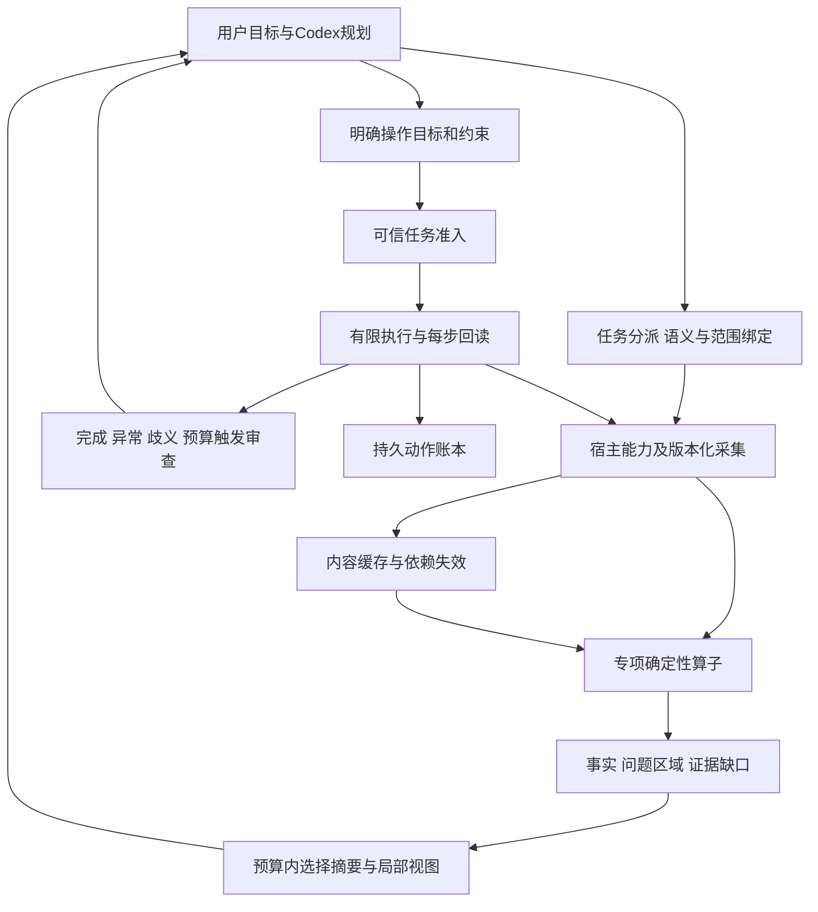

# Human Eye 架构与功能可行性分析

审查日期：2026-10-31。基线为 `9.7.2+20261031.dense.focus.r1`，源码摘要 `22fb2523bdbfb68d6e7227ea3df3b4373daa1a76461344bc1755406c5feeec8a`、78个运行时文件。本轮核对源文件清单、主要调用路径、合同及既有验收产物；没有新增算法、Blender实测或模型试次。本文解释技术判断，**不另行安排任务顺序**；唯一排期文件是 [PRODUCT_ROADMAP](PRODUCT_ROADMAP.md)，当前交付状态是 [PROGRESS](PROGRESS.md)。

## 1. 总判断：基础可复用，完整产品还缺什么

适合继续建设的产品是“面向Codex的任务驱动三维感知与受控操作引擎”。插件和Hook承担接入，引擎处理可核验的几何、局部观察及有限执行，Codex处理语义目标、全局规划和必要审查。这条路线不依赖改动基础模型的视觉编码器，也不以模型无条件信任工具为验收目标。

现有基础足以增量扩展，尚不足以承诺任意复杂模型的自动诊断与修复。主要缺口表现为：精确任务表达仍偏对象对；原始来源已有有限核验但不足以覆盖完整专业诊断；局部观察仍偏包围界或特定间隙；有界控制器与默认Codex完整任务入口之间存在接入缺口；真实资产规模和模型整任务价值尚未证明。优先补任务证据链是依据这些缺口作出的工程判断，尚不是完整链路性能分析证明的最大热点。这些缺口应串成少量可验收的纵向交付，不能分别发展成长期独立研究。

“小脑”的数值闭环可先用确定性算法完成；学习网络不是它的前置条件。“人眼机制”先落实为任务特征定位、必要证据选择和预算控制，不追求生物学结构逐项仿制。用户所说的凹陷、裂开、手臂扭曲是不同缺陷域，不能只靠多视图或一个曲率阈值统一解决。

## 2. 真实运行架构与模块实现等级

以下“已验”只指对应支持域，不能跨列相互代替：代码存在、正式入口可达、真实宿主通过、真实模型受益是四种证据。78文件被纳入构建身份不代表78文件中的每项算法都参与正式请求。

| 模块 | 源码与实际作用 | 当前成立的能力 | 缺口及架构判断 |
| --- | --- | --- | --- |
| 入口与自动路由 | `production_server.py`、`live_spatial_mcp.py`、`live_hooks.py`、`task_intent.py` | 正式入口连接LiveSpatialService；四个MCP工具；Hook可做提示前文字观察及受支持动作检查；历史真实消息入口已验 | 规则分类不是通用任务理解。当前Hook文字交付不能冒称前置图片注入；新增缺陷任务须分别验证分类、对象解析、实际交付 |
| 任务绑定 | `prompt_pairing.py`、`request_context.py`、`query_policy.py` | 精确名称/ID的对象对、有限查询、关联ID；单对象/未配对概览也已存在 | 缺的是单对象专业诊断和对应原生任务证据，不是单对象完全不能读。`task_context`只是计量关联；查询模式仍为overview/exact_pairs/nearest/top1 |
| 宿主采集 | `blender_host.py`、`blender_mcp_host.py`、`blender_worker.py` | 求值网格、世界坐标米制、身份/版本、有限原始姿态证据与原生图；正式固定MCP已验 | 普通求值读取宽于严格原生证据，后者仍限定静态独立刚体。原始面/边及来源映射不能靠求值三角网格猜回 |
| 场景能力与几何事实 | `geometry_safety.py`、`orthogonal_solid.py`、`scene_capabilities.py`、spatial_sniffer | 支持域内距离/接触/分离量、精确/界限/unknown，有限凸分量及正交实体；原支撑面发现；已有边关联、顶点link连通检查 | 通用凹形、开放面、自交网格不是自动可执行实体。实体准入拒绝不能当作缺陷定位结果；新诊断应复用已有内核并扩展结果语义 |
| 暂存与增量 | `scene_cache.py`、`scene_delta.py`、MeshEntity缓存 | 不可变内容快照、几何/变换变化区分、严格命中复用、基准错误时重同步 | 仍需捕获/验证当前输入；delta较小不代表省去了全量捕获与编码。可信编辑世代、增量BVH未形成完整产品路径；不含遮挡补全或长期语义世界模型 |
| 分析投影视觉 | `attention_policy.py`、`attention_rendering.py`、`auto_router.py`、标签/回填模块 | 按正间隙采样收益提案、渲染后验证、有预算回退、有限短标和诊断剖面 | 收益是屏幕采样代理量，不是已校准的信息增益/模型正确率；诊断图与自然可见性须分开 |
| 原生观察 | `episode_gateway.py`、`native_observation.py`、Blender原生渲染 | V1多尺度、V2轴盒亚像素任务间隙、V3有限高顶点目标局部；图片与实际相机/来源核对 | 两条视觉链并存。V3用投影AABB上界，中央射线只检查一个样本；不等于问题区域定位。SCENE新分支仍未开放 |
| 有限执行与监督 | `goal_segment.py`、`goal_execution.py`、`goal_scheduler.py`、`goal_supervision.py`、`task_authority.py`、宿主账本 | 可信owned worker内确定性目标、预算、接续、逐步回读、未知停止已有实证；默认MCP有单步/有限段接口 | OwnedGoalScheduler依赖可信任务批准和完整宿主计数；默认四工具没有等价的整任务自动入口。共享GUI允许外部编辑，不能继承独占worker保证 |
| 数据交付与计量 | `task_brief.py`、`result_contract.py`、`telemetry.py`、`task_metrics.py` | 精简事实/图片分离、关联与预算计量；未知usage不等于零 | 减少UTF8/PNG字节不是实测token或费用下降。仍需把完整任务成本和实际消费连接起来 |
| 历史扩展算子 | 顶层`module_2_*`、`module_3_*`、legacy facade及重导出 | 存在二进制编解码、轨迹、控制、曲率等实现 | 默认production路径不同于legacy demo。必须证明调用、合同、真实质量和收益后才可晋升为产品能力，不能照抄历史docstring的性能与精度声明 |
| 学习与异构计算 | 当前无已验的HE学习策略/GPU几何调度主链 | 可复用确定性回放与计量基础 | Agent Learning是工作知识服务，不是引擎中的学习小脑；Blender自身的图形渲染也不等于引擎CPU/GPU算子调度已经完成 |

已核对的直接入口包括：[`LiveSpatialService.observe`](../human_eye_plugin/live_service.py#L808)、[`_native_visual_policy`](../human_eye_plugin/live_service.py#L350)、[`BlenderSceneHost._capture`](../human_eye_plugin/blender_host.py#L420)、[`OwnedGoalScheduler`](../human_eye_plugin/goal_scheduler.py#L112)、[`validate_task_context`](../human_eye_plugin/request_context.py#L12)、[`validate_query`](../human_eye_plugin/query_policy.py#L39)。行号仅对应本次源码基线。

## 3. 三条实际流程，不把它们混称为一个已完成闭环

**自动文字观察**：真实用户消息 → Hook本地分类 → LiveSpatialService → 新鲜场景 → 对象对解析 → 量测/概览 → 有界文字。Hook调用`observe(..., include_image=False)`；执行前后Hook与用户消息入口的验收也各自独立。当前用户是在讨论架构，不应因提到Blender便读取或修改场景。

**显式原生图观察**：MCP observe → 来源/身份/请求检查 → 捕获与对象对 → 量测 → 原生能力协商 → 宿主再读/取景/渲染 → 独立消费端核验 → 输出文字和PNG。捕获、重读和消费端校验有不同职责；不能仅因“重复”就删去。可以在声明明确的新鲜快照范围内复用纯派生结果，不能把上次观察令牌变成写入许可。

**受控自动执行**：可信嵌入方验证稳定任务事件 → 固定目标、对象、原支撑面、原期限和总预算 → 调度器发现/预览 → 实际setter边界检查 → 新鲜回读和独立计数 → 继续/完成/停止。该路径目前有owned工程实证；默认Codex请求还缺完整产品接入。把模型JSON直接转为TrustedTaskAuthority会破坏它，而不是完成它。

现在的代码组织是“历史算子库＋生产服务与宿主边界＋多次纵向增量”。auto_router约1722行，blender_host约1819行；复杂度集中值得留意，但行数本身不是重写理由。新增第二个任务时，抽取小的任务分派和证据投影接口；保留旧入口回归，避免再往对象对分支加入所有未来专业逻辑。

## 4. 建议的融合架构与最小共同合同

采用模块化单体内核、薄Codex适配器和独立宿主worker。现阶段不增加微服务、常驻队列或训练服务。观察与执行可共用身份和快照，能力准入及授权分别处理。

以下是**需统一或增量补齐的最小语义要求**，其中身份、快照、回执等已有实现；该表不是“全部未实现”的清单，也不要求创建一个包揽所有专业的庞大schema：

| 共同对象 | 应表达什么 | 不应承担什么 |
| --- | --- | --- |
| TaskSpec | 观察/诊断/动作种类，单对象或对象对，用户目标、单位、指定参考、保护范围、完成条件 | 不从任意提示词推断编辑授权；不与现有仅作关联的task_context混名 |
| SourceSnapshot | 文档/实例/版本，raw或evaluated来源、坐标与单位、捕获范围、原始索引和必要映射 | 不把当前内容hash当完整编辑历史；不把未采集对象当已删除 |
| Evidence | 算子与版本、事实类别、原始索引/区域、测量精度/范围、覆盖/省略、unknown原因 | 不用一个“置信度0.99”掩盖事实与语义判断差异 |
| TaskFeature / PatchRef | 间隙见证点或缺陷边/面集合、局部包围、支持它的快照、为什么与任务相关 | 不把物体AABB中心等同于任务中心；不把局部图变成证据来源 |
| ViewRequest / ViewResult | 为补哪项证据取图、相机、采样范围、实际可见性、成本、是否仍有缺口 | 不隐去遮挡物后标作自然观察；每次双图额度不等于整任务可无限重复 |
| ActionGoal / Receipt | 可信准入、域、允许修改对象/区域、约束、固定预算、逐步真实结果和未知 | 不允许复用观察缓存授权，不允许换任务ID续额度 |

用既有间隙和新增网格诊断两个任务检验这些共性。只抽取实际复用的数据和服务；当前V1/V2/V3图片合同继续兼容，新任务采用明确的能力版本，不强行塞进旧字段。

缓存、动作账本、任务结果引用和学习轨迹的生命周期不同：缓存可淘汰；未决动作不可因淘汰而消失；引用失效必须回查当前来源；学习只能消费经过核验且注明支持域的轨迹。不要为了“统一记忆”把这些合成一个可任意覆盖的字典。

## 5. 复杂模型功能的可行性与失败边界

| 需求 | 可行性判断 | 最低必需数据与算法 | 关键限制 |
| --- | --- | --- | --- |
| 边界/裂口候选定位 | 结构事实高可行，语义损伤判定有条件 | 原始顶点、边、多边形索引；边面关联、边界连通簇、参考开口/设计约束 | 边界可能是袖口、嘴口、薄片或合法拆件；闭合裂纹/重叠壳并不一定新增边界 |
| 非流形、退化 | 有限静态域高可行 | 原始关联、边的面关联数、顶点link连通、重复索引、面积与数值界限 | 只查每边两面会漏掉bow-tie顶点；近退化阈值依赖尺度；不能检查前自动焊接 |
| 自交、近重合双层 | 中等，需独立几何域 | 有界空间筛选、三角形相交、邻接排除与稳健谓词 | 最坏候选数可很大；合法接触不等于穿插；拓扑完整不保证无自交 |
| 凹陷/鼓包定位 | 有参考时较高，无参考时只能给形状候选 | 冻结参考、同拓扑对应优先、局部法线和有符号残差、多尺度区域 | 正常凹槽与损伤不能仅由当前曲率区分；对应或参考不可信则不输出确定损伤结论 |
| 手臂姿态异常 | 限定角色和约束可行，任意角色不成立 | 骨架rest/pose、局部坐标、父子关系、角色角度/动作约束 | 固定通用角度不能覆盖不同角色；轴向扭转、屈伸和镜像需区分；IK奇异附近不自动翻转 |
| 蒙皮扭结/坍缩 | 中高难度，先诊断 | 原始绑定网格、求值网格、顶点对应、骨骼权重/姿态；局部面积/形变/截面或厚度变化 | 曲面本身没有唯一三维体积Jacobian；正常褶皱、自交和权重错误不能用单一缩放指标区分 |
| 自动局部修复 | 限定操作可行，通用修复高风险 | 明确期望形状、固定patch/保护区、域内求解、实际回读、撤销/失败停止 | 检测到问题不提供唯一修复方案；焊接/补洞改变索引、UV/材质/权重，不能继承仅平移的回滚合同 |

**首个新增域仍选原始静态网格的只读结构诊断。** 原因是拓扑事实有明确真值、能产生可回查的局部特征、无需先建骨骼和权重系统，最适合验证共同链路。它不是承诺先解决所有裂缝，也不是把拓扑诊断提升为唯一产品目标。

### 当前原始三角证据可复用，完整拓扑来源仍需补齐

`_capture`把求值网格三角化，`edges`由三角面重新生成；原生证据比对原始与求值顶点及多边形，却没有交付完整原始多边形/松散边或triangle→polygon映射。必须分两层判断：已核验原始索引对应的三角网格可支持部分边界/邻接事实；完整的原始多边形定位、松散边、原始与派生缺陷区分仍不充分。不能把后一缺口写成“当前所有拓扑数据都不可用”。

反证探针中，一个四边形的两种表示具有相同边界，三角化新增对角线关联数为2；加入一条松散边却不会改变由三角形重建的边集合。它同时说明可复用部分和信息损失的边界。`orthogonal_solid._closed_manifold`已经检查有向边、面连通和每个顶点link，包括pinched顶点；但其正常合同要求单个闭合实体，直接调用会拒绝合法开放面，不能把返回拒绝当损伤诊断。应复用关系计算，新增有位置、类别和覆盖的诊断结果，而不是复制一套闭合实体规则。

新增只读采集应增量保留缺少的来源，先检查分配/索引/有限数值边界，再进行诊断；保留正常的重复位置而不同索引、松散几何与合法开口。诊断事实路径不能先调用会修复/焊接/抹除缺陷的归一化步骤。图像路径若只能渲染部分几何，必须标作不完整/诊断视图或停止自然图交付；不能因删除了未知遮挡物而证明可见。Blender的Mesh API将vertices/edges/loops/polygons分别暴露，说明原始数据读取有直接入口；具体目标版本仍要用本地宿主验证。[Blender Mesh API](https://docs.blender.org/api/current/bpy.types.Mesh.html?highlight=transform)

边的关联数和顶点link应分别检查；自交是另一类几何问题。CGAL也将组合结构、几何缺陷与修复区分，说明不能把“非流形拒绝”包装成全域修复。这里采用的是问题分解，不在本轮引入CGAL依赖；若以后采用外部库，再验证构建、许可证、数值合同和成本。[CGAL网格处理](https://doc.cgal.org/latest/Polygon_mesh_processing/index.html)、[CGAL网格修复](https://doc.cgal.org/latest/PMP_Mesh_repair/index.html)

### 曲率与凹陷的区别

当前`estimate_local_principal_curvatures_and_gauss_bonnet`先按`1e7`量化合并位置；其平均曲率使用Laplacian向量的模，不保留朝向符号。对78个运行源的静态检查未找到该函数的直接调用，尚无已接入生产凹陷诊断的证据；静态检索不能证明一切动态调用均不存在。内部合并用于计算，不等于修改了Blender网格，也不能用其计算拓扑替代原始裂点事实。镜像凹/凸patch探针得到相同平均曲率，说明单靠该量无法完成这项区分，不意味着该算子毫无复用价值。

同拓扑且已对齐参考的首个表面变化量可设计为 `r_i = dot(p_current_i - p_reference_i, n_reference_i)`，同时报告切向变化和法线可靠性；这是对参考的有符号局部位移，**不能直接叫全局最近距离或损伤概率**。不同拓扑先解决对应/配准；重复形状、薄壳两侧或镜像可能错配。无参考时只输出局部曲率/形状异常候选，保留用户意图判断。

### 部分遮挡与人眼聚焦

聚焦优先级应由“任务缺什么证据”决定。中心被挡而裂口边缘可见时，需要边界簇上的代表点；物体中心可见而关键缝隙被挡时，物体中央射线为真没有帮助。对每个有限候选视向，先以几何上界排除不可能获益者，再检查少量任务见证点与完整捕获遮挡几何，最后核验实际输出。样本可见不能声称整个patch可见。

原生视图保持全景上下文，新增局部图须比当前证据补充有效信息；完全遮挡可以只交付精确结构事实和“视觉不足”，不为满足双图数量而强行出图。另一视向、深度/法线图和诊断剖面均可作为后续候选，但来源与适用任务要分开，不一次性全部开启。

### 规模可用性不能藏在“高顶点”一词里

当前一般采集上限为500000顶点/1000000三角形；V3原生聚焦的总场景上限仅4096顶点/2048三角形，且新分支只限XY/XZ。前者说明允许接收的上限，后者说明一个观察算法的有限工作域，两者都不是在这个规模上达到实际交互速度的保证。

还须纳入路径内其他准入：原生取景`_native_view_frame`限制总顶点100000；默认BlenderMCP桥响应上限64MiB；owned episode的`_native`证据限制2MiB；scene_delta默认8MiB；场景缓存默认8MiB保留数据预算不等于进程RSS或临时分配上限。这些限制属于不同路径，不能简单合成一个全产品面数上限；M1-01要画出所选任务实际经过的链再取交集，大小均在序列化和重复证据计入后检查。

单对象也是跨层合同：已有概览可用，但`_native_visual_policy`要求对象对，`BlenderSceneHost.observe_readonly_native`要求两个不同ID，消费端`_public_query`要求至少两个对象，`validate_readonly_observation`核验同一对象对绑定。因此不能只在query增加一个枚举便宣布支持。新的单对象诊断能力应贯穿生产者、宿主传输和消费者，旧动作/对象对合同保持；不创建虚假第二物体绕过限制。

面数、拓扑类型、遮挡、细节尺寸、数值尺度、依赖修饰器是不同维度。必须测采集/校验/扫描/图片/传输各段，明确“只能概览”“事实可用但无局部图”“预算停止”。引入局部BVH/邻接复用前要先确认数据所有权和失效；简化网格不能替代原始缺陷真值，尤其不能把细裂口简化掉。

## 6. 小脑的职责、审查时机与接入选择

采用“每步本地核验＋事件驱动Codex审查”。引擎负责在明确目标下生成有限候选、数值修正、计数与读回。Codex负责选择目标、参考、期望修复方向及遇歧义时重新规划。普通有限步无需让模型重新计算所有几何，完成、特征切换、停滞/振荡、外部修改、数值不可达、预算不足和未知结果必须交回复核。

默认不每N步强制发图；使用任务期限/步数上限和确定性事件，尚不引入未经校准的置信度阈值。调度器不能为一条失败或未回执动作另开任务重试；碰撞终态检查也不等于连续扫掠路径认证。

Codex产品化优先把现有调度器接到受控owned任务宿主，先明确任务归属、入口和结果交付。共享GUI自动写入单独评估：如果无法约束其他写入通道，继续提供新鲜预览和有限单段检查，明确不能继承独占宿主的完整性。**不为追求“自动”牺牲原有未知停止，也不把拥有一个任务授权回调当作整个Codex接入已经完成。**

接入的最高不确定项是可信任务事件从哪里来：当前测试嵌入方可以注入批准回调，默认MCP请求本身没有证明等价能力。应先验证真实任务来源能否绑定到冻结目标；若缺可靠宿主事件，就使用用户可核对的本机受信入口一次登记目标，再由Codex调用该任务。不能从模型可写的event_id/目标JSON补造可信批准。这一接入可行性仍待实证，不能承诺只加一个MCP工具即可完成。

## 7. 性能、传输与学习的取舍

完整时间按 `T = 捕获 + 几何/验证 + 观察/渲染 + 编解码/传输 + 等待 + 模型往返 + 动作/回读/审查` 核算，并区分不重叠关键路径与嵌套span，不能直接把所有span相加。最可能的价值来自减少无必要的模型往返与证据搬运；是否成立仍需实测，不能预报固定提速倍数。

| 选择 | 当前判断及理由 | 触发重新评估的证据 |
| --- | --- | --- |
| 小型模块化内核 vs 整体重写 | 选择增量提取任务分派和证据合同；保留已有几何/权限/回读证据 | 两个真实任务证明重复与耦合导致可测成本或错误，再局部抽取 |
| 内容校验 vs 只信编辑事件 | 保留内容/来源核验；宿主事件可作加速提示，不独立放行写入 | 可信对象所有权、完整编辑世代和同版本冷/热对照成立 |
| JSON/紧凑摘要 vs 新二进制总线 | 先减少不必要字段/图片/回查，内部全几何保持 | 完整链路证明序列化/搬运为主热点，真实跨进程所有权/失效/回收方案可验 |
| CPU vs GPU | CPU作参考与小任务默认；按批量/常驻数据评估候选 | 算法、上传/下载、同步、首次初始化、重用和回退总成本有收益；数值质量同门 |
| 确定性 vs 学习控制 | 确定性主干先可用；学习仅为候选排序/视角或残差建议 | 有足量正确失败轨迹、外部修改标记、训练/确认分离和影子评测；不能改变授权或成功判据 |
| 对每次任务都用引擎 vs 能力路由 | 有三维尺寸/拓扑/变形依据且宿主可读时用引擎；简单常识/图片外观可走原有模型路线 | 按具体任务与成本矩阵调整，不按场景对象数或“大模型应信任”强制调用 |

`BinarySharedMemoryFrameBus`当前代码用类级bytearray、内存视图和复制打包；解码view不等于整个跨进程链零拷贝，更不自动证明页锁内存。默认BlenderMCP桥仍是JSON传输。历史微秒/0ULP文案不能作为新后端采用依据。

学习型小脑接入在技术上可行，但模型只能提出建议；执行前仍走确定性域、预算和回读。对凹陷或角色意图的语义判断，可能需要参考资产/用户约束或学习数据，不能指望小网络从几何里还原不存在的意图。模型内视觉融合需要可控制模型及训练条件，当前不在Codex产品关键路径。

## 8. 对旧主计划的必要修正

保留M1任务证据闭环优先；将它拆为可执行的任务/来源合同、raw只读诊断、patch观察、Codex交付与有限出口，避免“先统一所有接口”变成新平台工程。真实资产规模作为明确门，不能隐藏到GPU研究以后。

M2必须分工程价值门和正式模型门。正常顺序是在有限证据链与工程价值评估之后收口已有Codex刚体任务；但新拓扑候选的成功不是旧间隙调度器的技术前置。若候选无收益或被宿主能力阻断，须明确冻结该候选，并按主计划的条件转入已满足自身依赖的任务，不能让M1变成无限等待点。正式模型/费用/盲评未绑定时不能伪造大收益；有限观察价值通过也不证明自动执行价值。

参考曲面、骨骼和蒙皮保留为后续专业域，各域先只读定位再独立写入；拓扑修复不因检测器完成就自动启动。其它Agent接入继续暂停。日志、标签、缓存只解决当前任务中的实测阻断，不恢复成各自无限优化的主线。

已有历史文档中存在“当前未安装”“下一步先重启”等当时状态，与最新正式交付不同。本轮为相关入口补历史标识；安装事实由PROGRESS及实际版本证据裁决，排期只由PRODUCT_ROADMAP裁决，固定阶段证据保持原样。

## 9. 证据与分析限制

初次分析冻结78个运行源和当时373个已跟踪文件，检查实际主路径、能力声明、旧合同与正式22fb发行结果。主要基线证据为本地`verification/fixes/20261031_v21_dense_focus_release/RESULT.json`、`20261031_v21_defect_focus_scope/SOURCE_AUDIT.json`；静态清单在`verification/fixes/20261031_architecture_master_review/`，这些机器档案不随公共源码上传。

初次分析未做功能探针；本次复查补充10项纯数据/内存宿主替身探针，没有启动真实Blender、进行性能对照或模型试验。不给未实现功能估算完成百分比、固定工期或未经测量的收益数字。分析由主代理完成，不冒称独立第二人审查。算法候选仍须后续独立真值和真实宿主验收。

外部API核对中，Blender在线版本页直接打开失败；可检索到的官方Mesh说明仅支持数据结构存在，不作为本机5.2运行验证。CGAL文档用于问题分类及可行性参考，不代表本项目已采用其实现。最终技术排序是结合本地证据的工程判断。

## 10. 反证复查的修正与保留结论

复查对应源码仍为22fb，复查前Git版本为e69d3ec。10项探针全部满足各自预期，包括预期拒绝；这不是10项新功能完成，也不是全域无误报/漏报证明。结果位于本地`verification/fixes/20261031_architecture_counter_review/PROBES.json`。

| 修正类别 | 反证/遗漏 | 已采取的修正 |
| --- | --- | --- |
| 现有能力被低估 | 单对象概览已存在；原始核验三角网格能保留部分边界；现有严格实体检查有顶点link算法 | 按可复用部分增量扩展，明确缺的是专业诊断输出与额外来源，不从零重做 |
| 跨层依赖未展开 | 单对象限制同时存在于service、宿主和consumer；数量上限不代表整链可承载 | M1-01增加跨层能力与字节/工作/期限预算表，旧执行合同独立保持 |
| 漏判验收不够明确 | 全部unknown也可表面零误报；多簇只报一簇、扫描中止和展示截断容易混淆 | 主计划增加问题级召回、回答覆盖、过度拒绝、定位和完整性口径；结构与损伤语义分开 |
| 排期可能卡住 | M3-A被写成依赖新诊断全部成功；停止规则可能误伤必要正确性修复 | 区分交付顺序与技术依赖；允许有记录地冻结无收益候选，必要正确性修复不按可选优化冻结 |
| 延期项失去归属/视图缺失语义 | 自交/近重合未明确归入后续；删去不能读取的遮挡物可能让局部图误导 | 归入M3-B2；未检查类别显式标记，不完整图不能认证自然可见性 |
| 证据等级表达过强 | “主瓶颈”未经整链测量；静态无直接调用不证明任意动态调用不存在；任务图片总额度尚非默认保证 | 改为工程优先假设，限制静态结论，明确单次预算与待落实整任务额度 |

保留的判断：有限刚体与缓存值得复用；原生V3并非通用缺陷定位；曲率均值不足以判断有符号凹陷；完整Codex自动任务、学习小脑、GPU几何调度与正式模型收益仍没有已交付证据。复查当时确定M1-01开工，没有新增并行功能主线；后续状态见下节及唯一主计划。

## 11. M1-01落地后的架构核对

[结构证据合同](MESH_STRUCTURE_EVIDENCE_CONTRACT.md)已冻结任务/来源/检查范围、单对象跨层责任和初始数值门。可执行验收器仅位于verification；正式78个运行源和当前安装不变。下一项为M1-02，不能将本次合同登记视为已经提供生产诊断。

3个独立Blender 5.2 factory进程实测14类解析源夹具和3档读取规模，验证原顶点/多边形及松散边集合保留、读取前后几何与选择不变。旧native路径拒绝空/零面网格，raw读取仍可获得其结构。这证明独立raw诊断采集可行，不能证明结构检测正确率、自然可见性或默认Codex已消费结果。原始读取基线与旧双证据工作量不同，不用时间比宣传优化收益。

默认四工具仍未包含完整受信目标登记/自动scheduler入口；现有TrustedTaskAuthority回调需要真实受信嵌入来源。M3-A入口风险已提前定位，保持先受信登记与owned宿主，再绑定原预算的方向，不以模型可写JSON补造授权。完整任务配额和单对象原生图仍待对应阶段实施。

## 12. M1-02首批候选后的历史判断

已把raw读取与首批三类结构事实做成独立模块，并通过owned固定worker及私有服务验证单对象交付；旧pair/render/write路径保持独立。源码身份为候选，正式安装仍是22fb。默认共享桥和公开MCP/Hook尚未开放该能力；非流形link、退化及位置/patch取景也未完成。

来源校验时已经需要构建边到原始面的关联，初版随后又扫描同一关联；剖析确认这部分重复工作后已复用。大网格后续中位从约100ms降至70ms，但冻结的首次/尾部成本门仍失败。因此判断为“正确性与有限纵向能力有进展，整批未达到发布条件”，不换门限，也不继续同根因抠性能。当前事实不支持重写总架构或立即引入GPU；后续按主计划补剩余检查并保留此规模失败边界。

## 13. M1-02六类事实与位置后的判断

目前支持非流形边、顶点link、有限退化以及原始索引绑定的局部/世界位置。顶点link采用一般原始多边形的邻角图，补足“边面关联正常但顶点夹断”的漏判机制；退化运算以精确二进制值计算，避免直接浮点面积在极小/极大坐标下下溢或上溢。精确算术有额外CPU成本，因此仍受单次工作/期限预算约束，尚不能称为性能优化。

架构继续分离来源、事实、位置、图像和动作：位置无法计算不删除已知拓扑事实；某类未知不覆盖其他已完成检查；没有全局可见性证据不生成自然可见声明。consumer核对协议、策略、来源、索引/分类、未知范围及位置语义。25个新owned解析场景和固定worker→私有service支持有限实现可行性，不替代真实资产和公开Codex消费。

下一步不重写框架：按主计划收口已有合同的其余三类检查，再让问题区域驱动观察。旧大网格成本失败继续冻结；性能、整任务额度、公开入口和模型收益分别验收。重复面link未知、非平面/非简单ngon退化未知是显式支持域限制，不能隐藏为“模型正常”；通用凹陷、自交和骨骼并未因此完成。
