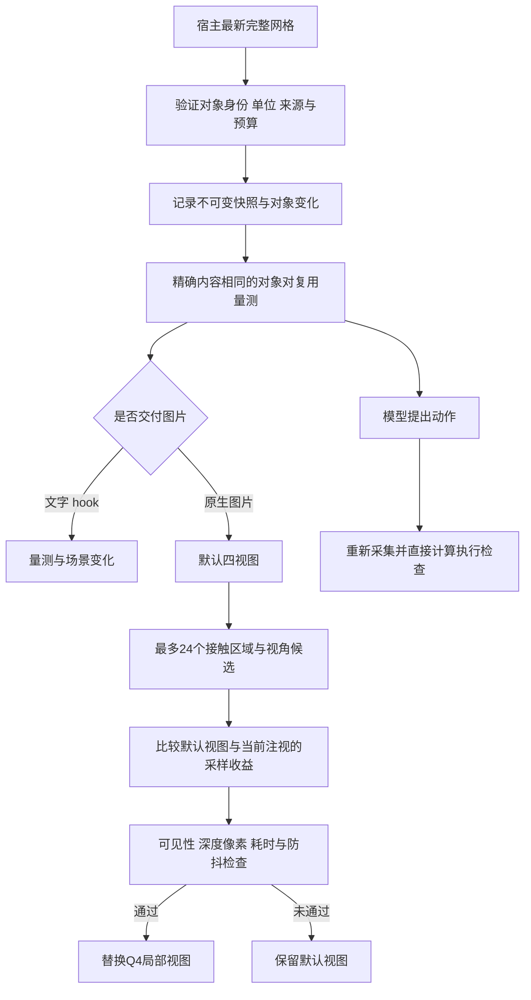

# 自动注意力与三维场景缓存

日期：2026-10-22。当前增量源码标记 `v1-attention-cache-20261022`。它接在真实场景的自动观察流程中，调用方无需先要求模型选择注意力工具。此前第一版流程与边界见 [三维流程](THREE_D_V1_WORKFLOW.md)。

## 已实现的流程

这里的自动转移只改变生成图像中的观察区域与视角，不移动 Blender 相机或物体，也不改变动作使用的 focal/reference 对象 ID。前三个全景视图保留空间上下文。语义目标未确定时仍返回场景总览，不猜测用户希望编辑哪个物体。

## 收益规则

候选来自已经算出的真实接触见证点；点间距离必须与未舍入的正间隙一致。零间隙、穿透、无效量测、无法确认见证点的情况不伪造局部区域。只考虑间隙不超过较小物体包围盒对角线四分之一的近接触，最多考察四组接触和总计 24 个候选，含正交方向与斜视方向。

目标是让接触间隙达到约 12 像素的有效投影采样。新注视须同时满足至少 4 像素增益、1.5 倍采样比例和至少 2 像素的净收益。新切换对照默认 Q4 及上一实际注视对当前见证点的投影，采用两者较高者，避免仅因默认图不好而反复切换。继续保持已有注视时，对照默认视图验证保留价值。

成本规则为显式工程参数：切换代价 1 像素，新增计算每毫秒折算 0.1 像素，新增工作上限 40 毫秒。耗时包含候选计算、可见性检查、局部渲染和图像合成。它不是通用的人类感知效用函数，也不是模型能力分数。评估候选本身有计算成本；系统保证通过这些规则才采用新视图，不能承诺评估阶段零开销。

全场景射线检查包含自遮挡，再核对两个见证点附近的实际深度像素。未通过时保留原图；不使用透视穿墙。可见性证据只覆盖两个局部见证点，不能据此声称整物体或整个场景可见。

驻留时间默认 1 秒。允许小幅跟随同一目标，大幅位移、缩放或换方向重新计算切换条件；未来时间和损坏状态不能跳过门槛。因驻留时间暂缓的结果会在下一个到期后的宿主观察事件重新评估，不被普通 120 秒观察缓存锁住。没有独立后台定时扫描。

## 三维缓存

`SpatialSceneCache` 保存不可变、按内容寻址的完整观察快照。稳定对象 ID 用于区分新增、删除、元数据变化、刚体变换与几何变化；刚体拟合仅用于描述变化，绝不用于近似缓存命中。

路由器默认保留最多 16 帧，预算 2 MiB。预算计算不可变载荷、键和条目记账空间，涵盖场景元数据；不是整个 Python 进程 RSS 或瞬时数组的上限。未变化几何共享存储，超限淘汰旧记录，不简化实际执行几何。快照读取返回副本，历史帧不会随当前顶点修改而变化。

量测缓存键绑定完整对象内容、身份、轴与原点、来源、米制世界坐标、对称阶数、碰撞公差及算法版本。只复用成功量测；微小几何变化也失效。新版本即使内容相同也要取得新的观察身份，历史缓存不能恢复执行许可。

同一常驻服务进程可复用量测。磁盘仅保存严格校验的场景历史，不保存可直接信任的量测结果；新进程首次量测重新计算。因此短命令 hooks 可连续记录场景历史，但不能获得常驻进程的量测缓存收益。场景历史表示实际观察到的快照，不能补出采集间隔中未观察到的变化。

执行前、候选终态、待回读状态及执行后真实几何复核继续直接计算；缓存不参与放行。可选历史损坏仅丢弃观测缓存，不清除未完成动作或执行隔离。该机制不是遮挡补全、SLAM、长期语义记忆，也不是对 Blender 的场景撤销。

## 实测口径

可复现脚本：[measure_attention_cache_benefit.py](../verification/measure_attention_cache_benefit.py)。每场景 5 次预热、30 对交替样本，改变任务文字以禁止整条观察复用，逐对核对量测一致。旧版来自本次修改前保存的路由器。

最近采样的中位耗时：

| 本地文字观察场景 | 修改前 | 新版 |
|---|---:|---:|
| 2 个物体静止 | 2.73 ms | 0.56 ms |
| 2 个物体，目标持续变化 | 2.47 ms | 3.08 ms |
| 8 个物体静止 | 14.69 ms | 2.02 ms |
| 8 个物体，第三物体微移 | 15.41 ms | 6.19 ms |

第二行明确显示缓存维护可能增加开销。以上包含路由器验证、哈希、历史记录、量测与文字输出，不含 Blender 通信、宿主启动、模型或网络。另保存含锁与落盘的当前服务完整观察耗时，不能与上述数字混作同一链路。原始样本、环境和代码哈希见 [性能记录](../verification/fixes/20261022_attention_cache/cache_benchmark.json)。

真实 Blender 调整、局部图像收益、最终回归与部署状态见 [本轮验收](../verification/fixes/20261022_attention_cache/REPORT.md)。几何采样改善和缓存计算收益已有局部证据，模型任务成功率仍需后续复杂场景、相同提示词的对照测试。

## 配置与交付

当前项目已按用户要求恢复 agent-learning，真实状态查询成功；这不改变旧双盲实验的历史配置记录。Human-Eye 的 Codex/Claude hooks 与五种消息格式共享上述引擎能力，其他 agent 的实际触发和效果仍需各自验证。

文字 hooks 自动读取三维事实与变化，不生成无人接收的图片；通过原生图片交付的工具或 SDK 观察才进行视觉注视规划。历史冻结源码、旧实验和发行包保持原样，本轮没有重新打包。
