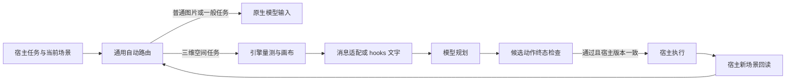

# 三维空间自动路由协议

2026-10-22，通用路由协议。后续 [Codex 实时接入](CODEX_LIVE_ROUTING.md) 已在当前项目安装并验证动作前后真实 hooks；其他 provider 消息格式仍按协议/实机分别验收。未生成发行包，也未发起额外模型 API 实验。

引擎定位为已知三维场景的空间感知前端。宿主先提供场景，再运行路由、组装模型输入；操作前和操作后分别检查候选终态和真实读回。这里的自动化由宿主执行，模型不用先推理选择 Human-Eye 工具。



## 宿主接入位置

Python 使用 `human_eye_plugin.auto_router.HumanEyeAutoRouter` 和 `human_eye_plugin.agent_adapters.AgentRuntimeAdapter`。其他语言可启动持久进程 `python -m human_eye_plugin.router_server`，每行发送 `{"id":1,"payload":事件对象}`，每行接收 `{"id":1,"result":路由结果}`；传输或输入异常为 `error`，不可当作动作通过。该进程为通用 JSON-lines worker，不是 MCP JSON-RPC 服务。原有六工具 MCP 接口保持原状。

有模型输入回调的 agent 可接完整图片与文字；有命令 hooks 的宿主可调用 [hooks 桥接](AGENT_HOOKS.md)，当前交付文字。仅有 MCP 工具列表的宿主仍需添加自动触发入口。当前不承诺所有封闭 agent 无配置通用。

## 输入事件

所有事件必须包含非空 `session_id` 和下面一种 `event`。

| event | 宿主调用时机 | 行为 |
|---|---|---|
| `before_model` | 适用的模型请求前 | 自动量测、生成画布和观测，或 native 透传 |
| `scene_changed` | 宿主发布新场景后 | 更新版本并生成新观测 |
| `before_action` | 空间操作执行前 | 核对观测、对象和对称性，检查请求动作终态 |
| `after_action` | 宿主执行并读取新快照后 | 比对实际变换、拓扑和轴来源，再检查与所有其他物体的碰撞 |

`before_model` 的典型输入：

```python
event = {
    "event": "before_model", "session_id": "agent-session-1",
    "task_kind": "spatial_3d", "task_instruction": user_task,
    "focal_id": "part-7", "reference_id": "fixture-2",
    "yaw_symmetry_order": 2,
    "scene": {
        "revision": "host-revision-42", "unit": "m",
        "coordinate_frame": "world", "source": "host-connector",
        "meshes": [mesh.to_dict() for mesh in actual_host_meshes],
    },
}
```

坐标必须是米和世界坐标。`MeshEntity3D` 交换格式包含顶点、面、边、稳定 ID、唯一标记、局部轴、轴来源和枢轴。入口验证有限数值、数组形状、整数索引及范围、身份唯一性。缺失几何时返回阻断，不使用内置演示场景。当前每场景上限为 256 个物体、50 万顶点、100 万三角面。

`task_kind=image_2d/ocr/general` 显式走原生视觉；即使这些事件携带场景变化，也会更新场景并使旧观测失效。没有三维上下文的一般请求原样通过，不触发引擎。`auto` 根据当前事件的结构化三维上下文路由，不用关键词猜测。`force_3d` 强制适用入口走引擎但仍要求真实场景；`off` 禁用自动观察，空间动作入口继续拒绝，不能作为绕过检查的开关。

当前量测以焦点和参考对象为任务对。可以根据唯一焦点和唯一其余物体确定对象；多物体场景应显式提供 ID，不会把不存在的 ID 改选为默认物体。`yaw_symmetry_order` 可为 1、2、4，并在后续动作与观测保持一致。没有可确定的对象对时返回原因，要求宿主补齐任务对象。

## 观测与动作

统一结果的 `route` 为 `native`、`engine`、`blocked`；同时包含原因、场景版本与 SHA256、观测 ID、缓存命中、是否实际运行引擎、量测/轴有效性、文字、可选 PNG 和检查范围。适配器保留原任务与原消息，将观测作为数据追加。内容为实际量测及来源，不注入旧查看工具的解析参考动作或标准答案。

当前画布使用世界米制自适应四视图：全场景 XY/XZ 正交图、全景透视图及所选对象对聚焦透视图。文字记录相机、比例尺和实际深度像素，图片不认证所有对象均可见。`include_image=False` 跳过渲染并明确文字交付；数值或渲染预算不适用时说明省略原因。开放网格、无法精确量测的拓扑或歧义坐标轴不能被包装成可靠动作依据。模型收到的间隙使用未舍入几何，旧显示齐平状态仅作显示标签，执行检查采用单独的严格碰撞分类。

动作事件携带刚获得的 `observation_id`：

```python
check = router.handle_event({
    "event": "before_action", "session_id": "agent-session-1",
    "scene": fresh_host_scene,
    "observation_id": observed["observation_id"],
    "focal_id": "part-7", "reference_id": "fixture-2",
    "yaw_symmetry_order": 2,
    "action": {"translation": [0, 0, 0.01], "rotation_euler_deg": [0, 0, 0]},
})
# 宿主只有在 check["allow_action"] is True 时才继续执行。
```

仅支持明确的刚体增量：先绕 `pivot_world`（缺省为 AABB 中心）旋转，再施加世界平移。欧拉角采用现有 `SE3AlignmentMath.euler_xyz_to_matrix`，单位为度；平移单位为米。不接受四元数、缩放或未知操作字段，避免静默选择另一套动作语义。顶层 ID 和动作内 ID 冲突时拒绝。

检查使用请求的精确变换，不借旧控制器的解析修正为错误请求放行。候选与场景内所有其余物体复检，未知几何或碰撞均拒绝。`allow_action=True` 的范围是 `terminal_geometry_only`：它不代表已执行，不认证路径，也不替代宿主原有权限。

宿主必须在同一锁或事务内确认待执行版本与检查版本一致再执行，否则存在检查后场景又发生变化的竞争条件。完成后发送 `after_action` 及新版本真实场景。没有读回、旧版本、实际变换不符或新碰撞都会给出原因；完成后检查不能撤销已发生的操作。

## 状态与失效

每会话仅保存当前场景和一份观测，默认最多 32 会话、观测有效期 120 秒。相同任务、对象对、对称性和完整场景才可复用观测；几何、拓扑、身份、枢轴、轴来源、场景来源、版本任一变化均使旧观测失效。缓存与输入输出隔离，支持可信本地 `export_state()` / `import_state()` 持久化；未来或过期时间戳不会授予动作资格。

动作通过后记录待回读状态。缺失回读、坏场景、引擎异常或同版本几何变化不能通过重观察旧快照清除此状态；需要宿主提供新版本。待回读会话不因 LRU 淘汰丢失；满额均待回读时拒绝新增会话。服务重启、状态丢失或恢复应由宿主重新导出真实场景，状态文件不能由模型写入或当作防篡改令牌。

这些机制解决自动调用和可追溯性，不保证模型一定采纳结论。当前完成本地协议、真实渲染量测和模拟宿主流程验证；真实 agent 事件覆盖、图片消费、触发率、误路由、任务成功率和延迟需要后续多场景验收。

后续已补充当前 Codex 的真实三类 hooks、Blender 实际变换和显式目标验收。新的 [第一版深审](THREE_D_V1_WORKFLOW.md) 区分这些实测、空间记忆缺口与尚未完成的跨场景模型效果验证。输入数量上限只约束交换格式，计算还受保守工作预算限制，不能据此承诺对所有 50 万顶点场景完成精确计算。
