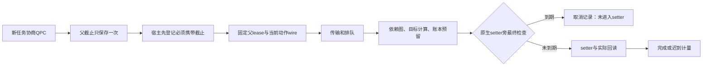

受控后台 Blender 的共同截止准入候选已实现并实测，当前未安装到生产。新父任务从创建开始显式使用双方协商的 Windows QPC/perf_counter，不把旧 GetTickCount64 绝对值转换、重标或续期。旧三回调监督上下文、普通未协商宿主和旧捕获协议保持原时钟行为。

共同计数器限定同一台 Windows 上支持 system-wide QPC 的 CPython ≥3.10，核验双方计数器描述、worker 协议、PID 和固定默认 worker 来源。Python 与微软的原始说明见 [Python perf_counter](https://docs.python.org/3.12/library/time.html#time.perf_counter)、[Microsoft QPC](https://learn.microsoft.com/en-us/windows/win32/sysinfo/acquiring-high-resolution-time-stamps)。模块在不支持的环境拒绝新能力，不猜漂移界或静默退回旧协议。

父任务先使用该显式 clock 保存唯一 started/deadline，journal 的时间戳、segment 的开始/截止/循环以及 service precommit 都使用同一选择。整数纳秒截止由原秒值向下取整，不在接收时重新建立“剩余若干秒”窗口。wire 携带固定父截止、当前 forward 截止（不大于父截止）、目标、文档/对象身份摘要、PID、动作哈希、场景 revision/fingerprint 及当前 nonce。

require_forward_deadline 在父截止尚未绑定时就阻止缺 token 的动作。首次 bind 固定原父 lease，后续子段可以改变自身较短的截止，但不能改变父截止。完整对象实例表用规范化 SHA 绑定，避免每步重复搬运全表而超过原请求上限；宿主仍以当前完整原生身份核验摘要。旧 worker 原来会忽略额外字段，所以 ProcessHost 在发送前另验新 capability，未协商时直接拒绝。

最终检查在账本预留之后、矩阵候选构造完成后或 location 原生赋值之前，使用已验证 wire 的整数计数器比较，并保留至少一个 QPC tick 和整数转换余量。若到期，记录 cancelled_before_entry：保留事件/nonce 身份，不算实际 setter 或路径，不留 pending，也不自动触发回滚。严格拒绝证书只证明绑定的这次 forward 没进入 setter，不证明世界未发生其他变化；调用者仍需新鲜观察。

ProcessHost 与 HostRuntime 两层核验证书，拒绝错误 nonce、动作、场景或截止绑定。原精度拒绝协议保持专用语义，没有放宽为任意 blocked 字串。新证明可以随子段持久保存并在重载时验证。当前父预算仍只接受已执行并验证的 step，因此包含零写 blocked step 的父对账保守冻结停止，不虚构一次移动或宣告任务成功；这项限制已明确测试。

已进入 setter 的结果继续回读、计量和持久化，迟到不能改写为“未执行”或重新发送。已登记的有界回滚单列计数和双程路径，可以在 forward 截止后完成并保持复核状态。操作系统可以在检查与赋值间抢占线程，因此本协议是最终边界的合作式准入，不是零误差物理硬实时保证。

deadline apply 的发送和接收使用原固定截止加最多约两秒回执收尾窗口，同时保留原本地 RPC 上限；这个窗口不延长动作截止。阻塞管道由受控 writer 线程处理，到期后使旧连接失效并终止自有进程。中断缓冲写造成的 close 错误记录为诊断，并继续清理其他流和线程。观察、锁等待等其他操作仍各有原超时，本轮没有把整个任务的所有等待变成统一 wall-time SLA。

真实实验分别验证：标准 worker 正常两段四次移动到约1毫米；真实暂停/pipe排队到期后返回有效零写证书；原 setter 在截止前执行、结果在截止后返回时仅记一次并停止；无回执超过收尾窗口时保持 unknown、失效并回收进程，不把 owner 看到的暂停状态改写成客户端“已知零移动”。迟到轨迹使用 custom trace worker，只由实验 owner 认证，默认生产 factory 正确拒绝它。

矩阵实测构建与最后只修流关闭的构建分别记录。最终代码另通过真实匿名管道堵塞 probe 和真实 Blender 无回执回收，没有重新发送原未知动作。安装版、生产状态和配置均保持原样。

下一步转向可信任务授权、新鲜接续审查与自动调度的收口，再打包并隔离安装验收。共享 Blender UI、任意外部脚本、非 Windows 共同计数器、学习型小脑及真实模型收益仍未由这条候选证明。证据：[本轮结果](../verification/fixes/20261030_v21_host_deadline/RESULT.json)。
