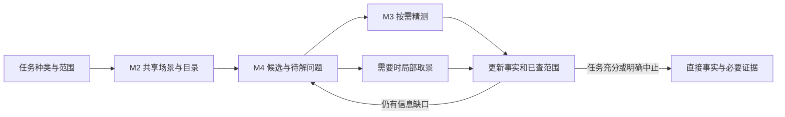

# 全场扫视能力与算法架构复核

日期：2026-11-12。对应用户问题：当前还缺哪些能力，如何优化算法与架构；整体扫视是否完成、为何相关任务表现弱。

## 1. 结论与证据身份

**整体自主扫视尚未完成。当前已有全场目录、指定目标的全场最近查询、局部精测和部分局部取景；尚未接成“无预给对象 → 发现候选 → 按需精查/换视角 → 累积已查证据 → 判断任务完成”的普通入口闭环。**

当前最明确的引擎收益来自已指定对象之后的空间求解与事实交付。非指向性任务仍把选择对象、判断缺什么证据和安排补查留给模型，插件往往只承担中间一段。后续重点应是把这段发现与观察调度收回引擎，并扩展真实几何适用范围；不继续把提示词微调、报告压缩或已达标旧题当主线。

本轮读取实施树 `C:/Users/Administrator/.codex/worktrees/m4-single-pass-acquisition/hefe`，观察 HEAD `a44a6138b9d354ecc98a4fbd76095f0536d6973f`，产品固定提交 `e836e03f4b3821f869c72ac3e50df5204f28b50f`。子审逐文件核对冻结清单，137/137 运行源哈希相同，聚合身份按冻结清单为 `2c453e56f3abf83a49f9c8ef37a3a77728dd8f05168db4fd5217d3bad465c390`。根复核抽读普通路由、nearest 调度、视觉采集调用、几何限制、专家检索及批准架构。

本轮是源码与既有记录复核：新增产品/Blender/模型/API 运行均为 0；未重新核对桌面默认安装。性能和质量数字来自注明的既有封存复核，不是本轮新增样本。静态调用次数不当作实测耗时。

分项依据：[全场入口与算法](../verification/fixes/20261112_global_scan_architecture_review/global/REPORT.md)、[主动视觉与记忆](../verification/fixes/20261112_global_scan_architecture_review/vision_memory/REPORT.md)、[历史任务与成本](../verification/fixes/20261112_global_scan_architecture_review/evidence/REPORT.md)。

## 2. 当前能力与实际缺口

| 能力 | 已有实现和证据 | 仍缺什么 |
| --- | --- | --- |
| 指定对象空间事实 | 选择性读取、三角 BVH、距离/见证、部分分离和闭壳分类、直接事实交付；最新消费者自然采用 | 真实非凸、包含、开放表面和高面数的覆盖仍有限；不能把一个方向的分离充分条件当通用实体关系求解 |
| 全场目录和暂留 | 普通入口已有宿主资源/姿态分离、dirty、缓存和增量；directory 给全体 mesh 范围 | 目录没有异常关系；冷态 tight bounds 仍遍历全体求值顶点，目录完整不等于问题找全 |
| 指定目标、全场找最近 | surface_nearest 获取候选、保守下界排除、保留对象精测和覆盖结果 | 必须给一个目标；初次上界固定，后续按对象 ID 精测全部保留者，没有随新 best 再剪枝 |
| 无目标整场检查 | 存在可复用目录、下界和算子 | 缺实际接通的全场关系候选队列、任务优先级、按需读取、未查范围与完成判断 |
| 局部视角和放大 | 投影视角择优、遮挡检查、防抖、局部窗口；原生图像有有限多尺度 | 当前 attention 围绕已测间隙；默认原生图像绕过该投影 attention。密集焦点默认 SCENE 不进入 V3 局部放大 |
| 连续观察记忆 | 缓存几何、测量和当前 focus，部分变化可复用 | 没有整场“已看区域、待解问题、有效视角、下一处”的统一任务状态 |
| 小脑和专家细胞 | 有限动作反馈循环；有轨迹与影子检索 | 尚无已接通的肢体扭转、脸部凹陷等训练专家；CandidateIndex 明确没有学习权重，不是用户定义的内置专家小模型 |

当前表面求解还有每对合计 4096 面的准入限制、实际窄相对数及工作量限制；不同读取入口的限制不同。不能继续用旧的单一“16384 点/面上限”描述整个产品，也不能只加大上限就获得复杂资产处理能力。普通读取允许部分 evaluated modifier；实例、Geometry Nodes 及 surface_nearest 的静态独立三角限制需要按入口分别描述。

## 3. 为什么“整体扫视”表现弱

### 3.1 发现阶段仍由模型完成

普通入口没有目标对时主要给 overview，attention 为 hold；task 入口需要显式对象或 target+候选。于是实际链路仍可能是：原生读全场目录 → 模型选对象 → 插件给关系 → 原生补形状。目录、关系、形状都有效，拼起来却比原生直接处理多一段工作。

既有 M4 目标筛选任务中，插件事实被采用，并非一律因为模型不信任而重算。selected geometry 消除了同集合的形状补查，但载荷增加，尚未形成完整净收益。下一步需要减少模型的筛选与往返，而不只是让单次事实更短。

### 3.2 当前注意力优化的是“已知间隙如何看清”

投影 attention 接收已经算好的 contacts/witnesses，优化局部间隙像素、遮挡和切换成本。它不会凭空发现远处两个未知对象的问题，也不维护整场尚未解决的问题。四视图、局部放大、相机防抖存在，不等于自主扫视已经完成。

原生多尺度和投影 attention 还是两条路径。默认 native SCENE 的密集对象不能使用仅接 XY/XZ 的 V3 细节窗口；遮挡后保留 overview，并没有通用的换方向再看闭环。当前普通链没有接通连续偏心分辨率、外围模糊或几何 LOD。即便增加这些显示算法，也需用实际识别/总成本验证，不能代替缺失的观察调度。

### 3.3 视觉旁路重复了几何工作

普通 capture_scene 已有 resident 和 resource 增量；不能笼统说“每次都全量读取”。但 capture_readonly_evidence 未进入 resident 分支。原生图像成功路径中，开始/结束各采一次，每张图渲染前后各采一次，因此单图完整采集 4 次、双图 6 次，另加 ordinary 开始的一次可驻留 capture。

根复核确认调用位置：`blender_host.py:1779,2370,2375,2437,2470`。这是确定的静态重复工作线索，尚未新增分段耗时实测；不能用它解释零新增图片的历史任务。优化方向是共享同次几何与资源版本，把渲染改变的相机/显示状态恢复检查和整份几何重建分开。

### 3.4 最近查询仍有可减少的求解

新 surface_nearest 先用一个真实三角见证得到上界，保留未被严格排除的对象；随后 `task_query.py:603` 按 ID 精测全部 retained。后续更小的实际距离没有用于收紧剩余队列。旧 top1 已有随 best 更新的调度形式，但其 signed/solid 合同不同，不能整段照搬。

首先可以在已经捕获的同一 retained scene 内按下界排序并动态停止，减少不可能获胜的窄相。进一步减少网格展开时，再把按需 materialize 放进同一版本读取流程。重叠 AABB 的下界常为 0，这种情况需要更好的局部界或精测，不能用中心距离/Top-K 假装已经排除。

## 4. 既有收益应怎样解释

| 既有同批对照 | 结果 | 能说明什么 |
| --- | --- | --- |
| 最新指定三对、零图像 M4 | N/P 各 3/3 正确；时间中位 68.825→28.952 秒，约 −57.93%；累计 token 91958→50567，约 −45.01% | 引擎事实替代模型编程与补证有效；不证明全场发现或主动视觉 |
| M4 含目标筛选，selected geometry | N/G 各 3/3；时间约 −11.55%，token 约 +6.31%，净收益门未过 | 部分补查消失，但筛选、交付与模型上下文仍有成本 |
| M1 给定目标、未知邻件 | 精简入口两题中位 36.856/33.706 秒，原生 77.931/71.549 秒；该批 27/27 正确 | 目标相对全场 nearest 已有有限正收益，不能概括为全场查询全部失败 |

各行版本、任务和样本不同，只在行内比较。旧 COMPLEX-005 的 nearest 九格都实际走原生自编求解，唯一插件调用参数被拒；其错误格未调用插件。不能把这批质量失败归成当前插件全场几何误算。

主要记录：[最新事实消费](M4_SPATIAL_FACT_CONSUMPTION_001_REVIEW.md)、[目标筛选与形状交付](M4_SELECTED_GEOMETRY_CONSUMPTION_001_REVIEW.md)、[M1 入口消费](M1_TASK_ENTRY_001_FORMAL_REVIEW.md)。

## 5. 唯一推进主线：接通任务驱动的发现—精查闭环

保留已批准 M1–M6 划分，不加一套扫描服务或独立大框架。M4 调度，M2 共享数据，M3 完成计算；明确对象的简单请求继续直达算子。

### 第一批：无预给对象的空间关系检查

先选择一种已有算子可回答、能独立列出全体真值的全场任务，例如固定区域内所有低于规定间隙的对象对，并单独说明穿入/包含的判定语义。用户给关系类型、范围和阈值，不给对象名、异常数或 Top-K 答案数量。不要一开始要求引擎理解任意“哪里不好看”。

算法：用宿主现有目录/包围界生成去重候选；下界已高于阈值者直接排除，其他按信息价值和成本排序，批量读取局部几何。nearest 则维护 best 上界和最小下界队列；等距仍处理。复用现有 BVH、见证及足够的分离证明，不再默认验证全场所有 solid，也不重建另一套缓存。

在现有 ReadContext/scene residency 内增加最少任务状态：候选、所缺事实、已测/已排除/待查/未知和依赖版本。任务相关范围处理完才完成；输出只展示重点与扫描范围，内部完整候选不必全塞给模型。排序只决定先后，不替代查全。

### 第二批：共享采集与增量扫视

文字求解、视觉规划和取景复用一份当前几何；把 native 4/6 次完整采集拆开测量，再消除重复构造。资源变化仅重建受影响网格，姿态变化优先更新变换/索引；对象删除、撤销、场景切换更新依赖的候选与覆盖。将当前 generation 全清的部分复用缩小到实际依赖，避免一个对象移动让整个任务从头算。

先在同一已捕获集上实现动态 nearest 剪枝，成本达到瓶颈后再优化捕获批次和对象空间索引。冷目录需要 tight bounds 时才精化；可用宿主保守范围完成排除时不提前扫所有顶点。所有计时包含索引构建、缓存准备和失效处理。

### 第三批：任务驱动的下一眼

以剩余信息缺口决定是否需要图片：数值充分直接交事实；缺凹槽形状、遮挡或材料解释时，再生成相关局部视图。复用现有视角候选，但排序目标改为“能解决多少待判定项/增加多少有效可见区域”，并扣除重复视角及采集/模型消费成本。

记录已观察区域和有用视角；被挡住就选择补视角，问题已解决就转向下一处。先用简单可测规则，不引入训练模型；待实际瓶颈证明需要，再评估外围降采样、连续中心凹或几何 LOD。

### 后续：复杂几何与专家细胞按真实缺口推进

现有凹槽迁移资格任务继续用于检验 M3 的跨几何能力，不替代全场扫视验收。后续真实失败决定优先扩实例、变形网格还是特定 modifier；不能同时开所有域。

M6 保持用户定义：内置专家小模型，按肢体扭转、局部凹陷等问题族训练，输出定位/程度/原因或修正候选。先由 M2/M4 提供稳定局部输入并积累合格标签，再验收专家泛化；不训练一个语言回答器来掩盖漏采候选。

## 6. 验收与避免反复优化

1. **先查全，再比较成本。** 独立全体真值作为召回分母；不以返回的候选为分母。无目标名、无异常数量、无靠前 K 项成功条件。分别计漏检、误报、unknown、定位与扫描完整性。
2. **空间扫描和视觉扫描分验。** 零图片任务验证发现/求解/传输；确实需要换视角的任务才验证遮挡、局部取景和跨视角融合。一张共同初图不算主动视觉完成。
3. **公平原生。** 同场景、问题、模型和预算，原生允许合理批量读取、BVH与缓存。记录整个任务的调用、实际 token、图像、墙钟及失败/回退；同时分列几何采集、内存和模型可见输出。
4. **缓存另验连续任务。** 静态重复、只改一个对象、删除、撤销和换场景分别记录新展开量与错误/遗漏。缓存命中率不能替代完整任务收益。
5. **一批只消除一类明确工作。** 第一轮达标后按既有约定再做一次有因果依据的优化；之后只有新的主成本或质量缺口才追加。没有新瓶颈就冻结，不以改阈值/换旧题继续刷成绩。

本文件记录下一主线建议，不启动新消费者、不改产品、不向活跃实施任务插入重复派单。已安排的凹槽资格回报仍按原计划复核；随后将全场候选发现与覆盖调度作为优先转向，而非无限延长指定三对的优化。
