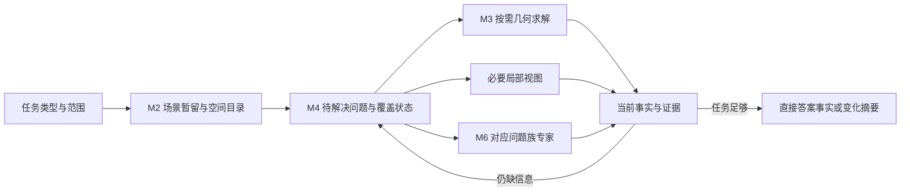

# 当前扫视能力与下一阶段算法架构

2026-11-13。回答用户“当前还缺哪些能力、怎样发挥引擎优势、整体扫视是否完成”。固定实施交付e089a7ba，运行产品452b44d2、138源4067c864…a9f6。本轮源码与既有原件复核，没有新增Blender、模型或API实验，也未核验桌面默认安装。

**参数化全场几何扫描已有可用实现；通用主动扫视尚未完成。** 目前已能不给对象名，查全场“哪些三角表面距离不超过阈值”，并报告已测、已排除和未解决的范围。尚不能把“检查这个复杂场景哪里有问题”普遍转换为自动发现目标、选择下一处、换视角、融合证据和完成判断。

这两种扫视要分别验收。引擎能直接读取完整几何时，不必先渲染很多图片来模仿眼睛；把粗查、选择性精查、连续记忆接起来，才是类人眼思路对三维引擎的实际价值。

## 当前状态与旧结论修正

| 能力 | 当前实现 | 尚缺的能力或证据 |
| --- | --- | --- |
| 全场几何关系发现 | surface_scan普通入口、全体对象对分母、包围界排除、三角表面精测、覆盖状态；不需预给目标 | 目前是一类表面阈值关系；表面距离不自动代表穿入、包含或语义异常 |
| 场景暂留与连续观察 | 资源/姿态分离、宿主资源delta、当前结果复用、不变对象对跨版本复用 | 公平保留原生上下文和缓存后的完整多轮收益尚未验收；模型每轮仍收到完整表 |
| 主动视觉 | 已有局部视角评分、遮挡检查、focus状态和有限放大 | 仍围绕指定对象与已有接触；缺全场已看/待看状态、问题驱动下一视角和跨视角闭环 |
| 复杂真实几何 | 三角表面算法和BVH，不能概括成只会盒子 | 扫描来源仍限独立静态三角网格；高面数、实例、父子级、modifier、动画、shape key需要各自接入；不能靠一项预算解决 |
| 非指向异常检查 | 特定关系能发现；特定专家能处理指定局部 | 没有通用“哪里不自然”的发现能力，也缺自动定位专家需要的局部输入 |
| 专家小模型 | 手臂扭转已有训练MLP及普通只读入口 | 输入仍需指定网格、骨链和截面；合成训练域的塌缩程度估计不等于真实人物泛化，更不等于脸部专家 |

因此20261112旧文两处必须按时间纠正：全场无目标surface_scan已补上；手臂专家已含训练权重，并非只有检索索引。旧文保留作历史，不再用它描述当前缺失。场景暂留缓存与用户定义的“专家记忆细胞小模型”也属于不同能力。

源码依据（均为上述实施树）：

- `live_service.py:1053,1383`、`blender_host.py:1570`、`surface_scan.py:182,237,291`：全场扫描与覆盖。`surface_scan.py:14–16`现上限256对象、新pair默认512；预算用尽保留deferred，不冒充完整。
- `scene_residency.py:113,168`、`scene_cache.py:179`、`read_context.py:41,71`、`live_service.py:1428`：暂留和复用。`live_spatial_mcp.py:707`：完整紧凑事实交付。
- `attention_policy.py:232–272`需要focal/reference和既有contacts；`live_service.py:1146`普通无接触概览仍hold；`native_observation.py:541`局部V3路径限制。surface_scan成功是零图片证据，不能当视觉扫视验收。
- `blender_host.py:1344–1373`扫描来源准入；`surface_proximity.py:15–20,188`每对合计4096面、16384窄相及工作预算。这与旧“统一16384点/面上限”不是一回事。
- `arm_twist_expert.py:198,218,235`、`arm_twist_weights.py:1–2`为10特征→12隐层→单值训练MLP；`live_spatial_mcp.py:266`、`live_service.py:1258`、`blender_host.py:2098`接入普通工具；其输入/训练范围见`arm_twist_source.py:78,109`。本轮确认实现存在，不重新认定未重跑的训练或真实资产质量。

## 当前表现弱的具体原因

第一，历史全场任务存在能力缺口和交付浪费两类原因。现在一类发现能力已经补上，但旧详细结果仍让消费者重复读、再自行写算法。紧凑候选的三次消费者均一次observe后直接交出完整正确答案；旧详细组均重复读取后原生重算。说明这一轮的交付问题确实得到改善，不能再笼统归因于模型不信任任何工具。

本次固定24对象、530顶点、978三角形、276对象对任务，紧凑版相对原生完整任务配对耗时中位下降60.09%，reported token总量下降62.22%。九份final内容正确，执行有效为C3/3、N/O各2/3，两项正式门仍false，所有失败成本保留。实际费用未知。详见[独立成本复核](M4_SURFACE_SCAN_COMPACT_CONSUMPTION_001_COST_REVIEW.md)。这验证一种任务，不能据此宣称高面数真实场景或所有扫视任务都赢原生。

第二，当前普通视觉策略主要解决“已知哪里需要看清”，没有解决“尚不知道哪里需要看”。如果要求检查未知异常，目标选择、缺失证据和补查调度仍可能落回大模型。多次局部观察相加不会自动形成全场覆盖。

第三，内部增量已有实现，模型层却每轮仍消费整表。内部少算、宿主少传、模型少读是三个不同收益；需要连续任务账本判断哪一段仍昂贵。不能重建已有缓存，也不能拿冷态原生对热态插件。

第四，当前扫描来源和算力规模尚未覆盖常见人物/复杂装配。扩大数值预算只能增加既有算法工作量；它不会自动提供求值网格身份、实例资源共享、变形更新或骨骼局部输入。

## 保持现有模块，接成更短的执行流程

数值查询在几何求解后直接结束；需要辨认外观和遮挡才进入视图；符合已定义问题族才调用专家。M4沿用现有调度，不新增并行“扫描大系统”。完整几何留引擎，模型接收任务事实、必要引用与确实有用的图像。

算法方向按缺口选择：

1. **连续观察**：先验证现有对象依赖失效和跨轮进程/上下文持续。重复场景复用结果；姿态变化更新相关对象对。若实际主要成本仍在重复事实投递，再做基底版本绑定的变化摘要。无完整基底时走完整事实，不把已有宿主delta当成模型协议。
2. **大场景关系发现**：现有全体pair账本在小规模可验完整性；扩大对象数前，测对象级空间索引、批量候选查询和局部索引更新能否减少二次枚举。查询用下界排除，nearest用随best更新的队列。内层继续复用三角BVH，按需展开相关资源；不先将整个复杂场景转成大数组。应由实际新增工作量和完整召回验证收益。
3. **真正的下一眼**：让候选视角按“预计解决多少剩余问题/总代价”排序，考虑可见区域、遮挡、已看重叠及图像消费。先用可测规则接通已看/待看状态；仍看不清则换方向，问题解决则转下一处。外围低精度、局部精查用于少做工作，不能用模糊后的缺失信息宣布没问题。
4. **真实来源扩展**：一次选一种实际挡住目标任务的来源，优先研究只读当前求值几何如何进入同一资源/姿态模型。实例共享局部BVH、变形只更新受影响资源；确有主成本后再评估BVH refit与重建条件。不要同时开放所有modifier、动画和角色写入。
5. **专家能力**：保留已训练手臂模型，重点补真实资产的局部定位、可复用特征及跨角色泛化。先让一个问题族从整个人物自动定位到局部并正确估计，再增加脸部凹陷等另一族。训练一个语言回答器不能填补前端没发现候选的漏洞。

以上为优化方向，不冒称全部已完成或已测收益。具体实现由下一项真实瓶颈决定。

## 有边界的推进顺序

当前只派一项：[连续BASE→REPEAT→EDIT工程资格](M4_SURFACE_SCAN_CONTINUITY_001_PLAN.md)。复用现C和原场景，两个隔离工程episode、六业务调用、零模型预试，验证薄客户端跨轮启停不丢后台/缓存，改动后读到当前结果。通过后冻结公平N/C连续消费，原生同样保留自己的求解脚本和模型上下文。

该验证用于判断暂留优势能否转成完整任务收益，不继续微调已通过内容质量的同题格式。下一项能力工作应优先接通真正需换视角的“发现—补看—覆盖”任务；若连续过程先暴露了明确来源/缓存缺陷，先修那一个缺口。复杂几何扩域与专家泛化各自独立验收，不混成一个大批。

验收分母用全场真值或预定义问题全集，记录漏检、误报、unknown、定位、完整性、全生命周期时间、模型实际usage和所有回退。至少有一轮有根据的优化；之后无新主成本或质量失败就冻结，停止反复优化同一道已封顶题。
