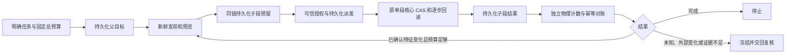

跨段监督目前是源码候选中的私有服务接入，尚未安装到生产配置，也没有新增默认自动动作 MCP 工具。已有有限 V1 感知和单段执行继续作为主干；本层负责同一明确任务的父子段预算和对账，不替代几何验证或用户授权。

可信宿主在创建 LiveSpatialService 时注入 GoalSupervisorContext，提供同一次系统启动的单调时钟域、当前任务的动作授权回调、独立物理计数回调。JSON 参数不能提供这些能力。授权回调须绑定任务、对象身份、引擎版本、原支撑三角形及新鲜证据；第二段仍须通过接续审查、重新发现和预览。更换父目标 ID 不能用来给同一次授权重新发预算。

父账本位于原 connector state 的 goal_supervision 字段，沿用原文件锁和原子持久化，不另建一份可独立失配的执行账本。最多保存 16 个父记录，每个最多 3 个子段，不自动淘汰请求身份。总步数最多 8、每步最多 1 毫米、总路径最多 8 毫米，默认总时限 30 秒；可显式收紧，总时限硬上限 180 秒。每次派发采用子段截止与原父目标绝对截止的较早者，等待、复核和重启不会续期。

| 持久化事实 | 处理 |
| --- | --- |
| 预留或派发后没有子段结果 | 保持阻断；缺记录不能证明没有移动 |
| 子段 running、inflight 或结果未知 | 冻结，禁止自动重发，包括换请求 ID |
| 子段最终提交，父段未确认 | 读取原始子账本，取得独立物理计数后补账，不再执行 |
| 同一结果重复确认 | 幂等，不重复扣账或移动 |
| 完整回执在截止后才完成核验 | 仅补记已发生动作，不能宣告按时完成或继续写入 |
| 时钟域变化或时钟倒退 | 保守冻结，不从墙钟重新创建窗口 |
| 父子关系、请求或已确认记录损坏 | 拒绝加载或继续，不重建空预算 |

预算从原事件时间、真实子段回执及受信计数重建，不相信缓存的剩余额度。普通 transform 和未绑定的新段也受未决父目标约束，观察和预览仍可用。物理计数须覆盖所有实际 setter 和回滚，不能从子段回执求和后冒充独立证据。计数包只接受完整性、累计次数、累计路径、当段逐步路径及回滚次数五个受限字段；完整候选账本验证后才提交确认，超大输入拒绝后仍可重载。Python 回调运行在 connector 锁内，不得重入该服务或修改宿主。

独立 Blender 已验证：首个进程在子段最终提交后、父确认前退出 23；新进程对账不增加 setter，随后新鲜发现和预览后完成第二段。共两段、四次移动，最终约 1 毫米，重启保持原开始时间和截止。实验中 host 截止比父截止早约 0.328 秒，两者都未续期；这不是单一数值截止或通用生产时钟来源的证明。

后续候选已补上同次捕获的原生姿态和独立setter注册计数，并由固定无UI typed worker提供受控范围的可信context；共享MCP仍不具备任意外部写入的完整性。激活器也已增加父子账本校验，私有配置下验证原有指纹栅栏可以隔离同state的存活旧writer。当前均未安装，详见[生产宿主证据](PRODUCTION_HOST_EVIDENCE.md)。

新owned候选已经显式协商共同QPC，让父任务、子段、precommit和宿主setter旁使用同一固定截止；旧monotonic父任务不重标或续期。到期前未进入setter的请求保留零写取消身份，晚到已执行结果仍计量。含blocked零写步骤的父账务当前保守冻结停止，不把它变成成功。详见[截止准入](FORWARD_DEADLINE_CONTRACT.md)。旧writer证明仍限于同一canonical state及其合法配置，不覆盖任意外部入口，合作式准入也不宣称OS零误差硬实时。

最新源码候选将上述私有能力接入单次可信任务调用。任务授权索引与父子账本同锁保存，同一认证事件不能换目标、预算或原期限；引擎自动完成新鲜发现、最终有效预留的预览、一次性精确派发、独立对账与原生接续审查。最终成功必须同时具备完成的父账本、已确认全部物理事实和仍满足目标的原生证据，再关闭注册目标。已满足目标可真实零写完成；未知或停止仍保持阻断。关闭后受管理宿主继续拒绝无token普通写入。只在固定owned typed worker范围实测，下一步为隔离打包激活，未开放默认MCP自动任务。详见[自动任务合同](OWNED_GOAL_SCHEDULER_CONTRACT.md)。

本阶段保留原持久化级别，不承诺文件系统断电恢复；也不增加学习型小脑、通用旋转、动态避障或扫掠路径认证。真实模型对照试次仍为 0，未据此宣称模型收益或速度提升。证据：[本轮结果](../verification/fixes/20261030_v21_supervisor_ledger/RESULT.json)。
