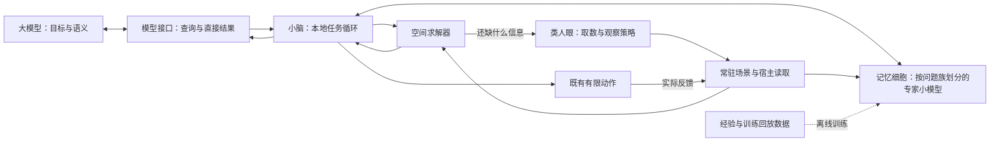

# Human Eye 整体框架重构与分模块推进计划

2026-11-05 · 最终方案 r3（已批准；实现模块至少一轮追加优化） · **用户已确认，按模块执行**

代码核查基线：`229df6eb9d278483483c299a9244487a38b0311b`。本文件取代 `V1_PERFORMANCE_FIRST_ARCHITECTURE_PROPOSAL.md` 的推进安排；历史实验及固定 Git 审核快照保留。r2已完成源码与方案复核；用户现已批准按模块循环推进，并明确要求首轮达标后仍至少实施一轮优化。r3将该要求写入交付流程，由PERF-000开始。

## 1. 确定的整体方向

**类人眼负责高效获取信息，空间引擎负责计算，小脑负责本地任务循环，记忆细胞本身是解决一类问题的内置专家小模型；大模型负责语义、目标和高层决策。**

“记忆细胞”按用户定义指具有学习能力的专家模型，例如肢体异常扭转、局部形状异常塌陷。经验数据库、场景缓存和读取排序器各有用途，不作为记忆细胞本体。r1把细胞定义成经验记录并优先研究读取排序的安排，由本修订替代。

优化对象是完成任务的整条工作流：模型编程/调试、宿主读取、本地计算、数据搬运、观察补查及反馈。图变小、报告变短、内部函数变快，分别是局部指标，最终要在完整任务上超过合理原生。

产品目标：简单场景也有净收益；复杂场景中优势随候选、几何、遮挡或连续任务规模扩大。实现路线优先删除无用工作、移动计算位置和改进算法，不先扩大模块数量。

本计划同时包含当前观察主链和后续小脑/记忆/内置小模型。各阶段按依赖交付，不把未来能力写成已经实现。

## 2. 本次复核确认的关键问题

| 当前事实 | 对最终设计的影响 |
| --- | --- |
| `live_service.observe` 先完整 capture；`attention_policy.propose` 接收完整 meshes 和已经算出的 contacts，主要替换 Q4 | 现有 attention 是计算后的视图策略。新的引擎取数策略必须前移到详细采集之前，不能直接改名后宣称省了读取 |
| `blender_mcp_host` 把 capture 结果编码返回；`blender_host` 重复展开网格、三角化和逐顶点转换 | 优先使资源、索引和可行的计算常驻在数据附近，减少把完整几何搬到另一进程再处理 |
| `scene_cache` 在完整采集之后才复用；pair key 再编码完整网格；`scene_delta` 是附加交付 | 场景暂留必须接宿主变化和资源版本，增量成为全量的替代路径，避免保留多套完整场景 |
| 包装先深拷贝和完整编码，再生成 brief；内部反复解析 `context_text`，部分模型消息生成后被丢弃 | 内部统一传结构化结果，出口只构造选中的输出；完整诊断离开普通路径 |
| `SpatialSceneIndex` 先验证全场景支持性再筛选；距离计算已有分块但仍遍历大批点面/边边组合 | 分块已控制部分内存，下一步要减少实际组合数量：按任务直达、距离下界早停、层级包围体剪枝 |
| `OwnedGoalScheduler`、`goal_execution` 已有有限多步执行与回读 | 小脑复用现有控制基础，优化采集、求解、反馈和持久化，不重建第二套执行器 |
| `TaskEpisode` 有轨迹；`CandidateIndex` 是未启用的有限影子检索；尚无已接通训练/推理链 | 这些可作数据与对照基础，不能算专家细胞已实现。Agent Learning 是开发知识服务 |

已核对的四对象实际 MCP 文本为 19,226 字节；约 9,444 字节用于能力表、4,915 字节用于 routing、1,997 字节用于运行身份。该样本表明输出存在明显冗余，不证明整个产品已经超过原生。

## 3. 目标运行架构

这是职责图，不是每次查询都必须经过全部模块。明确的简单只读任务直接走：**接口 → 必要读取/缓存 → 算子 → 结果**。领域异常任务由小脑选择相应专家细胞，不让所有专家每次都运行。

复杂任务在一次引擎调用内部循环“补信息 → 计算 → 判断是否足够”。大模型只在语义需要补充、任务范围改变或阶段结果需要决策时介入。

### 模块边界与数据接口

| 模块 | 输入 → 输出 | 优化责任 |
| --- | --- | --- |
| M1 模型接口 | 用户任务/目标 → 有限查询；事实/必要图 → 模型结果 | 简短工具描述、目标绑定、直接交付，减少模型编程与补查 |
| M2 场景状态与读取 | 对象/区域/字段/精度需求 → 带版本与覆盖范围的数据 | 目录、资源/姿态分离、批量采集、按变化更新和共享缓存 |
| M3 空间求解器 | 当前相关数据 → 数值结果/见证，或缺失信息需求 | 解析解、批量粗筛、局部精算、层级剪枝，保持同任务精度 |
| M4 类人眼取数策略 | 廉价目录、已有状态、任务信息缺口 → 下一批读取/观察请求 | 决定读哪里、读哪些字段、需要什么精度、是否换视角 |
| M5 小脑控制器 | 目标、当前事实、已有技能 → 局部步骤与反馈循环 | 少调用大模型，复用一次回读，减少重复求解和无用保存 |
| M6 专家记忆细胞（内置小模型） | 局部几何/骨骼/参考及任务条件 → 异常定位、程度、原因候选与修正预测 | 学会一类问题并跨资产复用；每类独立验收 |

经验、标签和训练回放是M6的数据支持，不作为每次推理必经的第七层。

共享少数结构即可：`Query`、`SceneState`、`NeedInfo`、`Result`、`Episode/Skill`。优先改现有类型，不开发通用工作流语言、跨模块序列化框架或新微服务。

## 4. 框架重构的具体做法

### 4.1 计算靠近数据，资源常驻

- 优先复用 Blender/现有 worker 的常驻进程，查询读取已加载的资源和索引。能在宿主附近完成的几何计算只返回结果及必要证据。
- 如果求解必须在外部进程，复用数组/资源句柄，仅传新资源或变化数据；不先为全量场景造 Python 字典、JSON，再恢复为数组。选择进程位置时同时测宿主响应延迟，重计算不能长时间占用 Blender 主线程。
- 对象目录、求值几何资源和实例姿态分离。相同求值资源共享一份；纯刚体姿态改变只更新变换和受影响结果。
- 变更标记在宿主实际变化时产生，读取时消费。删除、替换、撤销、重连及场景切换更新版本或重建一次，避免每轮全量扫描证明缓存可用。
- 完整目录和“详细几何已载入”分开：未读到详细网格，不等于对象不存在。
- 先批量数组读取和同次签名复用，再接细粒度变化；每一步都必须实际减少工作次数。

### 4.2 内部只保留一份结构化事实

- 去掉 `context_text` 在内部的 JSON 往返；最终 MCP/Hook 出口才编码。
- 取消普通观察里未消费的模型消息、全量能力表、动作授权包装和默认完整诊断。
- 正常事实路径只组装要交付的字段。详细诊断按需构造；已有 full 重新观察语义保持明确，不编造历史引用。
- 观察缓存持久化和调试日志脱离每次读取的同步路径。动作记录仍对应真实执行状态；不把它们作为可丢缓存。
- 固定源执行快照覆盖依赖、别名、延迟导入和 worker；初始化完成后复用实际执行字节，热路径不反复扫描/编译源码。

### 4.3 求解器少做计算

- 指定对象对直接进入对应算子，省去无关对象的完整支持性处理。
- 最近邻查询先算批量距离下界，按候选精算并早停。当前 ≤256 对象优先使用简单数组粗筛，规模交叉点实测后才换复杂对象树。
- 网格距离以层级包围体/空间分块排除不可能成为最优的三角形对；分块只负责控制峰值内存，剪枝负责减少总计算。
- 共享拓扑、边集合和局部几何预计算；姿态变化时更新受影响部分。
- 对已确认的规则几何用解析解。表面距离、实体包含、碰撞和视觉可见性各回答自己的问题，不为每次查询顺带计算全部结论。

### 4.4 类人眼只负责信息获取

类人眼策略的输出是读取计划，不是最终几何答案。其工作顺序是：

1. 先使用目录、包围范围、已有状态获取低成本概览。
2. 根据任务与信息缺口选目标区域，获取必要字段与精度。
3. 信息不足时切换局部区域或观察方向，取得能区分候选解释的证据。
4. 信息足够即停止，后续场景变化只更新受影响部分。

“模糊/外围低分辨率”用于减少非关键区域数据；“聚焦”用于取得关键局部；“扫视”是下一次取数选择；“暂留”由 M2 保存版本化状态。最终测量由 M3 完成。

可直接读取坐标/拓扑时，优先用结构化数据。只有视觉信息真正补足任务时才渲染；不把已有数值画成图再让模型读回。

已有 Q4 注意力保留为可复用视图算法。新的 M4 输入必须足够廉价，不能为决定“先读哪个对象”，预先精算全部距离或渲染全部候选。明确简单查询直接跳过 M4。

## 5. 后续小脑、记忆细胞与内置小模型

### 5.1 小脑：常驻本地反馈循环

复用现有 scheduler/execution：`目标 → 当前误差 → 选择局部步骤 → 执行/取数 → 实际反馈 → 更新`。先使只读的信息获取循环贯通，再优化已有有限动作循环。

常规小步由本地完成，目标和范围一次设置。一次反馈同时供误差计算、完成判断和事件记录使用。数值结果与执行实际状态明确，模型不参与每个微小步骤。

### 5.2 记忆细胞本身就是领域专家小模型

按通用问题族组织少量专家，而非按角色、对象或每条历史记录创建模型。一个细胞包括问题定义、输入表示、学习参数、预测输出及该问题族的验收标准。“记忆”体现在训练所得的可泛化知识与行为中。

| 首批问题族 | 需要的输入 | 专家预测输出 | 修复质量关注点 |
| --- | --- | --- | --- |
| 肢体异常扭转/蒙皮形变，先验证手臂 | 当前与参考局部网格、骨骼链相对姿态；区分蒙皮原因时再读权重与蒙皮方式 | 异常区域、程度、原因候选，以及骨骼/权重/局部形状等不同操作域的修正候选 | 扭转和体积异常是否减小，动作目标、关节连续性及非目标区域是否保持 |
| 局部异常塌陷，先验证面部 | 局部曲面与邻域、区域/尺度、中性形态或参考、目标表情/风格 | 异常区域、相对目标的偏差，以及建议目标形状、局部残差或形变参数 | 凹陷是否符合目标地修复，身份特征、表情、正常凹面和周边结构是否保持 |

问题族用于跨角色复用；首个版本只选其中一个，优先评估肢体扭转族，因为已有姿态/形变测量可复用。骨骼姿态、权重和顶点不是同一种修正变量，首批在其中一个明确操作域建立完整闭环，再扩其他原因。

“扭成麻花”是外观症状，不能只看某一个骨骼角度判断原因。Blender文档也区分姿态、权重和蒙皮体积保持对变形的影响；此处用于规定专家输入，不作为自动修复结论。[Armature Modifier](https://docs.blender.org/manual/en/latest/modeling/modifiers/deform/armature.html)

面部正常凹面与异常凹陷需要结合参考形态、区域和表情目标判别。专家训练包含正常结构、合法夸张和真实缺陷，目标不是把表面统一变平滑。

### 5.3 小脑如何使用专家细胞

流程：`类人眼定位/取数 → 小脑按任务选择细胞 → 专家诊断与修正预测 → 引擎执行所选算子 → 实际回读 → 小脑评估并继续`。

第一批专家输出结构化局部预测和修正候选，不生成通用脚本。引擎负责坐标、几何约束与实际操作；小脑负责多步组织、误差收敛和停止。模型也可以输出低维形变系数或局部位移残差，具体表示由该问题族的数据与算子决定。

每类细胞可以有独立轻量网络，或共享几何编码器并使用专用预测头；优先实现独立可测的最简专家，再根据数据和性能决定共享。共享编码器是实现选择，不改变“细胞就是专家模型”的定义。仅调度被任务命中的专家，避免全体模型常驻计算。

读取候选排序继续作为M4的可选算法研究，不再占据首个记忆细胞的产品目标。参数量、特征维数和网络类型不预先固定为32维或82K；轻量与否按完整任务成本衡量。

### 5.4 数据、基线与验收

- `TaskEpisode`、归档和检索代码用于数据准备、回放和非学习对照，不等于已实现专家细胞。场景缓存、训练样本库、专家权重分别管理。
- 训练数据包含正常状态、已知扰动、真实异常、修正过程和独立结果。合成扰动提供可控真值，真实资产检验分布差异；不把所有原始造型当成缺陷。
- 按角色/资产/骨架与拓扑划分训练和保留测试，检查未见资产；同一角色的相邻帧不跨训练/测试冒充泛化。
- 先验定位、误报/漏报与原因分类，再验修正残差、局部形态和非目标区域变化；单有分类准确率不算修复完成。
- 专家内部比较数值/规则基线、可用的经验检索基线、加入专家模型后的相同任务链。整体继续与合理原生比较，原生可使用已有Blender算子。
- 分账数据制作、训练、加载、特征提取、推理、求解和反馈总成本，以及实际模型往返和内存。每个专家在冻结输入规模后设延迟/内存目标，旧读取排序的2ms门槛不套用到形变预测。
- 给出完整任务净节省与训练摊销点。学习收益必须体现为更好定位、更少纠偏或更高修复质量；模型权重小不自动代表有效。

## 6. 原生竞争基线与公平验收

原生输入是任务、工具定义、选取返回的文字/数值、实际图片和调用历史；完整 `.blend` 不自动进入模型。模型负责选择读取和生成代码，Blender/Python 可以执行精确算法。当前原生协议明确允许读网格、用数学库、保留脚本/缓存和自行选图。其外部调用链符合[工具调用流程](https://developers.openai.com/api/docs/guides/function-calling)，不能把原生限制成只看一张图。

P 与 N 使用同一模型、资产、任务、通用工具、预算和可读数据，P 额外获得 Human Eye。原生可复用高效脚本；插件的初始化、接口说明、加载、求解及回退计入。冷态与持续使用分别比较。

### PERF-000：先回答优化哪项工作

交付一张真实表：`模型最初收到什么 → 查询/代码 → 本地计算 → 实际返回/图片 → 补查原因 → 答案与分段成本 → 对应重构模块`。

首先读取已有记录，缺口再小规模补测。上限24次任务回答：简单/中等/复杂各两题，P/N配对冷态共12次；另各选一条简单/复杂链，续测新问题、重复问题、局部变化，P/N合计追加12次。复用原进程和缓存，作为成本定位，不用于宣布正式产品胜出。

通过正常直接工具入口调用；公共测试必要适配尽量复用现有基础。评分与审计放在后台，不让模型手工读长协议、写请求JSON文件、转发图片引用或回填哈希。产品不可省的成本保留；纯试验管理成本单列。

第一批结束固定：初始性能表、优先瓶颈、目标模块、内部数据接口及正式验收安排。先做可消除成本最大且依赖满足的工作，不因某个文件容易改就优先优化它。

### 分档产品目标

| 档位 | 质量要求 | 已确认端到端目标 |
| --- | --- | --- |
| 简单 | 正确性、目标完整性不低于原生 | 配对中位总耗时降低至少10% |
| 中等 | 同上，重点检查对象选择与证据充分性 | 配对中位总耗时降低至少30% |
| 复杂 | 同预算质量不低于原生 | 配对中位总耗时不超过原生1/3 |

上述是已确认的实施目标，不是当前成绩。每档单独验收，复杂题收益不能抵消简单题退化。成本对照包括模型输入/输出、调用、图片、本地资源和总时间；字节压缩不等于token或费用下降。Pro未提供的usage/费用记录为未测。

先判质量，错误、遗漏、非预期unknown、拒绝和超时保留在总分母；速度比使用双方正确完成的配对任务，并同时报告这部分覆盖率。不能靠快速错误或只回答容易题获得速度成绩。超时单列，不把截止时间当作真实完成时间。

正式首轮计划每档12个独立任务，各两次P/N配对，总上限144次任务回答；先冻结交错顺序、场景种子与生命周期。正式模型对照为P/N两组，旧插件用于本地成本和代码差异归因。重复同题用于估计噪声，不算新增独立任务。报告按任务聚类的配对时间比与区间；点估计达到门槛但区间不支持时，结论为尚未证明，不换题或反复测到赢。

本地CPU/工具延迟与模型端到端延迟分别报告。p95为尾部不退化目标；样本不足以支持尾部判定时保留未验收，不以一次最快记录替代。正式轮后是否补样由具体不确定性决定，不自动扩大循环。

复杂场景分别改变对象数、目标几何、遮挡/候选歧义和连续任务次数，画出速度比、成功率和成本随规模变化的曲线。只增加远处干扰物得到的优势归于筛选，不外推到复杂几何。

## 7. 分批推进顺序与依赖

| 批次 | 实际工作与现有代码落点 | 完成标准 |
| --- | --- | --- |
| PERF-000 原生工作流审计 | 复用现有观察/原生入口、试验记录和计量 | 真实成本表、模块工作替代表、冻结对照与优先级 |
| PERF-010 简化共同主链 | `live_service`、`auto_router`、`host_runtime`、`agent_adapters`、`live_spatial_mcp` | 最小查询/结构化结果贯通；删无用消息与JSON往返；默认任务事实可直接消费 |
| PERF-020 数据位置与场景常驻 | `blender_host`、`blender_mcp_host`、`scene_cache`、`scene_delta` | 批量读取、资源/姿态分离、按需采集/变化维护；减少真实搬运和重建 |
| PERF-030 求解算法 | `spatial_index`、`geometry_safety`及对应领域算子 | 每批只换一个热点算法；少做无关支持检查/精算，结果与独立真值相符 |
| PERF-040 前置类人眼策略 | 读取计划接M2；复用`attention_policy`/视图候选中有效部分 | 从完整采集前开始选择对象/区域/精度；同结果下真实少读、少补查；简单任务跳过 |
| PERF-050 只读产品同版验收 | 固定候选、正常入口、旧插件/原生对照 | 分档产品门槛与完整成本；模块贡献不能拼接不同版本 |
| PERF-060 小脑本地闭环 | `goal_scheduler`、`goal_execution`、已有owned执行与回读 | 复用新场景/求解器，一次反馈多用；减少大模型往返、重复采集和每步包装 |
| PERF-070 首个专家问题族与数据 | 优先评估肢体扭转；复用姿态/形变测量、轨迹与回放 | 定义缺陷、参考、输入、修正变量；建立正常/异常数据和独立保留集，冻结规则/原生基线 |
| PERF-080 首个专家记忆细胞 | 训练该问题族小模型，接小脑与一个具体修正算子 | 异常定位到实际修正形成闭环，未见角色/姿态有质量和成本收益 |
| PERF-085 第二个问题族 | 首个细胞收口后再验证局部塌陷，优先面部 | 独立评估参考/表情条件、身份保持与修复结果，不把扭转成绩移用到面部 |
| PERF-090 整体复核 | 固定同一候选，观察与已纳入的控制任务分别验 | 原生整题收益、阶段回归、真实入口及发布候选材料 |

依赖关系：010提供共同边界；020提供分级数据；030提供结果和信息缺口；040才能在采集前有效决策。020/030的独立热点可按PERF-000成本调整先后，不能跳过数据依赖。

060复用前述基础，不先开发通用角色修复。只读Episode可随前面批次积累；070先把一个问题族的数据、目标和可用修正算子弄清，080实现对应专家细胞，085再处理第二类。每类遵循定位→诊断→一个明确修正域→反馈闭环，扩展骨骼、权重或网格操作分别验收；读取排序不作为这些专家的必经前置。

每批保持一个主要优化假设。一批通过后替换重复实现，旧入口保留薄适配；不长期维护两套完整引擎。

## 8. 工程硬指标与模块贡献

这些是实施目标，绑定固定机器、输入和进程状态，不能当作当前成绩。

| 项目 | 目标 |
| --- | --- |
| 固定四对象概览/单对象对事实 | 正文≤2 KiB/4 KiB；保留所需对象、数值原精度、版本与实际状态 |
| 文字投影与编码 | 暖态CPU p95≤2 ms；不先构造完整诊断再裁剪 |
| 共同路径 | 未消费模型消息0次；最终正文编码1次；普通任务读使用说明0次 |
| 静态复查 | 未变对象重新展开几何/拓扑、重算几何签名均为0 |
| 64/256对象暖态同查询 | 完整服务调用p95≤20/50 ms |
| 64/256对象单纯姿态变化查询 | p95≤100/200 ms；未变资源不重建 |
| 新对象对精算 | 目标对合计≤4096三角面时，64/256对象场景p95≤200/500 ms |
| 初次场景建立 | 宿主已启动时，64/256对象档p95≤500/1500 ms；启动另计入完整任务 |
| 场景常驻内存 | 256对象档插件增量驻留≤128 MiB；临时峰值另报 |
| 专家记忆细胞 | 按问题族冻结局部输入规模、预测质量、特征＋推理＋求解完整延迟和内存；在实际诊断/修正任务上有净收益 |

规模档：8/64/256对象，总顶点2千/2万/10万，总三角面4千/4万/20万。目标对几何、其他对象复杂度和变化比例分别冻结。精算分表面距离（含凹面）与已有实体关系支持域两组，不以一种代替另一种。

完整服务调用从收到MCP请求到结果可交付，包含入口、宿主通信、求解和包装。视觉另固定渲染器/分辨率：单张384² Workbench简单材质局部图完整调用初始目标p95≤500 ms；分析投影与Cycles分别记录。

模块采用同输入输出、同版本单变量对照，核对少做了多少读取、复制、编码、候选求解、图片或模型往返。M4分别记录引擎取数收益和模型读图收益；M6将数据准备、专家预测、数值求解和修正反馈分别计量，避免重复归功。

## 9. 简化检查与内部约束

移出热路径：同一未变数据反复校验/哈希、每次扫描源文件、无关对象全套支持性判断、完整诊断日志、每步模型消息和小步审批。

内置保留对象/场景版本对应、数字和状态真实、动作范围及实际反馈三个基本条件。首次外部数据进入时完成必要检查，内部通过资源版本和结构化数据复用；执行状态未知先查实际状态，不自动重复动作。

本计划以最短查询和反馈链为目标，不新建厚重“安全层”。必要计算与反馈合入算子/控制器，详细审计由开发复核读取。

## 10. 两个对话的执行与独立复查闭环

规划/复核：本聊天 `01a1971f-eef5-7a23-a1b1-2352beb80a77`。唯一实施者：`local/01a15a65-561c-7420-bc32-2fb6fd7dba41`。

1. 用户已确认，由本聊天先派PERF-000。每批明确基线、一个主要瓶颈、预期消除的工作、范围、指标与证据。
2. 实施者完成实现/定向回归，固定候选提交，报告原始结果、失败与剩余最大成本；主动发完成消息唤醒本聊天，然后结束该批。
3. 本聊天读源码与实际调用链，在隔离副本重跑关键反例和成本检查；核对同版身份、测试分母、是否少做了工作，以及是否还有更简单算法。作者结果与独立结果分开。
4. 实现模块一律经过“初版 → 独立深审 → 至少一轮实质优化 → 再次独立深审”。即使初版收益已经达标，也不能直接进入下一模块。追加优化必须针对已观察到的计算、读取、数据搬运或结构冗余，实际形成代码候选并测量；仅提出建议、修改文档或重复跑测试不算优化轮。缺陷先修，修复正确性本身也不能替代性能/架构优化轮。重复完成消息不重复派单，始终单一实施者，不持续轮询。
5. 同一瓶颈两个候选无收益，重审假设或转向另一个已证实瓶颈，不宣布整个任务失败，也不无限微调同一门槛。
6. 追加优化与初版使用相同输入、进程状态和计量边界，检查质量、完整耗时、内存及实际消除的工作。候选无收益或退化时保留证据并拒绝候选，保留较优实现；完成真实优化轮后，由独立复核根据证据决定收口或继续。不能换题、降低精度、缩小质量分母或把成本移出计时范围换取通过。
7. 审计与集成验收阶段PERF-000/050/090不为满足轮数另造代码改动；它们必须独立核查完整输入、合理原生能力、来源和成本。每个实现模块单独登记初版提交、首审结论、追加优化提交及实测、复审结论和剩余建议，一次集成跑分不能替代这些证据。只有质量、收益和追加优化复核均有明确结论，模块才可标为完成。
8. 达到用户已确认的整个推进范围，或明确指定的阶段终点全部目标时停止派单；普通批次完成继续按上述规则派下一批。用户叫停或确无已授权且能安全继续的工作时，同样停止并给出具体结果/决策材料。

每批复核必须回答：哪些工作已经消失？剩余最大成本在哪里？更简单替代是什么？模块收益是否进入完整任务？下一批为什么值得做？

## 11. 已确认的执行范围

用户已确认本最终方案，按上述模块依赖和闭环推进源码、隔离验证、既有Pro能力的有界对照与本地提交。正式安装、原资产修改及新增动作域按具体交付处理；Google API/Key/503与付费试验继续暂停。

首批为PERF-000原生工作流与成本审计，实际派发和回报在两聊天的交接消息中记录。小脑和按问题族划分的专家记忆细胞已纳入总架构；记忆细胞本身就是内置小模型。这些学习与修复能力尚未实现。

