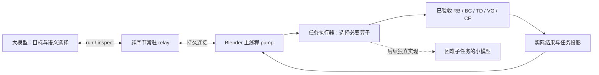

# Radical V1 大模型接入：本地完成任务，按决策需要交付结果

2026-11-06，修订2及025实现状态追加。用户要求减少多轮传输、无效输出，在复杂三维任务中显著提高原生大模型效率。本次改变接入模块的交互单位和主要验收标准。**E0/E1有限原生功能已经[验收](LLM_ENTRY_FUNCTIONAL_REVIEW.md)，任务收益或真实模型接入仍无PASS。** 六模块已验收，不重新开启其优化。修订1保存在提交`37c672c`与`llm_entry_design_evidence.zip`，旧决定保持。见[实施工作单](LLM_ENTRY_WORK_ORDER.md)、[价值复审](LLM_TASK_VALUE_REVIEW.md)。

## 复审结论

常驻传输方向保留，但原“每个动作一次往返、完整AO加新图”仍把任务求解留给大模型。候选还会每动作按绑定模式渲染、返回联合before/after AO。桥快20%不能证明完整任务快一倍。新的主线是：**模型确定目标，本地选择必要算子、求解并执行，返回实际结果；只有新的语义决定才再找模型。**

| 旧失败证据 | 本版选择 |
| --- | --- |
| B3e精简报告与合理native同为10/10，native资料更短 | 对照能写脚本、缓存、批处理的合理native，不人为做差基线 |
| 旧纯视觉试验插件55.3、native68.1且各1/3通过；处方和负反馈曾冲突 | 提供确定计算和真实结果，不把多看图/报告全当能力；不宣称当前支持旋转装配 |
| 旧压缩丢失区域位置，模型靠私有ROI补答案 | 按任务保留对象、单位、原face ID和位置，不按字节阈值截断必要信息 |
| 多次capture、JSON嵌Python再嵌JSON、重复连接与源码扫描 | 保留纯bytes relay、持久连接、主线程pump，几何留本地 |
| 局部耗时、估算token、成功子集曾被当整体收益 | 完整任务质量先过；计模型/工具/图像/冷启动/失败成本，未知usage保持未知 |

历史数字只按原报告范围引用，不推算新收益。出处与候选源快照见复审证据。

## 整体结构与模块顺序

| 增量模块 | 内容与验收 | 顺序 |
| --- | --- | --- |
| E0 常驻通道 | 原bytes收发、真实主线程调用、图片交付与释放；桥提速不是产品收益 | 与E1并行，复用当前relay/pump |
| E1 解析间隙任务＋最小结果 | 一目标调用完成测量、解析平移、执行与回读，数值模式不运行无用TD/图片/全AO | 当前实施及主要收益验收 |
| E2 单relative shape key求解 | 明确参数域的一维求解，真实全局BC和必要TD/图像，不逐步问模型 | E1收益与主审达标后推进，当前未实现 |
| E3 困难任务的小模型 | 对明确残余难题增加本地预测/视觉决策，独立测质量与全任务收益 | 据真实失败定范围；当前CF V+A不是通用求解器 |

实施自测完整交付后主动唤醒主干；主干深审算法/架构与结果退化。已确认优化不因换聊天重来。主干候选若退化，撤回主干改动、保留实施达标版；不加运行时旧算法fallback。

## E1：全局最近点直接求平移

输入是明确对象对、目标间隙g、容差和可选终态图。可信合同：moving求值表面仅统一世界平移，reference求值表面固定，当前全局无符号表面距离d>0且0≤g≤d。动作中拓扑/形态/单位不变，不把方向投影到限制轴。增大间隙、旋转、绕障、穿透分类不是该任务。绑定方声明前提，不每次扫描全部依赖证明前提。

BC给出全局最近点a,b，直接计算：

`delta_world_m = (d-g) * (b-a) / d`

对任意表面点对，平移后距离≥d−|delta|=g；旧最近点对平移后距离=g给出同一上界，因此新全局距离恰为g。**见证切换不会破坏证明。** 省去候选搜索、步长试探和强制CF预测。真实Blender仍执行一次并全局BC回读，以实测误差判成功；不达标就返回实际状态，不隐式重试或回滚。零间隙只说明零表面距离，不说明实体未重叠或第三物体无碰撞。

纯间隙路径直接复用public `BlenderControl.observe/execute/close`及其RB/BC，从typed `ClearanceReadback/Outcome`生成结果。不修改17个已验收源、不读Session私有状态、不复制几何核；不需要TD、全AO、CF预测或初始图就不运行。完整`BlenderRadicalSession`留给确需形变/学习的任务，这是按任务选依赖。两执行器不能同时保留独立current再交替修改同一对象。

终态图按需使用同一resident bridge和最终readback，捕获实际context并调用public `VGRenderer.prepare/observe`一次，不新建Session重测。必须保留遮挡对象、顺序、单位和对象身份，不能拿stale context；相机/SECTION语义沿VG。首批采用F视图；零gap只能使用当前支持的NATURAL，不扩写SECTION算法。renderer由连接惰性创建、跨目标复用，EOF/stop时释放；目标control替换时关闭旧control，连接关闭时释放当前control。

主干已完成32个CPU状态的设计核对，独立凸包穷举oracle最大误差4.44e-16m；这不是Blender执行或LLM收益验收。

## 模型只收当前决定需要的信息

默认两类工具：`run`提交小型结构化目标并本地完成；`inspect`按需查目录、当前图、具体见证或详细事实。schema由实施固化。宿主负责惰性打开与EOF/stop关闭，不强制模型open→observe→predict→execute→feedback→close。细粒度开发操作可保留，但不全放进默认工具目录。

对象有歧义才查相关名称/稳定ID/定位和可用控制；对象明确就直接run。首版不另写通用自然语言规划器。单场景对象对常驻；更换对/目标而需重建控制器时计真实成本，不冒称固定对会话已有全场景共享索引。两臂获得相同公开对象资料，人工预绑定不能当免费私有答案。

成功结果默认只含任务/当前观察标识、对象、米单位、目标/容差/实测间隙/误差/达标与**实际控制变化**。不重复before全文、相机矩阵全集、完整Top-K、候选、训练特征、审计日志或全schema。失败或下一决定需要定位时给对应对象、原face ID、当前世界米位置及未满足条件，不能只给无法行动的分数。预测和实测明确区分。

请求图片时只给一张真实终态图及观察/frame、对象对应、面板和NATURAL/SECTION语义。数值任务默认不渲染、不传图。inspect仅交付所请求当前信息；反投影需求才附匹配相机数据。详细AO是显式诊断/形变消费，纯gap路径不先生成全AO再解码。schema、目录、补查、重新取图、上下文恢复都计任务成本；不把必要信息藏到第二轮造低token。保存当前结果，不建设无界历史库。

V仅接受实际看图后的可选评价，可附带下一业务请求；没有下一请求就不强迫反馈回合。A只来自真实Outcome，解析任务不为采集A强制L推理。未交付图片不自贴pixel_pass。使用学习路径时新时序/图片/票据独立核对，不借原五段实验旧图标签。

## 通道与测试保持必要范围

保留纯标准库全双工stdio relay→持久loopback→Blender主线程非阻塞pump。relay不处理JSON/引擎；主线程处理分片、通知无返回、partial send与EOF，两端TCP_NODELAY。无逐请求代码、源码hash/compile、重连、整mesh传输、PNG落盘；PNG最终MCP边界仅base64一次。按实际宿主一种交付合同返回，避免完整内容在TextContent和structuredContent重复。

测试聚焦一次真实写入/回读、单位与身份、正确收发、终态图与释放。保留避免重复动作、假结果、主线程卡住的必要检查，不穷举畸形输入/任意并发/多版本兼容，不加TTL、配额、权限账本、重试和fallback。旧MCP只可一次引导，不作为热路径，不改用户GUI或私有handler。

实际协议profile按宿主确认，mock不是部署证明。参考[MCP工具](https://modelcontextprotocol.io/specification/2025-11-25/server/tools)、[stdio传输](https://modelcontextprotocol.io/specification/2025-11-25/basic/transports)；latest不等于宿主实际支持版本。Blender主线程设计沿修订1，GUI/event-loop资格用隔离原生进程验证。

## 主要验收：完整任务显著受益

以下都是**事前目标，尚未实测**。预检后、正式运行前冻结任务、初态、模型设置、时钟、成功谓词和源身份；不看成绩后改题/改门。

| 维度 | E1事前目标 |
| --- | --- |
| 质量 | 限定任务全部满足实际间隙/控制/未请求对象状态要求；无native成功而本端失败配对。独立几何/场景核对，不能done自证；模型最终回答也正确 |
| 完整耗时 | 复杂任务均值较合理native至少下降50%，至少75%配对更快，各预定任务族不劣、整体p95不升；失败按事前时限计入并保留原耗时，不挑成功子集 |
| 模型往返 | 对象明确的数值目标一次run完成，无额外open/预测/确认/评分；native多轮子集的串行决策往返中位至少减少50%。native已一轮就如实持平，不人为拆分 |
| 有效信息成本 | 全部模型可见文字输入输出token目标减少50%，包含schema/目录/补查。缺usage则只报可验证字节/消息/图片数，token门未验，不能换算费用或按每图固定token填补 |
| 完整成本 | 分别计模型决策轮次、宿主工具调用、IPC、图像、全部输入输出与冷启动/加载；端到端包括模型/宿主/本地/图像/补查，隐藏provider请求数保持未知 |

合理native使用同模型设置、场景/目标/权限/容差/初态，允许Python/NumPy/Blender API、事前通用helper、常驻状态、批处理、视图与缓存，不要求逐面手算或每题重写。native不用HE内核/本端答案，其他自然能力不限制。helper建立和首次加载计冷任务，稳态不重复收取。慢例、失败、输出、控制变化、图像质量全部保留；成功率或样本不足则相应收益未证明。

E1正式草案：三类复杂任务各4个预登记episode（密集非凸表面、非单位/父变换、复杂遮挡下指定终态视觉），共12/臂，另2个简单控制/臂，交错运行。复杂性/视觉问题/独立oracle具体列出，不靠无关物体堆量；这是有限范围资格，不宣称普适统计。真实模型消费之前，脚本只证明本地功能。

原B（同wire手工编排）和L（旧桥承载同新引擎）留作必要的传输归因。原20%桥收益、3×5+31微计时不再是本阶段强制主门，当前也没有正式接入成绩据此改判通过。先做任务实验，实际瓶颈/退化才补局部测量。E1主要收益和主干复审通过后再推进E2；token或宿主资格未测时不宣称全部验收。
