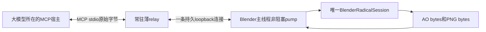

# Radical V1 大模型接入：常驻引擎与最小交换

2026-11-06，用户要求旧接口底层交换必须极致简化后才能使用。本文件是本端新接入模块的架构决定与预检目标，**不是已完成实现、已测收益或真实宿主接入的声明**。六模块与Python会话仍沿用已验收c2dcf1d，另一端实现不合并。实施工作单见[接入派工](LLM_ENTRY_WORK_ORDER.md)。

## 旧报告与当前源码揭示的问题

本轮独立阅读旧报告并只读核对当前旧接口及已安装addon文件，详细证据、行号和源摘要在`artifacts/llm_entry/preflight_root_001/`的三个审查报告中。

| 证据 | 对新架构的约束 |
| --- | --- |
| 旧BlenderMCPHost每RPC新TCP，request JSON嵌入Python代码，再包execute_code JSON；stdout回包又包JSON | 移除逐请求代码传输、重连、重新加载/编译模块和多层解包；不在旧router上继续叠新门面 |
| 旧有图observe还包含额外能力/图像RPC和多次完整capture；已安装addon主线程queue drain结束返回0.05秒 | 图像和事实来自同次常驻引擎结果；新桥独立测实际调度，不能把50ms配置当实测延迟 |
| 旧facts被序列化为context_text，再由MCP复制、投影和序列化；部分PNG路径存在多次base64与临时文件 | AO保持现有bytes，PNG保持内存bytes；只在最终MCP交付处base64一次，不经落盘或decode/re-encode |
| SOURCE_GUARD报告记载每工具扫描125源约3.6MB；区域见证报告8次CLI合计约35–39秒，而数学/序列化不到1秒 | 移除运行时源码扫描和逐调用进程生命周期；这些历史数值是作者报告，不能直接相减宣称本端收益 |
| 旧网格JSON重建丢失local_axes，计算与自检共享错误坐标；旧脚本成功曾未转化为模型成功 | 几何、坐标、索引、模型留在Blender；真实模型只消费公开事实/图片，必须另验 |
| 旧紧凑报告丢失定位、与合理native持平；早期token含本地编码器及固定图像估值 | 不以删必要信息换字节，不用bytes推token/费用；脚本、真实模型、实际宿主分栏 |

近期旧`verification/fixes`部分私有原样本在本checkout缺失，相关成绩仅引用其报告；当前源码调用链是本轮静态核验。保留数值/坐标/真实结果语义，不继承旧期限、配额、来源哈希、权限账本、重试或fallback。

## 选定的最小架构

1. relay只做全双工字节转发，不import旧plugin或引擎，不parse/dumps JSON，不重发命令。Windows stdin与socket的转发可用外部relay线程；Blender新桥不新增Python后台线程。MCP通知可能无响应，不能逐输入行强等一个输出行。
2. listener、连接、recv行缓冲、dispatch和send待发offset都由Blender主线程pump持有。非阻塞处理分片、合包和部分发送，不能假设一次recv就是一个JSON，也不能在主线程sendall阻塞。仅顺序处理当前操作并对待发响应施加自然背压，不增加调度/权限框架。两端TCP_NODELAY；实际timer等待、大包发送、UI响应与空闲CPU必须测。
3. Blender内只解析一次外部请求，直接调用已验收会话。scene、objects、reference、CF部署与VG资源常驻；不向LLM、relay或其它worker发送整mesh/索引/模型数组。没有逐次全场景导出、文件IPC或热路径源码哈希。
4. 只在最外缘生成一个MCP响应。AO已是引擎生成的JSON bytes，不能为包装而全量loads/dumps；放入MCP文本块仍有必要的字符串转义。PNG只在MCP image块base64一次。relay原样转发。不得宣传端到端零copy，宿主自身封装成本不受本桥控制。
5. 首版是单客户端、串行、明确绑定场景的一段任务。用户/其他工具若改变了场景，调用方明确声明changes或重新建立会话；不靠全量指纹扫描恢复任意并发编辑保证。停止bridge/EOF时在主线程关闭本桥会话和资源，不关闭用户Blender、不保存用户文件。

实际目标是正在运行的Blender。独立后台worker可以做相同handler的功能资格，但不能代替GUI事件循环、GPU上下文、真实MCP图片交付的验收。现有Blender MCP只可用于一次引导加载；不作为新热路径，也不修改其私有handlers。旧addon仍运行时，不能声称整个Blender进程没有后台线程。

## 最少交互与真实学习

工具具体schema在实施预检中收敛，原则上保留建会话/观察、明确动作step、按需预测/反馈、关闭的最小语义，不追求把所有参数塞进一个巨型工具。对象目录若确实需要，单独计入冷启动，不暗中借用私有目标。

稳态step以一次请求、一次返回为目标：

`模型已看过当前图 → 该图的真实V反馈（可缺省）→ 本地predict_action → execute → 真实A反馈 → 返回after/Outcome/实际预测值与新图`

命令已由模型在请求中明确选择，不再强制“先看预测再确认”的额外往返；预测比较只在调用方确实需要时提供独立predict-only操作。A只从真实Outcome生成，外部不传measured_delta。缺少V判断就保持unknown，不能把“已送达图片”当pixel_pass。新after图的V只能在模型看过后由下一请求返回，不当场自贴标签。

此顺序可能使after VG读取更新后的V模型，与原五段实验after渲染后才反馈的顺序不同；不能承诺直接重用原after PNG/评分。新的B/I基准必须同一真实交互时序并重新绑定实际图像与反馈。原五段次序另按原入口/明确操作复核，不拿少一次next观察的流程与完整五段成本作提速对比。

不每动作无条件再observe next；实际after已是当前真实观察，额外next只由明确查询/视角需求/场景变化触发。对未反馈票据的保留和释放、仅当前或有限待反馈观察的支持范围必须明确；不保存全历史、不使用TTL账本，也不能默默错绑旧反馈。

首次返回包含必要schema和实际图；稳态只发送本次新图。联合AO引用已经交付的before图时，必须有明确的观察/附件引用及公开消费合同，计入接收方保留和再次取得成本；新上下文不能被假定看过旧图。若需改变AO发布格式，先提交精确最小seam及独立可恢复证明，不修改已验收AO核、不自行写一套几何报告器。

## 事前收益目标与验收边界

以下是未测目标；精确工作负载、时间边界、工具schema、源身份和运行命令在预检回传后由主干冻结，未冻结不运行正式收益批次。若目标无法合理成立，先报告原因与影响，不以先看正式成绩后改门通过。

| 维度 | 准入目标 |
| --- | --- |
| 结构 | 稳态明确动作1次模型工具往返/1次本地IPC往返；热路径0进程重启、0重连、0源码扫描/编译、0整mesh传输、0图片落盘；每张新图最多1次base64 |
| 行为 | 同责B/I的公开事实、图像/相机、真实写入与Outcome、特征/更新/next一致；不能删除预算内必要事实或用脚本私有数据补答案 |
| 最薄基线 | 同一引擎、交互顺序、最终MCP内容，以及同一relay/pump/IPC的手工薄编排B；只把手工编排换成候选工具编排I，完整调用集合p95 I/B≤1.05。不能让B重复capture或多发图片；不拿无传输的direct-handler作为此比值分母 |
| 现有桥对照 | 同一新会话在既有Blender MCP execute_code上的合理常驻薄包装L；与I内容/反馈相同。目标完整热调用中位至少降低20%，集合p95不超过L；不复制旧全源guard来人为拖慢L |
| 实际传输 | 统计两条边界全部请求/响应UTF8 bytes、PNG原bytes/base64、JSON解析/序列化次数、冷schema/绑定/启动、稳态增量。图片占比高时如实承认字节改善受限，不硬造总字节百分比 |
| 资源与调度 | 新桥无忙等；独立报告空闲CPU、UI/event pump实际间隔、部分发送和完整响应持有峰；保持单会话资源生命周期，不引入无界历史副本 |
| 实际消费 | 当前宿主可发现并调用新工具、真正收到MCP图片；模型基于公开返回完成观察→明确动作→实际结果→真实反馈。不能用只生成PNG、脚本PASS或旧MCP可调用替代 |

计时至少区分engine-direct、含最终MCP编码的direct-handler、完整wire-entry，单列真实模型思考/网络等待和首次启动。正式统计沿原3独立进程、5预热/31实测配对的原则，具体案例与调度配对先冻结；不能把不同进程/GUI/headless端点直接相减冒充精确IPC开销。记录失败/慢例/图像质量和原型限制，按同一目标完成优化后收口，不重新优化六模块。

## 协议与外部资料

MCP实际工具结果支持文本与base64图像；stdio为换行JSON-RPC，stdout不能夹日志。见[MCP 2025-11-25工具](https://modelcontextprotocol.io/specification/2025-11-25/server/tools)和[stdio约定](https://modelcontextprotocol.io/specification/2025-11-25/basic/transports)。官方latest现指向2026-07-28，其每请求metadata等约定已有变化，见[最新传输定义](https://modelcontextprotocol.io/specification/2026-07-28/basic/transports)。不能凭latest链接猜当前宿主支持版本：预检必须确认并固定一个实际支持的协议profile，不为兼容堆多版本自动fallback。

Blender线程约束参考[5.0官方说明](https://docs.blender.org/api/5.0/info_gotchas_threading.html)；本轮该站直开失败，相关限制由官方搜索索引及[线程timer相关讨论](https://projects.blender.org/blender/blender/pulls/139602)辅助核对，不能当作已逐行审阅全部最新版源码。实际5.2.3主线程事件循环资格仍需独立验证。
