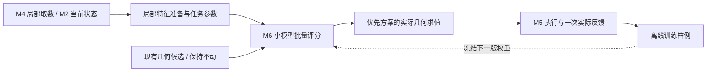

# M6 专家模型选型与推进分析

日期：2026-11-14。负责人：当前 M6 对话 `01a1d986-24a4-73f1-9689-6845d1f01ef3`。

本线使用 `codex/m6-candidate-value`，代码基线为 `7d42bb939c7881a98fe322c10c216398f6c7aecc`。M4 主线继续由原规划/实施对话负责；本线独立准备专家算法、数据和验收，不改其冻结试验。

## 1. 当前决定：比较选型，尚未定型

用户明确更正：本阶段要求分析后续哪类模型更好，并未指定一定采用某一模型。前版直接确定 MLP、限制一万参数，并把 M6 固定为候选评分器，过早收窄了选型。撤回这三个定案；当前没有启动新模型训练。

“给选项如何给出答案”作为 **候选评分/排序** 路线参与比较。它是模型的任务输出，可以由树模型、MLP 或几何网络实现；能量学习是另一种训练/推断表达，不与这些架构互斥。M6 也可以学习异常区域、直接修正参数或形变结果，先由真实失败决定需要哪一种输出。

选型需依次明确：问题和输出 → 可取得的输入信息 → 独立资产与标签 → 模型结构 → 完整成本。参数量、是否使用 NumPy 和是否共享主干均在此之后确定；已有运行环境是成本因素，不是预选获胜架构的理由。

M6 的“记忆细胞”由训练得到的权重、归一化参数和对应问题族构成。实际场景缓存仍归 M2；执行循环仍归 M5。模型分数是预测值，实际修改结果来自既有回读。

## 2. 当前实现与未解决的问题

本次实际读取四份 M6 源码、AST 解析冻结权重、解压统计保存数据并核对散列；结果在 [BASELINE.json](../verification/m6_value_baseline_001/BASELINE.json)。四份源码与已审 M6 收口提交 `d01d49bc0ec82583b24a8faf22e622e6f6ea8c5d` 完全一致。本次没有重新训练、推理、启动 Blender 或运行模型消费对照。

| 当前部件 | 已有实现 | 对新路线的含义 |
| --- | --- | --- |
| `arm_twist_expert.py` / `arm_twist_weights.py` | 10 维特征、12 隐单元、145 个实际训练参数；输出截面异常严重度；静态准备和批量推理已优化 | 是诊断模型，尚无候选排序/修正预测头 |
| `arm_twist_source.py` | 同索引局部 patch、骨链、姿态、权重及截面从真实 Blender 来源进入专家；已有绑定和准备复用 | 复用此入口，不另建采集平台 |
| `arm_twist_correction.py` | 限定三骨同轴、截面相邻均匀权重域；中骨角度为 `clip(theta / 2, interval)` 的闭式解；`model_calls=0` | 这是几何已知最优解，不能靠在外面加神经网络创造收益 |
| M5 反馈链 | 有限姿态修改、实际回读和结果记录已经贯通；重复回读已做过一次优化 | 专家通过现有循环落地，不增加第二调度器 |

旧作者报告的保留集只有 **2 个资产、14 个姿态、350 个截面**，其中 4 个异常姿态、14 个阈值阳性截面。本次重新统计了这些分母。旧报告中，网络与几何方法的分类和定位均打平；真正异常的收缩量，直接几何更精确。总体 MAE 的改善主要来自“正常弯曲/合法小扭转不算缺陷”的标签定义。

旧根复核还记录：202 个阴性特征行与训练集相同到小数点后十位；当时没有同等静态准备的几何成本对照。以上是历史独立复核结论，本次未重跑特征或速度。已有网络实现成立，真实角色上的学习净收益仍待证明。

因此，问题首先在 **学习任务、候选空间、数据分布和完整成本**，目前没有证据说明应先增加网络容量。

## 3. 候选评分路线的运行流程（备选）

以下仅说明选择“候选评分”输出时怎样接入现有系统。若采用直接修正预测，模型输出修正参数后求值；若采用异常定位，输出区域供求解器处理。不要求所有专家都绕行候选排名。

1. 大模型提出目标和关注部位，M4/M2 提供必要局部状态。M6 不每步重新理解自然语言，也不扫描整个角色来评分一个关节。
2. 复用静态 rest、拓扑、权重和局部标架；一次准备当前状态。姿态或权重发生变化时更新相关特征。
3. 现有几何方法生成有限选项，包含“保持不动”。所有算法比较时消费同一组候选。
4. M6 一次批量评分，优先返回一个候选；需要第二个时使用已经算好的排序。候选生成、评分和必要求值在一次本地调用内完成。
5. 对真正选中的方案计算实际结果，M5 使用同一结果继续执行/反馈。调用失败、没有改进及多试一次的成本都计入完整任务。

接口只表达必要信息：局部状态引用、任务目标、候选参数 → 候选 ID/参数、排序分数、预测改善及采用的局部状态引用。诊断区域可沿用现有输出。无需为此增加通用模型注册服务、第二套状态账本或多轮审批。

### 评分模型的数学含义

令 `s` 为局部状态，`g` 为任务，`a_i` 为候选：

`score_i = fθ(features(s, g), parameters(a_i))`

按预测任务收益从高到低排序；也可以定义 `Eθ = -score`，选择能量最低者。评分值不直接称为成功概率。

同一状态只构造一次特征。候选侧使用姿态增量、允许调整的骨、影响范围等廉价量。**候选完整变形后的面积、碰撞、损伤和实际耗时是监督答案，不能先对所有候选算出这些答案，再把评分器耗时称为提速。** 已被精确求值的候选也不必再用网络决定其已知效果。

训练首先学习同一状态/任务内候选的相对优劣，允许多个同样好的答案。候选顺序、名称和序号不成为答案捷径。必要时增加结果回归头，但先证明排序本身有价值。

## 4. 各类模型的比较与有条件建议

下表为结合本项目输入与目标的工程判断，不是新基准的测量结果。直接几何仍作为同输入、同准备的对照。

| 候选 | 适合的输入和输出 | 值得比较的优势 | 主要代价/局限 |
| --- | --- | --- | --- |
| 梯度提升树，如 CatBoost / XGBoost | 已提取的角度、权重分布、曲率等表格特征；分类、回归、排名 | 适合作为现有结构化数据的有力基线；可直接处理非线性条件组合 | 不自动理解网格邻接；树规模影响运行成本；分段输出不适合所有连续优化需求 |
| 小型 MLP | 定长局部特征、任务条件；连续参数、残差或候选分数 | 批量计算方便；可选择平滑输出及可微结构；易接现有数值路径 | 输入丢掉的信息不能靠隐藏层补回；小数据下不预设优于树模型 |
| RBF / 姿态空间插值 + 修正形状基 | 固定角色/相近绑定的已知姿态和修正样例；预测低维修正系数 | 很适合“见过若干姿态，快速插值修正”的问题；应纳入简单强基线 | 依赖可对齐的形状/参数空间；单角色插值成绩不能冒充跨角色通用专家 |
| 局部点云网络，如 PointNet++ 类 | 局部坐标、法向和参考形状；区域、形状表示或任务输出 | 可直接学习局部几何，多种点数/采样下有研究基础 | 需构造邻域并处理采样；没有网格拓扑输入时，连接关系和近邻接触可能混淆 |
| 局部网格/图网络 | 顶点、边、参考位置、骨骼影响；局部诊断、形变残差或评分 | 直接利用拓扑和局部关系，值得优先研究手臂蒙皮、面部形变等跨资产专家 | 图构造和消息传递有成本；拓扑边不能独自表示跨表面接触；训练数据需覆盖真实变化 |
| 短时序模型，或几何编码器加时序头 | 多帧姿态、接触、运动；相位、漂移或后续状态 | 针对静态输入无法区分的动画问题 | 需要连续序列和整段评价，单帧凹陷任务未必获益 |

### 两种目标，应给出不同优先级

**对当前少量结构化特征数据**：优先比较同输入下的直接几何、树模型和小型 MLP。树与 MLP 是平等候选，不要求先证明 MLP 失败才允许试树。数据只有 11 个构造资产，现阶段不以这些数据宣布任何架构具备通用角色能力。

**对“跨角色处理手臂扭转、面部凹陷”等长期目标**：更值得优先研究局部几何编码器，尤其能够接收网格和骨骼关系的图网络；再根据任务接诊断、评分或低维修正头。这是结构适配上的判断，尚不是性能胜出结论。若真实信息以采样点为主、连接关系不稳定，则点云网络也应进入比较。

**对固定角色的快速修正**：还应比较姿态空间插值和修正形状基的系数回归。模型不一定需要直接输出成千上万个顶点位移；学习少量有效修正系数可能降低求解成本。需要区分固定角色适配与通用问题族，不能为了容易得分改变用户的目标。

### 决定输出任务，而非只换网络

- 有完整候选但选错/全量求值昂贵：候选评分可能合适。
- 缺少可用修正：考虑直接参数/残差预测或改进候选生成；只做排名解决不了这个缺口。
- 判断局部是不是异常需要空间关系：先比较表征和诊断任务，不先固定排序头。
- 只有多步动作组合才有收益：再研究短时序价值/转移预测；强化学习属于学习控制策略的路线，不是必须采用的网络结构。
- 有大量未标注网格/序列：自监督表征预训练可作为研究方向，但仍需下游任务数据检验。
- 合理修正存在多种差异很大的答案：条件生成模型可以研究候选生成；扩散等多次采样的完整成本需要与直接回归/几何生成比较。
- 语言或原画意图是主要缺口：大模型/视觉模型可以提供任务条件或偏好；是否放入本地反复修正循环，需要单独证明质量和成本价值。

“评分/能量模型”“图网络”“强化学习”分别涉及输出/目标、网络结构、学习方式，不能作为互斥的同一层选择。共享编码器加多个专家头也属于组合架构，需在多个任务数据和收益可比较后决定，不能仅按模块数量设置五个头。

原草稿提出的 60 万参数共享主干、五个 6 万参数头和 0.35 ms 时延保留为历史设想。它们没有被当前证据验证，也不是本轮必须实现的规格。先选任务和数据，再决定网络规模。

## 5. 专家族的推进顺序

**手臂扭转适合作为优先研究样本。** 已有采集、诊断、几何修正和反馈，可用于判断需要的是更好的表征、修正生成还是选择。旧闭式三骨域保留为控制项；“截面内权重不再均匀”是候选选择路线的一个备选机会探针，是否采用由选型分析决定，不是已经下发的唯一实施任务。

后续候选按实际需求进入，每次只推进一种：

| 问题族 | 小模型可能学什么 | 必须补的数据/能力 |
| --- | --- | --- |
| 局部蒙皮/扭转 | 哪种有限姿态或修正参数能恢复形状，同时保留目标姿态 | 非均匀权重、未见资产、实际修正结果；先判断公式是否仍能廉价解决 |
| 面部异常凹陷 | 同一局部形状在表情/身份/目标不同情况下，应选哪种局部修正 | 正常眼窝/鼻孔/表情与新凹陷的对照、参考形状、真实修正偏好；单凭曲率符号不够 |
| 关节异常方向 | 多个可达姿态中哪一个符合角色和当前动作 | 角色关节语义、合法活动范围、连续姿态和修正结果 |
| 动画脚部滑移 | 当前接触阶段及何种时序修正更合适 | 多帧接触、合法滑行/蹬地对照、整段动画质量；不由静态任务推断通过 |
| 刚体装配 | 有多种近似方案时的任务偏好或试探顺序 | 若现有几何算子已经快而准确，保留几何即可，不强行设一个学习头 |

面部参考匹配、网格/权重写入、动画修改是后续各自的具体任务。M6 能打分不等于这些执行器已经完成。用户此前提供的 Yanyite 是潜在真实样本，当前未检验其骨架和截面是否适用，不能当作已经覆盖的角色。

## 6. 数据与答案怎么建立

数据先围绕任务建立。候选评分的训练单位是 **原始资产/绑定 + 当前姿态 + 任务目标 + 候选集合 + 每个候选的实际结果**；直接修正预测需要可接受修正或修正系数；诊断需要区域/类型标签；时序预测需要连续状态与动作。不能为了沿用旧数据而把所有模型都改成同一个评分任务。

- 首先看“候选里有没有完成任务的方案”。离线枚举得到的最优项只称为“候选集内最好”，不冒充整个动作空间的全局最优。
- 候选无好解时，改进候选生成或问题表达；候选有好解却选错时，才针对排序模型；选对却执行结果不同，则处理执行/状态链。这三类分开记录。
- 按原始资产、绑定和派生关系划分训练/验证/测试，再做姿态和扰动增强。同一资产的镜像、不同帧和合成变体留在同一侧。
- 分别列出未见权重、未见角度、未见拓扑和真实资产结果，避免用同一模板的很多截面代替独立角色。
- 正常弯曲、保持不动、多个等价答案、不可达目标和有意不对称都保留在任务中。直接几何基线获得同样任务意图，不能故意让它不知道“哪些变化允许”。
- 合成几何可提供结果标签，用来检验求值替代和速度。艺术效果、身份保持和表情是否合适，需要真实修正偏好；几何教师标签本身不能证明语义超越教师。
- 实际反馈进入离线数据；经过归组、核对和固定测试后才形成下一版权重。运行中不直接把一次成功回执当成训练标签热更新模型。

## 7. 按模块分段验收

| 阶段 | 交付 | 决定是否继续的证据 |
| --- | --- | --- |
| S0 现状核对（本批） | 本方案、首批任务、可复跑的源码/权重/数据索引 | 确认现有能力和真实分母；完成，不宣称新收益 |
| S1 任务与选型审计 | 代表性失败、输入信息、数据划分、同准备几何基线；给出最值得比较的至多两个学习候选 | 明确模型应学习的输出，候选是否具备信息和数据基础；不存在学习缺口就收口 |
| S2 有边界的模型比较 | 同一任务/资产划分/质量目标，冻结候选，保存预测与完整成本 | 按质量与完整成本选择，区分架构、输入表征和数据变化带来的效果 |
| S3 一次实质优化 | 针对 S2 瓶颈的一项算法/表示/批量化修改 | 使用验证集改进，保留 S2 记录；最终测试集不参与调参 |
| S4 实际入口 | 同一权重/源码、真实局部来源、M5 反馈、原生任务对照 | 局部算法收益能够转化成完整任务收益 |

S2 即使首轮达标，也按用户要求实施一轮有依据的优化候选并作对照。优先消除重复特征/无用候选或改善表示；候选没有净改善就记录结果、保留初版，不为了保证采用而修改验收。S3 后固定成果，不开启无终点的第三、第四次微调。

### 质量指标

按所选输出使用对应指标；候选覆盖/排名仅适用于候选路线，不能替代诊断区域或直接修正质量。

- 总任务完成率，包含无好候选和没有答案的任务；另列候选可解子集上的选择成功率。
- 候选集覆盖率、Top-1/Top-k 可行解命中、与候选内最好结果的差距。
- 正常形状误修、目标/保护区域变化、原目标遗漏；按资产分组，不只按截面平均。
- 诊断、候选遗漏、排序错误、实际求值错误、执行偏差各自的分母。

### 成本指标

`总成本 = 采集 + 准备 + 特征 + 候选生成 + 全部评分 + 实际求值 + 执行/回读 + 额外重试`

分别保存冷启动、热态单任务和多姿态复用结果。模型消费对照另计全部工具调用、输入/输出 token、消息往返和端到端时间。平台未提供的费用和 token 字段标记未测。离线训练成本单列，说明多少次任务可摊回，不混进每步推理，也不隐去。

若选择候选评分路线，可预登记的工程目标为：**相同任务质量下，完整局部任务中位耗时至少下降 20%，昂贵候选求值次数至少减半**；同时列出 p95 和每个任务。这只是该路线的候选验收目标，不能用来筛掉输出不同的诊断/直接修正模型；其他任务在比较前按其真实目标确定质量与成本门。

若目标是质量提升，S1 必须先记录几何基线的实际失败；在训练前确定可接受时间代价。不能看到速度没过后，再改口用一个无关分数当收益。

第一版及一次优化都没有净收益，就保留几何主路径，结束该假设。新的尝试需要新的失败证据或新的任务，不能只是扩大网络、换随机种子、放宽分母。

## 8. 工作流和并行边界

本对话负责 M6 的任务选择、实施与复核记录。每批固定一个问题、一份基线、一套评价；先产出可审查结果，再决定下一批。作者运行、历史复核、本轮实际复算分栏。

M4 正在运行的本机/模型正式对照期间，M6 可以并行读源码、设计特征、整理数据格式和写离线工具。Blender、CPU 性能对照和模型消费者试验错开，避免争抢机器后比较假耗时。M6 当前只改本工作树与本分支，合并按固定提交交接。

当前下一步是完成代表性任务/数据与模型选型比较，再形成有边界的实施批次。[M6-CANDIDATE-VALUE-001](M6_CANDIDATE_VALUE_001_PLAN.md) 降为候选评分路线的备选探针；不因文档已写好就自动进入排名模型训练。

## 9. 依据

- 当前产品：`arm_twist_expert.py`、`arm_twist_weights.py`、`arm_twist_source.py`、`arm_twist_correction.py`；源码与旧报告散列见 BASELINE。
- 历史作者：`verification/m6_arm_expert_001/REPORT.md`、`run_01/result.json`；历史独立复核：`D:/hefe/verification/fixes/20261109_architecture_completion/` 下本次索引列出的七份文档。
- 用户旧草稿：`Human Eye V20 Oculo Cerebellar Microbrain Architecture Spec.md`，仅取五个专家问题族和小模型设想；其中参数量、零误判及延迟不是本次验证事实。
- [Learning to Rank，XGBoost 官方文档](https://xgboost.readthedocs.io/en/stable/tutorials/learning_to_rank.html)：候选按同一查询分组，学习相关程度/相对排序。这里借鉴任务形式，不要求引入该依赖。
- [Energy-Based Models，NYU / LeCun](https://cs.nyu.edu/~yann/research/ebm/index.html)：以标量能量比较输入/输出配置并选择低能量项。说明候选评分的另一种表达，不证明本项目会获得特定收益。
- [MeshGraphNets 原论文](https://arxiv.org/abs/2010.03409)：网格上的学习型模拟是后续表征研究参考，不作为角色修复已经有效的证据。
- [树模型与深度学习的表格数据比较](https://arxiv.org/abs/2207.08815)：说明树模型值得与神经网络公平比较；研究中的数据规模和分布不能直接外推到本项目。
- [PointNet++ 原论文](https://arxiv.org/abs/1706.02413)：分层学习点集的局部结构，是点云路线的依据。
- [Pose Space Deformation 原论文](https://www.cs.toronto.edu/~jacobson/seminar/lewis-et-al-2000.pdf)：从姿态参数到局部形变的样例插值，是固定角色基线的参考。
- [Neural Blend Shapes 作者项目页](https://peizhuoli.github.io/neural-blend-shapes/)：形状基与姿态条件混合系数的学习提供另一种修正表示；不据此承诺在本资产或硬件上的效果。

外部资料查阅日期：2026-11-14。
