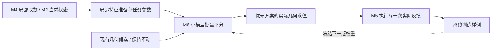

# M6 小模型与候选选择推进方案

日期：2026-11-14。负责人：当前 M6 对话 `01a1d986-24a4-73f1-9689-6845d1f01ef3`。

本线使用 `codex/m6-candidate-value`，代码基线为 `7d42bb939c7881a98fe322c10c216398f6c7aecc`。M4 主线继续由原规划/实施对话负责；本线独立准备专家算法、数据和验收，不改其冻结试验。

## 1. 决定做什么模型

用户对“jev”的解释是“类似于给选项如何给出答案”。按这个功能设计 **任务条件候选评分器**：给定局部状态、任务目标和若干修正选项，预测各选项的效果，选择值得实际求值的方案。这属于监督学习中的排序/价值预测；能量函数也是一种表达方式，不将这个词自动解释为 JEPA。

第一版采用现有 NumPy 运行基础上的小型 MLP，学习同一任务内的候选优劣。输入维度确定后再固定网络，首版规模目标不超过一万参数。小网络的目的，是省去昂贵的反复变形求值，或者学会廉价几何规则判断不了的任务偏好；参数少本身不是验收成果。

M6 的“记忆细胞”由训练得到的权重、归一化参数和对应问题族构成。实际场景缓存仍归 M2；执行循环仍归 M5。模型分数是预测值，实际修改结果来自既有回读。

## 2. 当前实现与未解决的问题

本次实际读取四份 M6 源码、AST 解析冻结权重、解压统计保存数据并核对散列；结果在 [BASELINE.json](../verification/m6_value_baseline_001/BASELINE.json)。四份源码与已审 M6 收口提交 `d01d49bc0ec82583b24a8faf22e622e6f6ea8c5d` 完全一致。本次没有重新训练、推理、启动 Blender 或运行模型消费对照。

| 当前部件 | 已有实现 | 对新路线的含义 |
| --- | --- | --- |
| `arm_twist_expert.py` / `arm_twist_weights.py` | 10 维特征、12 隐单元、145 个实际训练参数；输出截面异常严重度；静态准备和批量推理已优化 | 是诊断模型，尚无候选排序/修正预测头 |
| `arm_twist_source.py` | 同索引局部 patch、骨链、姿态、权重及截面从真实 Blender 来源进入专家；已有绑定和准备复用 | 复用此入口，不另建采集平台 |
| `arm_twist_correction.py` | 限定三骨同轴、截面相邻均匀权重域；中骨角度为 `clip(theta / 2, interval)` 的闭式解；`model_calls=0` | 这是几何已知最优解，不能靠在外面加神经网络创造收益 |
| M5 反馈链 | 有限姿态修改、实际回读和结果记录已经贯通；重复回读已做过一次优化 | 专家通过现有循环落地，不增加第二调度器 |

旧作者报告的保留集只有 **2 个资产、14 个姿态、350 个截面**，其中 4 个异常姿态、14 个阈值阳性截面。本次重新统计了这些分母。旧报告中，网络与几何方法的分类和定位均打平；真正异常的收缩量，直接几何更精确。总体 MAE 的改善主要来自“正常弯曲/合法小扭转不算缺陷”的标签定义。

旧根复核还记录：202 个阴性特征行与训练集相同到小数点后十位；当时没有同等静态准备的几何成本对照。以上是历史独立复核结论，本次未重跑特征或速度。已有网络实现成立，真实角色上的学习净收益仍待证明。

因此，问题首先在 **学习任务、候选空间、数据分布和完整成本**，目前没有证据说明应先增加网络容量。

## 3. 最短运行流程

1. 大模型提出目标和关注部位，M4/M2 提供必要局部状态。M6 不每步重新理解自然语言，也不扫描整个角色来评分一个关节。
2. 复用静态 rest、拓扑、权重和局部标架；一次准备当前状态。姿态或权重发生变化时更新相关特征。
3. 现有几何方法生成有限选项，包含“保持不动”。所有算法比较时消费同一组候选。
4. M6 一次批量评分，优先返回一个候选；需要第二个时使用已经算好的排序。候选生成、评分和必要求值在一次本地调用内完成。
5. 对真正选中的方案计算实际结果，M5 使用同一结果继续执行/反馈。调用失败、没有改进及多试一次的成本都计入完整任务。

接口只表达必要信息：局部状态引用、任务目标、候选参数 → 候选 ID/参数、排序分数、预测改善及采用的局部状态引用。诊断区域可沿用现有输出。无需为此增加通用模型注册服务、第二套状态账本或多轮审批。

### 评分模型的数学含义

令 `s` 为局部状态，`g` 为任务，`a_i` 为候选：

`score_i = fθ(features(s, g), parameters(a_i))`

按预测任务收益从高到低排序；也可以定义 `Eθ = -score`，选择能量最低者。评分值不直接称为成功概率。

同一状态只构造一次特征。候选侧使用姿态增量、允许调整的骨、影响范围等廉价量。**候选完整变形后的面积、碰撞、损伤和实际耗时是监督答案，不能先对所有候选算出这些答案，再把评分器耗时称为提速。** 已被精确求值的候选也不必再用网络决定其已知效果。

训练首先学习同一状态/任务内候选的相对优劣，允许多个同样好的答案。候选顺序、名称和序号不成为答案捷径。必要时增加结果回归头，但先证明排序本身有价值。

## 4. 模型选择顺序

| 阶段 | 方法 | 进入条件 |
| --- | --- | --- |
| 起点 | 闭式/直接几何、缓存后的廉价规则、简单线性评分 | 必须先有；与学习模型获得同样任务信息和静态准备 |
| 第一学习候选 | 小型任务条件 MLP，批量候选排序，使用已有 NumPy | 候选中有好解，但廉价选择会出错，或完整求值占据足够成本 |
| 有证据的替代候选 | 小型树排序模型 | 只有表格特征上的特定失败支持替换时再试；不同时启动模型搜索大赛 |
| 几何表征升级 | 局部点/网格编码器，加同一排序头 | 人工特征丢失了决定优劣的空间关系；先用最小反例证实 |
| 多专家共享 | 共享局部编码器，手臂/面部等独立任务头 | 至少两个专家分别证明收益，再检验共享是否省成本、是否互相干扰 |
| 时序模型 | 短历史条件评分或状态转移预测 | 例如动画滑步确实需要多帧推断，且有真实序列数据 |

原草稿提出的 60 万参数共享主干、五个 6 万参数头和 0.35 ms 时延保留为历史设想。它们没有被当前证据验证，也不是本轮必须实现的规格。先选任务和数据，再决定网络规模。

## 5. 专家族的推进顺序

**先继续手臂扭转。** 已有采集、诊断、几何修正和反馈，可直接定位学习能贡献什么。旧闭式三骨域作为控制项；新机会审计只研究“截面内权重不再均匀”这一项变化，保持其他几何和动作维度固定。该变化先在离线计算中研究，不修改现有产品准入来迎合测试。

后续候选按实际需求进入，每次只推进一种：

| 问题族 | 小模型可能学什么 | 必须补的数据/能力 |
| --- | --- | --- |
| 局部蒙皮/扭转 | 哪种有限姿态或修正参数能恢复形状，同时保留目标姿态 | 非均匀权重、未见资产、实际修正结果；先判断公式是否仍能廉价解决 |
| 面部异常凹陷 | 同一局部形状在表情/身份/目标不同情况下，应选哪种局部修正 | 正常眼窝/鼻孔/表情与新凹陷的对照、参考形状、真实修正偏好；单凭曲率符号不够 |
| 关节异常方向 | 多个可达姿态中哪一个符合角色和当前动作 | 角色关节语义、合法活动范围、连续姿态和修正结果 |
| 动画脚部滑移 | 当前接触阶段及何种时序修正更合适 | 多帧接触、合法滑行/蹬地对照、整段动画质量；不由静态任务推断通过 |
| 刚体装配 | 有多种近似方案时的任务偏好或试探顺序 | 若现有几何算子已经快而准确，保留几何即可，不强行设一个学习头 |

面部参考匹配、网格/权重写入、动画修改是后续各自的具体任务。M6 能打分不等于这些执行器已经完成。用户此前提供的 Yanyite 是潜在真实样本，当前未检验其骨架和截面是否适用，不能当作已经覆盖的角色。

## 6. 数据与答案怎么建立

一个训练单位是：**原始资产/绑定 + 当前姿态 + 任务目标 + 候选集合 + 每个候选的实际结果**。

- 首先看“候选里有没有完成任务的方案”。离线枚举得到的最优项只称为“候选集内最好”，不冒充整个动作空间的全局最优。
- 候选无好解时，改进候选生成或问题表达；候选有好解却选错时，才针对排序模型；选对却执行结果不同，则处理执行/状态链。这三类分开记录。
- 按原始资产、绑定和派生关系划分训练/验证/测试，再做姿态和扰动增强。同一资产的镜像、不同帧和合成变体留在同一侧。
- 分别列出未见权重、未见角度、未见拓扑和真实资产结果，避免用同一模板的很多截面代替独立角色。
- 正常弯曲、保持不动、多个等价答案、不可达目标和有意不对称都保留在任务中。直接几何基线获得同样任务意图，不能故意让它不知道“哪些变化允许”。
- 合成几何可提供结果标签，用来检验求值替代和速度。艺术效果、身份保持和表情是否合适，需要真实修正偏好；几何教师标签本身不能证明语义超越教师。
- 实际反馈进入离线数据；经过归组、核对和固定测试后才形成下一版权重。运行中不直接把一次成功回执当成训练标签热更新模型。

## 7. 按模块分段验收

| 阶段 | 交付 | 决定是否继续的证据 |
| --- | --- | --- |
| S0 现状核对（本批） | 本方案、首批任务、可复跑的源码/权重/数据索引 | 确认现有能力和真实分母；完成，不宣称新收益 |
| S1 学习机会审计 | 固定候选、同准备几何基线、候选覆盖率、成本分解 | 找到明确的选错或昂贵求值；公式已足够好则采用公式并收口 |
| S2 第一版排序模型 | 单一数据划分、冻结小网络、保存预测和完整成本 | 质量不下降且完整时间明显改善，或在预设成本内解决此前选错 |
| S3 一次实质优化 | 针对 S2 瓶颈的一项算法/表示/批量化修改 | 使用验证集改进，保留 S2 记录；最终测试集不参与调参 |
| S4 实际入口 | 同一权重/源码、真实局部来源、M5 反馈、原生任务对照 | 局部算法收益能够转化成完整任务收益 |

S2 即使首轮达标，也按用户要求实施一轮有依据的优化候选并作对照。优先消除重复特征/无用候选或改善表示；候选没有净改善就记录结果、保留初版，不为了保证采用而修改验收。S3 后固定成果，不开启无终点的第三、第四次微调。

### 质量指标

- 总任务完成率，包含无好候选和没有答案的任务；另列候选可解子集上的选择成功率。
- 候选集覆盖率、Top-1/Top-k 可行解命中、与候选内最好结果的差距。
- 正常形状误修、目标/保护区域变化、原目标遗漏；按资产分组，不只按截面平均。
- 诊断、候选遗漏、排序错误、实际求值错误、执行偏差各自的分母。

### 成本指标

`总成本 = 采集 + 准备 + 特征 + 候选生成 + 全部评分 + 实际求值 + 执行/回读 + 额外重试`

分别保存冷启动、热态单任务和多姿态复用结果。模型消费对照另计全部工具调用、输入/输出 token、消息往返和端到端时间。平台未提供的费用和 token 字段标记未测。离线训练成本单列，说明多少次任务可摊回，不混进每步推理，也不隐去。

新排序模型的初始工程目标是：**相同任务质量下，完整局部任务中位耗时至少下降 20%，昂贵候选求值次数至少减半**；同时列出 p95 和每个任务，不能用少数容易任务掩盖退化。这是未来要检验的目标，不是目前成绩，也不替代项目原有整机目标。

若目标是质量提升，S1 必须先记录几何基线的实际失败；在训练前确定可接受时间代价。不能看到速度没过后，再改口用一个无关分数当收益。

第一版及一次优化都没有净收益，就保留几何主路径，结束该假设。新的尝试需要新的失败证据或新的任务，不能只是扩大网络、换随机种子、放宽分母。

## 8. 工作流和并行边界

本对话负责 M6 的任务选择、实施与复核记录。每批固定一个问题、一份基线、一套评价；先产出可审查结果，再决定下一批。作者运行、历史复核、本轮实际复算分栏。

M4 正在运行的本机/模型正式对照期间，M6 可以并行读源码、设计特征、整理数据格式和写离线工具。Blender、CPU 性能对照和模型消费者试验错开，避免争抢机器后比较假耗时。M6 当前只改本工作树与本分支，合并按固定提交交接。

第一批已具体化为 [M6-CANDIDATE-VALUE-001](M6_CANDIDATE_VALUE_001_PLAN.md)。其出口是“是否值得训练、训练解决哪一种选择困难”，不是先承诺一定训练出一个更大的模型。

## 9. 依据

- 当前产品：`arm_twist_expert.py`、`arm_twist_weights.py`、`arm_twist_source.py`、`arm_twist_correction.py`；源码与旧报告散列见 BASELINE。
- 历史作者：`verification/m6_arm_expert_001/REPORT.md`、`run_01/result.json`；历史独立复核：`D:/hefe/verification/fixes/20261109_architecture_completion/` 下本次索引列出的七份文档。
- 用户旧草稿：`Human Eye V20 Oculo Cerebellar Microbrain Architecture Spec.md`，仅取五个专家问题族和小模型设想；其中参数量、零误判及延迟不是本次验证事实。
- [Learning to Rank，XGBoost 官方文档](https://xgboost.readthedocs.io/en/stable/tutorials/learning_to_rank.html)：候选按同一查询分组，学习相关程度/相对排序。这里借鉴任务形式，不要求引入该依赖。
- [Energy-Based Models，NYU / LeCun](https://cs.nyu.edu/~yann/research/ebm/index.html)：以标量能量比较输入/输出配置并选择低能量项。说明候选评分的另一种表达，不证明本项目会获得特定收益。
- [MeshGraphNets 原论文](https://arxiv.org/abs/2010.03409)：网格上的学习型模拟是后续表征研究参考，不作为角色修复已经有效的证据。

外部资料查阅日期：2026-11-14。
