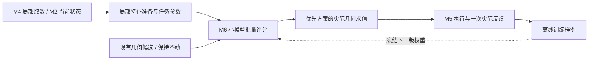

# M6 专家模型选型与推进分析

日期：2026-11-15（旧候选收口后，按用户最新要求重新筛选局部凹陷模型）。负责人：当前 M6 对话 `01a1d986-24a4-73f1-9689-6845d1f01ef3`。

本线使用 `codex/m6-candidate-value`，代码基线为 `7d42bb939c7881a98fe322c10c216398f6c7aecc`。M4 主线继续由原规划/实施对话负责；本线独立准备专家算法、数据和验收，不改其冻结试验。

## 1. 当前决定：先筛选，一个首选，必要时比较

用户明确更正：本阶段要求分析后续哪类模型更好，并未指定一定采用某一模型。前版直接确定 MLP、限制一万参数，并把 M6 固定为候选评分器，过早收窄了选型。这三个定案已撤回；经数据与任务筛选后，唯一局部凹陷候选已完成首版及一次优化，均经独立复核未达质量标准，当前候选关闭。

用户最新要求“下一步确实要筛选出处理局部凹陷的模型”。先前关闭的是自设计6290/6339参数候选，不能代表整个任务不可学。现按[重新筛选](M6_SHAPE_MODEL_RESELECTION.md)进入一个成熟基线：Pointfilter官方预训练权重，实际1360899参数，CPU加载与合成前向已过；[PRETRAIN001](M6_SHAPE_PRETRAIN_001_TASK.md)固定37例验证修复与正常保持，训练0，随后按结果决定一次领域训练或优化。当前不转蒙皮，不轮训全部候选。官方论文训练图包含Armadillo/Bunny外形，既有Armadillo只作迁移压力组，不称未见资产泛化。

“给选项如何给出答案”作为 **候选评分/排序** 路线参与比较。它是模型的任务输出，可以由树模型、MLP 或几何网络实现；能量学习是另一种训练/推断表达，不与这些架构互斥。M6 也可以学习异常区域、直接修正参数或形变结果，先由真实失败决定需要哪一种输出。

选型需依次明确：问题和输出 → 可取得的输入信息 → 独立资产与标签 → 模型结构 → 完整成本。参数量、是否使用 NumPy 和是否共享主干均在此之后确定；已有运行环境是成本因素，不是预选获胜架构的理由。

用户于 2026-11-14 进一步明确：先做优先判断，明显不适合的路线直接排除，不能把全部候选都训练一遍。当前流程因此改为**预判筛选 → 一个首选实现 → 必要验证**。下文模型目录用于分析，不是逐项训练清单。默认只有一个学习候选，与合理直接几何/插值基线比较；第二学习候选只有在一项会改变决策的关键不确定性不能通过已有证据或廉价探针解决时才进入。仍允许零候选，不预定网络结构。

M6 的“记忆细胞”由训练得到的权重、归一化参数和对应问题族构成。实际场景缓存仍归 M2；执行循环仍归 M5。模型分数是预测值，实际修改结果来自既有回读。

### 用户已确认的问题族路线

用户于 2026-11-14 确认按“问题族专门训练、按任务调用、共享计算、完整收益验收”推进。拆分依据是输入、异常机理和修正变量：同一类表面恢复覆盖多个部位与损坏幅度；需要骨架/权重或连续帧的任务分别建立专家。六类能力标签不固定为六个网络。

运行流程沿用：一次局部取数和准备 → 选择相关专家 → 共享实际几何求值 → 现有 M5 执行与反馈。先共享坐标、拓扑邻接、骨架与空间索引；首个学习模型独立训练。第二个任务确有相近输入和重复表示时，再判断共用编码器是否划算，不要求独立与共享两套架构都训练。任务、输入类型与已知依赖足以决定调用时，直接使用这些信息，不额外训练路由模型。

| 顺序 | 问题族 | 当前做法 |
| --- | --- | --- |
| 第一 | 局部凹陷、鼓包和形状失真 | 旧小网络及诊断已收口；新批PRETRAIN001筛选一个官方预训练成熟基线，先查质量，再决定领域训练与优化 |
| 第二 | 蒙皮扭转、关节体积损失 | 取得骨架、权重与姿态/修正配对后，选择骨架条件的参数或形变模型 |
| 后续 | 动画抖动、滑动、连续性 | 单帧能力与序列数据具备后，再进入短时序专家 |
| 按实际缺口 | 接触、间隙、支撑等空间关系 | 明确几何量继续直接求解；有修正生成或方案选择的真实困难时才立学习任务 |

多类问题关联时读取同一状态并共同评价，专家只提出方案，由现有执行入口统一处理；同一组变量的修正不各自执行一次。按真实依赖启用相关专家，任务成本包含路由遗漏、追加调用与反馈，不能只统计成功激活的专家。

M6-SHAPE-PAIRS-001 已完成独立复核，原七例和负结果保持。整区方法误改正常形状，真值定位诊断改善四例、恶化两例；定位与恢复先验都需要处理。由此将唯一首选候选收窄为局部网格消息传递残差网络，逐点预测修正、正常点目标为零。详见 [独立复核](M6_SHAPE_PAIRS_001_REVIEW.md)。

2026-11-15，[M6-SHAPE-DATA-001 已独立复核](M6_SHAPE_DATA_001_REVIEW.md)：33 个 patch、231 个正常/凹陷观察，四个角色上游未知，保留同组；1930 项独立数据核查通过。网络具体为宽24、12步共享消息传播、6290参数的局部向量残差模型，未训练方程检查通过。48 是上限，不为补数继续造重叠数据。

首轮 [M6-SHAPE-TRAIN-001](M6_SHAPE_TRAIN_001_REVIEW.md) 固定于9c29a9f，231训练、Armadillo117验证、Bunny156保留。一次1200步训练完成，独立复算1044个保存候选与六个真实前向。正常点门槛348/348失败；中心/偏心支持误差比0.8597/0.7778，宽域改善+4.07%/-25.10%，没有可部署修复收益。随后 [M6-SHAPE-OPT-001](M6_SHAPE_OPT_001_REVIEW.md) 在固定36694d0e完成：同数据/初态/预算追加49参数定位头与条件修正监督，验证117例全部no-op，4725受损点漏检；当前候选关闭，不发第三训练。首轮/本轮冷态配对差p95分别+2.193/+2.215秒（不含耦合），没有跨日同条件性能归因，完整成本未验收。Bunny保持未评分；两个扫描对象的有限几何结果不代表真实人物艺术验收。

## 2. 初始基线记录与未解决的问题

本次实际读取四份 M6 源码、AST 解析冻结权重、解压统计保存数据并核对散列；结果在 [BASELINE.json](../verification/m6_value_baseline_001/BASELINE.json)。四份源码与已审 M6 收口提交 `d01d49bc0ec82583b24a8faf22e622e6f6ea8c5d` 完全一致。本次没有重新训练、推理、启动 Blender 或运行模型消费对照。

| 当前部件 | 已有实现 | 对新路线的含义 |
| --- | --- | --- |
| `arm_twist_expert.py` / `arm_twist_weights.py` | 10 维特征、12 隐单元、145 个实际训练参数；输出截面异常严重度；静态准备和批量推理已优化 | 是诊断模型，尚无候选排序/修正预测头 |
| `arm_twist_source.py` | 同索引局部 patch、骨链、姿态、权重及截面从真实 Blender 来源进入专家；已有绑定和准备复用 | 复用此入口，不另建采集平台 |
| `arm_twist_correction.py` | 限定三骨同轴、截面相邻均匀权重域；中骨角度为 `clip(theta / 2, interval)` 的闭式解；`model_calls=0` | 这是几何已知最优解，不能靠在外面加神经网络创造收益 |
| M5 反馈链 | 有限姿态修改、实际回读和结果记录已经贯通；重复回读已做过一次优化 | 专家通过现有循环落地，不增加第二调度器 |

旧作者报告的保留集只有 **2 个资产、14 个姿态、350 个截面**，其中 4 个异常姿态、14 个阈值阳性截面。本次重新统计了这些分母。旧报告中，网络与几何方法的分类和定位均打平；真正异常的收缩量，直接几何更精确。总体 MAE 的改善主要来自“正常弯曲/合法小扭转不算缺陷”的标签定义。

旧根复核还记录：202 个阴性特征行与训练集相同到小数点后十位；当时没有同等静态准备的几何成本对照。以上是历史独立复核结论，本次未重跑特征或速度。已有网络实现成立，真实角色上的学习净收益仍待证明。

因此，问题首先在 **学习任务、候选空间、数据分布和完整成本**，目前没有证据说明应先增加网络容量。

## 3. 候选评分路线的运行流程（备选）

以下仅说明选择“候选评分”输出时怎样接入现有系统。若采用直接修正预测，模型输出修正参数后求值；若采用异常定位，输出区域供求解器处理。不要求所有专家都绕行候选排名。

1. 大模型提出目标和关注部位，M4/M2 提供必要局部状态。M6 不每步重新理解自然语言，也不扫描整个角色来评分一个关节。
2. 复用静态 rest、拓扑、权重和局部标架；一次准备当前状态。姿态或权重发生变化时更新相关特征。
3. 现有几何方法生成有限选项，包含“保持不动”。所有算法比较时消费同一组候选。
4. M6 一次批量评分，优先返回一个候选；需要第二个时使用已经算好的排序。候选生成、评分和必要求值在一次本地调用内完成。
5. 对真正选中的方案计算实际结果，M5 使用同一结果继续执行/反馈。调用失败、没有改进及多试一次的成本都计入完整任务。

接口只表达必要信息：局部状态引用、任务目标、候选参数 → 候选 ID/参数、排序分数、预测改善及采用的局部状态引用。诊断区域可沿用现有输出。无需为此增加通用模型注册服务、第二套状态账本或多轮审批。

### 评分模型的数学含义

令 `s` 为局部状态，`g` 为任务，`a_i` 为候选：

`score_i = fθ(features(s, g), parameters(a_i))`

按预测任务收益从高到低排序；也可以定义 `Eθ = -score`，选择能量最低者。评分值不直接称为成功概率。

同一状态只构造一次特征。候选侧使用姿态增量、允许调整的骨、影响范围等廉价量。**候选完整变形后的面积、碰撞、损伤和实际耗时是监督答案，不能先对所有候选算出这些答案，再把评分器耗时称为提速。** 已被精确求值的候选也不必再用网络决定其已知效果。

训练首先学习同一状态/任务内候选的相对优劣，允许多个同样好的答案。候选顺序、名称和序号不成为答案捷径。必要时增加结果回归头，但先证明排序本身有价值。

## 4. 各类模型的比较与有条件建议

下表为结合本项目输入与目标的工程判断，不是新基准的测量结果。直接几何仍作为同输入、同准备的对照。

| 候选 | 适合的输入和输出 | 值得比较的优势 | 主要代价/局限 |
| --- | --- | --- | --- |
| 梯度提升树，如 CatBoost / XGBoost | 已提取的角度、权重分布、曲率等表格特征；分类、回归、排名 | 适合作为现有结构化数据的有力基线；可直接处理非线性条件组合 | 不自动理解网格邻接；树规模影响运行成本；分段输出不适合所有连续优化需求 |
| 小型 MLP | 定长局部特征、任务条件；连续参数、残差或候选分数 | 批量计算方便；可选择平滑输出及可微结构；易接现有数值路径 | 输入丢掉的信息不能靠隐藏层补回；小数据下不预设优于树模型 |
| RBF / 姿态空间插值 + 修正形状基 | 固定角色/相近绑定的已知姿态和修正样例；预测低维修正系数 | 很适合“见过若干姿态，快速插值修正”的问题；应纳入简单强基线 | 依赖可对齐的形状/参数空间；单角色插值成绩不能冒充跨角色通用专家 |
| 局部点云网络，如 PointNet++ 类 | 局部坐标、法向和参考形状；区域、形状表示或任务输出 | 可直接学习局部几何，多种点数/采样下有研究基础 | 需构造邻域并处理采样；没有网格拓扑输入时，连接关系和近邻接触可能混淆 |
| 局部网格/图网络 | 顶点、边、参考位置、骨骼影响；局部诊断、形变残差或评分 | 直接利用拓扑和局部关系，值得优先研究手臂蒙皮、面部形变等跨资产专家 | 图构造和消息传递有成本；拓扑边不能独自表示跨表面接触；训练数据需覆盖真实变化 |
| 短时序模型，或几何编码器加时序头 | 多帧姿态、接触、运动；相位、漂移或后续状态 | 针对静态输入无法区分的动画问题 | 需要连续序列和整段评价，单帧凹陷任务未必获益 |

### 两种目标，应给出不同优先级

**对少量结构化特征数据**：先判断输出是分类/排名还是连续修正，结合样本量、批量调用方式和已有直接算法，选树模型或小型 MLP 中最合适的一条。两者均可成为首选，默认不同时训练。当前旧 11 个构造资产已由几何覆盖，尚无已证实的学习机会，因此本阶段不对这份数据新增树/MLP 训练。

**对“跨角色处理手臂扭转、面部凹陷”等长期目标**：有可靠局部拓扑且任务确实需要连接信息时，优先研究局部网格/图编码器，按任务接诊断、评分或低维修正头。真实信息以采样点为主、连接关系无法可靠取得时，再优先点云路线。先按实际表示筛选，不默认把两种网络都训练。当前这是结构适配判断，尚未选定本轮训练架构。

**对固定角色的快速修正**：有同索引姿态与修正配对时，先用姿态空间插值/修正形状基检验可得收益，再判断是否需要学习系数。无需默认加入图、点云和生成模型。需要区分固定角色适配与通用问题族，不能为了容易得分改变用户的目标。

### 本阶段的直接取舍

| 路线 | 当前处理 | 依据 |
| --- | --- | --- |
| 旧构造域再训练树、MLP 或更大网络 | 排除本轮训练 | 已有几何覆盖冻结答案，尚未建立新增质量/成本机会 |
| 六个独立模型每次全量并发 | 排除默认运行设计 | 任务只需要相关能力；先共享数据准备、按依赖调用，额外计算需具体用途 |
| 一个模型同时训练六类异常 | 暂不进入 | 尚无六类可比较监督，输入与目标差异明确，无法形成有效联合训练 |
| 时序模型、强化学习、多次采样生成/扩散、大语言模型承担局部数值循环 | 排除当前静态评价批 | 当前任务没有序列、长期策略或多解生成需求；没有对应收益假设 |
| 独立专家与共享编码器各训练一套作为必经步骤 | 取消必做要求 | 先看是否存在可共享表示与实际重复计算；数据准备复用可能已解决主要成本 |
| 局部网格/图表示或结构化小模型 | 保留条件首选方向 | 按实际任务与信息选择其中一条；当前耦合探针仍不训练模型 |

这些是本阶段的适用性决策，不是实测宣判某架构永久无效。新任务带来相应输入/目标时再判断，不自动恢复全部候选。

每次进入训练前只需一份简短选型结论：要学的输出、可用输入与监督、首选理由、已排除路线及理由、验证会改变哪个决定、成本和结束条件。先做能排除路线的廉价数据/信息探针。第二候选必须有独立的进入理由；第一候选失败后先判断数据/输入/目标问题，不能自动遍历目录换模型。

### 决定输出任务，而非只换网络

- 有完整候选但选错/全量求值昂贵：候选评分可能合适。
- 缺少可用修正：考虑直接参数/残差预测或改进候选生成；只做排名解决不了这个缺口。
- 判断局部是不是异常需要空间关系：先比较表征和诊断任务，不先固定排序头。
- 只有多步动作组合才有收益：再研究短时序价值/转移预测；强化学习属于学习控制策略的路线，不是必须采用的网络结构。
- 有大量未标注网格/序列：自监督表征预训练可作为研究方向，但仍需下游任务数据检验。
- 合理修正存在多种差异很大的答案：条件生成模型可以研究候选生成；扩散等多次采样的完整成本需要与直接回归/几何生成比较。
- 语言或原画意图是主要缺口：大模型/视觉模型可以提供任务条件或偏好；是否放入本地反复修正循环，需要单独证明质量和成本价值。

“评分/能量模型”“图网络”“强化学习”分别涉及输出/目标、网络结构、学习方式，不能作为互斥的同一层选择。共享编码器加多个专家头也属于组合架构，需在多个任务数据和收益可比较后决定，不能仅按模块数量设置五个头。

原草稿提出的 60 万参数共享主干、五个 6 万参数头和 0.35 ms 时延保留为历史设想。它们没有被当前证据验证，也不是本轮必须实现的规格。先选任务和数据，再决定网络规模。

## 5. 六类专家能力与推进顺序

**局部形状恢复是当前第一优先。** 用户已允许以未扰动参考制作异常副本，配对、首轮模型训练及直接对照已复核；首版与一次优化均未达到修复标准，当前候选已关闭；后续立项应先说明输入/监督或任务表达的新证据。手臂扭转已有采集、诊断、几何修正和反馈，保留为后续绑定问题的参考；旧闭式三骨域作为控制项。“截面内权重不再均匀”仍是可选机会探针，不因已经有文档就自动下发。

用户于 2026-11-14 确认按通用异常机理覆盖多数空间任务，并要求处理多类问题耦合。能力按下表六类组织，标签可共存；实际网络数量和共享方式仍待数据比较。每批推进一种明确缺口，同时验证它与已有能力的相关组合。

| 问题族 | 小模型可能学什么 | 必须补的数据/能力 |
| --- | --- | --- |
| 局部形状 | 面部凹陷、鼓包、局部拉伸/塌陷是否符合部位与任务，以及合理修正 | 正常与异常形状、参考和接受修正；身份/表情/有意造型上下文 |
| 绑定与蒙皮 | 扭转、关节体积丢失和权重影响异常的修正参数或形变 | 非均匀权重、未见资产、实际修正结果；先比较合理几何方法 |
| 姿态与关节 | 多个可达姿态中哪一个符合角色和当前动作 | 角色关节语义、活动范围、姿态与修正结果 |
| 接触与穿插 | 身体/衣物/对象接触下的合理局部修正 | 相关表面的关系、接触意图、实际几何评价与可接受修正 |
| 场景空间关系 | 支撑、容纳、对齐、间隙、通道和装配目标下的调整方案 | 对象关系、任务目标及整体效果；直接几何已快且准确时继续复用 |
| 时间连续性 | 滑动、抖动、翻转及接触跳变的连贯修正 | 连续帧和合法运动对照、整段质量；单帧结果不能替代时序验收 |

先推进局部形状/绑定蒙皮，再以真实需求进入姿态/接触和空间关系/时间。面部、手臂是样本入口，不是各自一个不可复用的模型。几何退化等能直接可靠计算的量继续由共享算子提供。

联合处理与组合验收以 [M6_COUPLED_EXPERT_CONTRACT.md](M6_COUPLED_EXPERT_CONTRACT.md) 为准：多标签发现、同状态方案、关联变量联合评价、既有 M5 单一执行入口，以及按真实影响范围回读。当前局部修正通过不能冒称全场景完成。该合同是后续实现要求，不表示六类能力已经实现。

面部参考匹配、网格/权重写入、动画修改是后续各自的具体任务。M6 能打分不等于这些执行器已经完成。Yanyite 已完成真实输入审计：当前保存资产是静态网格，没有 Armature、蒙皮权重、形态键或动画，不能直接用作绑定／时序专家的监督。现有 410 点空间选区只有工程定位，尚无被接受的修正形状。

截至 M6-COUPLED-PROBE-002 独立复核，局部形状与端态表面相交的联合评价、一次共享准备优化及退化配对范围修订已经完成，评价器探针收口。真实有限接触条件明确通过，缺少形状接受目标时联合状态仍为 unknown。随后完成 PAIRS001、DATA001与TRAIN001，淘汰整区重建、冻结231例训练数据并发现首个残差模型的质量缺口；正常参考只作为标签/评价答案。新扫描源native单位尚不兼容旧米制接触入口，完整接触未知；OPT001质量优化也失败，当前学习候选收口；不顺序训练六类专家或重复已知域拒绝。

## 6. 数据与答案怎么建立

数据先围绕任务建立。候选评分的训练单位是 **原始资产/绑定 + 当前姿态 + 任务目标 + 候选集合 + 每个候选的实际结果**；直接修正预测需要可接受修正或修正系数；诊断需要区域/类型标签；时序预测需要连续状态与动作。不能为了沿用旧数据而把所有模型都改成同一个评分任务。

- 首先看“候选里有没有完成任务的方案”。离线枚举得到的最优项只称为“候选集内最好”，不冒充整个动作空间的全局最优。
- 候选无好解时，改进候选生成或问题表达；候选有好解却选错时，才针对排序模型；选对却执行结果不同，则处理执行/状态链。这三类分开记录。
- 按原始资产、绑定和派生关系划分训练/验证/测试，再做姿态和扰动增强。同一资产的镜像、不同帧和合成变体留在同一侧。
- 分别列出未见权重、未见角度、未见拓扑和真实资产结果，避免用同一模板的很多截面代替独立角色。
- 正常弯曲、保持不动、多个等价答案、不可达目标和有意不对称都保留在任务中。直接几何基线获得同样任务意图，不能故意让它不知道“哪些变化允许”。
- 合成几何可提供结果标签，用来检验求值替代和速度。艺术效果、身份保持和表情是否合适，需要真实修正偏好；几何教师标签本身不能证明语义超越教师。
- 实际反馈进入离线数据；经过归组、核对和固定测试后才形成下一版权重。运行中不直接把一次成功回执当成训练标签热更新模型。

## 7. 按模块分段验收

| 阶段 | 交付 | 决定是否继续的证据 |
| --- | --- | --- |
| S0 现状核对（本批） | 本方案、首批任务、可复跑的源码/权重/数据索引 | 确认现有能力和真实分母；完成，不宣称新收益 |
| S1 任务与选型审计 | 代表性失败、输入信息、数据划分、同准备几何基线；给出最值得比较的至多两个学习候选 | 明确模型应学习的输出，候选是否具备信息和数据基础；不存在学习缺口就收口 |
| S2 首选模型验证 | 默认一个学习候选与合理直接基线；只有必要时增加第二候选，固定任务/资产划分/质量目标并保存完整成本 | 验证是否产生净收益，区分架构、输入表征和数据变化带来的效果 |
| S3 一次实质优化 | 针对 S2 瓶颈的一项算法/表示/批量化修改 | 使用验证集改进，保留 S2 记录；最终测试集不参与调参 |
| S4 实际入口 | 同一权重/源码、真实局部来源、M5 反馈、原生任务对照 | 局部算法收益能够转化成完整任务收益 |

S2 即使首轮达标，也按用户要求实施一轮有依据的优化候选并作对照。优先消除重复特征/无用候选或改善表示；候选没有净改善就记录结果、保留初版，不为了保证采用而修改验收。S3 后固定成果，不开启无终点的第三、第四次微调。

一次实质优化可以是复用准备、减少求值、改善表示或批量推理，不要求训练另一种架构。共享编码器训练只有在多个任务具备数据且其收益假设成立时才启动，不能为了完成对照表而训练。

### 质量指标

按所选输出使用对应指标；候选覆盖/排名仅适用于候选路线，不能替代诊断区域或直接修正质量。

- 总任务完成率，包含无好候选和没有答案的任务；另列候选可解子集上的选择成功率。
- 候选集覆盖率、Top-1/Top-k 可行解命中、与候选内最好结果的差距。
- 正常形状误修、目标/保护区域变化、原目标遗漏；按资产分组，不只按截面平均。
- 诊断、候选遗漏、排序错误、实际求值错误、执行偏差各自的分母。

### 成本指标

`总成本 = 采集 + 准备 + 特征 + 候选生成 + 全部评分 + 实际求值 + 执行/回读 + 额外重试`

分别保存冷启动、热态单任务和多姿态复用结果。模型消费对照另计全部工具调用、输入/输出 token、消息往返和端到端时间。平台未提供的费用和 token 字段标记未测。离线训练成本单列，说明多少次任务可摊回，不混进每步推理，也不隐去。

按用户最新确认，速度项目优先以**相同任务质量下，完整任务中位耗时至少下降 20%**为立项目标，同时列出 p95、冷启动与每个任务。若是候选评分路线，再判断昂贵求值次数是否至少减半。具体口径在试验前固定，不能把正在执行的正确性探针或一次非独占计时改称达标性能验收。质量提升项目按下面的质量目标和允许成本评定，不强制套用速度门。

若目标是质量提升，S1 必须先记录几何基线的实际失败；在训练前确定可接受时间代价。不能看到速度没过后，再改口用一个无关分数当收益。

下一项投入同时考虑任务出现频率、每次可获得的质量/时间收益、标签取得成本、训练成本、加载内存与维护成本。未知的使用频率与费用保留未知；同一计量口径下，用累计节省是否覆盖数据/训练投入判断能否摊回。先估计待替代部分在完整任务中的占比：该部分仅占 10% 时，单靠将其变成零耗时也最多节省 10%，需要质量机会或更大的成本目标才能继续。

七个配对已完成生成、目标与直接恢复方法核查：没有发现既定能量求解错误，主要是整区修复目标不匹配；真值定位后仍存在轻微损坏的恢复缺口。一个失败基线不能直接证明网络有收益；不因此扩展网络搜索。原方法已淘汰，先补来源分组、正常负例和训练合同，再进入唯一首选局部残差模型。

第一版及一次优化都没有净收益，就保留几何主路径，结束该假设。新的尝试需要新的失败证据或新的任务，不能只是扩大网络、换随机种子、放宽分母。

## 8. 工作流和并行边界

本对话负责 M6 的任务选择、实施与复核记录。每批固定一个问题、一份基线、一套评价；先产出可审查结果，再决定下一批。作者运行、历史复核、本轮实际复算分栏。

M4 正在运行的本机/模型正式对照期间，M6 可以并行读源码、设计特征、整理数据格式和写离线工具。Blender、CPU 性能对照和模型消费者试验错开，避免争抢机器后比较假耗时。M6 当前只改本工作树与本分支，合并按固定提交交接。

旧局部凹陷候选已在 [OPT001复核](M6_SHAPE_OPT_001_REVIEW.md) 关闭。[OBSERVE001复核](M6_SHAPE_OBSERVE_001_REVIEW.md) 确认两个描述筛选均失败，不能据此宣称完整输入无效。[TASK001复核](M6_SHAPE_TASK_001_REVIEW.md) 接受已有直接参考恢复与本轮不训练结论，同时澄清：真实艺术验收缺少认可目标，不等于合成恢复研究没有监督答案。[OBJECTIVE001复核](M6_SHAPE_OBJECTIVE_001_REVIEW.md) 已独立复算306标签、六见证四旧输出的18432方向查询及原质量判定；最佳方法集合不变，关闭对旧输出换指标便能挽救当前候选的解释，未来不同损失训练效果仍未测。旧候选及其诊断跟进保持收口，不做其第三训练。最新PRETRAIN001另以已核查官方源、公开预训练先验和完整邻域输入建立成熟基线；不把模型扩容本身当作成功依据。M6整体尚未完成、无新增学习模型通过收益验收，骨架条件问题族暂不启动。Bunny保持未评分且不自动充当新预训练候选的未见资产测试。[M6-CANDIDATE-VALUE-001](M6_CANDIDATE_VALUE_001_PLAN.md) 仍只是备选探针，未自动派发。

## 9. 依据

- 当前产品：`arm_twist_expert.py`、`arm_twist_weights.py`、`arm_twist_source.py`、`arm_twist_correction.py`；源码与旧报告散列见 BASELINE。
- 历史作者：`verification/m6_arm_expert_001/REPORT.md`、`run_01/result.json`；历史独立复核：`D:/hefe/verification/fixes/20261109_architecture_completion/` 下本次索引列出的七份文档。
- 用户旧草稿：`Human Eye V20 Oculo Cerebellar Microbrain Architecture Spec.md`，仅取五个专家问题族和小模型设想；其中参数量、零误判及延迟不是本次验证事实。
- [Learning to Rank，XGBoost 官方文档](https://xgboost.readthedocs.io/en/stable/tutorials/learning_to_rank.html)：候选按同一查询分组，学习相关程度/相对排序。这里借鉴任务形式，不要求引入该依赖。
- [Energy-Based Models，NYU / LeCun](https://cs.nyu.edu/~yann/research/ebm/index.html)：以标量能量比较输入/输出配置并选择低能量项。说明候选评分的另一种表达，不证明本项目会获得特定收益。
- [MeshGraphNets 原论文](https://arxiv.org/abs/2010.03409)：网格上的学习型模拟是后续表征研究参考，不作为角色修复已经有效的证据。
- [树模型与深度学习的表格数据比较](https://arxiv.org/abs/2207.08815)：说明树模型值得与神经网络公平比较；研究中的数据规模和分布不能直接外推到本项目。
- [PointNet++ 原论文](https://arxiv.org/abs/1706.02413)：分层学习点集的局部结构，是点云路线的依据。
- [Pose Space Deformation 原论文](https://www.cs.toronto.edu/~jacobson/seminar/lewis-et-al-2000.pdf)：从姿态参数到局部形变的样例插值，是固定角色基线的参考。
- [Neural Blend Shapes 作者项目页](https://peizhuoli.github.io/neural-blend-shapes/)：形状基与姿态条件混合系数的学习提供另一种修正表示；不据此承诺在本资产或硬件上的效果。

外部资料查阅日期：2026-11-14。
