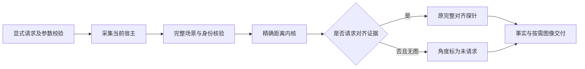

# 按需距离与对齐证据

```json
{
  "focal_id": "current_focal_full_id",
  "reference_id": "current_reference_full_id",
  "include_image": false,
  "query": {"mode": "top1", "alignment_evidence": false},
  "response_detail": "brief"
}
```

示例ID须替换为当前捕获返回的完整身份。可使用原overview、exact_pairs、nearest或新top1；此选项不重绑定对象、扩大支持域或授权动作。

| 请求 | 图像 | 观察中的对齐探针 |
| --- | --- | --- |
| 省略新参数 | 保留原生PNG | 保留原完整计算 |
| include_image=false | 不渲染或交付图片 | 仍保留完整计算 |
| include_image=false且alignment_evidence=false | 不渲染或交付图片 | 省略可选面法线／切向对齐探针 |
| 有图且alignment_evidence=false | 捕获前拒绝 | 不静默回退或伪造角度 |

每次服务／MCP请求仍采集当前宿主，不以缓存代替fresh捕获。纯距离路径复用未改变的完整网格精确内核，保留数值、符号、穿透方法范围、未知、身份、单位和宿主rigid_frame；宿主姿态认证与面特征对齐是不同证据。

纯距离有效性由strict内核独立判定。面特征对齐未计算或无效，不单独否定已成立的strict距离；有效距离也不赋予角度、面控制标架或动作有效性。原几何内核不支持或不能数值核实时继续未知。

纯距离measurement中，axes_valid、axes_check、contact_normal_angle_deg、tangent_yaw_mismatch_deg和control_frame_trustworthy为null；alignment_evidence.status为not_requested，reason为explicit_distance_only_observation。null表示未请求，不能解释为对齐、零度或实测失败。精确内核没有凸体表面witness时point_a/b为null；已有孔槽内核返回的原始表面witness继续保留，不编造锚点。

完整与纯距离pair缓存使用不同参数／算法版本；整观察key也包含query、图像选项及新合同revision。返回完整证据时不能复用缺少角度的缓存。full／brief均保留该事实与所有未知项，原native图片默认交付保持。

明确角度goal仍由目标核验独立计算所需角度，失败或未知不能算目标达成。观察选项不传递为动作豁免：动作前完整fresh标架／几何检查、候选全场碰撞检查、提交版本门及动作后实际回读均保留。


