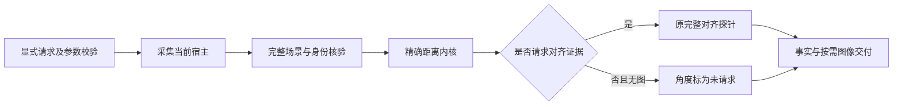

# 按需距离与对齐证据

2026-10-28 当前聊天重载验收：已实际载入 v19／9.7.2+20261028.support.discovery.r1（a0198acc…／installed_distribution／68 文件），状态健康、目标账本 0，旧配置快照拒绝已解除。当前 MCP 完整发现唯一支撑面，实测间隙仍为 3.1304261516453477 毫米；回填完整 selector 的 1 毫米目标预览只返回单步限幅候选，未移动。人为改错客户端 revision 的预览被拒绝并要求重新观察；没有实际编辑宿主来制造这条负例。独立 Fraction 真值、768×768 原生 PNG 和全 14 Scene 不变均已核对。

真实用户三维回复已在模型该轮工具调用前触发 v19 UserPromptSubmit，自动交付完整几何文字；五组定义保留。本轮还核对了 clearance_segment 预览的 PreToolUse／PostToolUse 去重，不能当作 execute:true 的动作链或 transform 各事件已通过。自动原生图片仍未证明，Hook 为 text_only。先前独立安装私有场景的 12 次移动是另一阶段证据，本聊天本轮零移动。

只读安装 SDK 边界矩阵 12 组／28 次调用／277 项检查通过；凹体、开放 reference、穿透／接触和有限面外一 ULP 明确 unsupported，几何／有理复杂度和过长 revision 返回 unknown，不放宽门。真实多候选截断未覆盖。下一单点候选先检查审计日志大字节／少行时重复整写和轮转，再考虑纯距离观察的对齐按需；两项均未实现，成本对照仍 pending。既有 27.84%—36.71% 文本字节减少不等于端到端或模型提速。工程构建可继续有限验收，整体公开发布门仍为 false。

[当前重载阶段](../verification/fixes/20261028_v19_reload/REPORT.md)、[当前量测与预览核对](../verification/fixes/20261028_v19_reload/CURRENT_VALIDATION.json)、[真实用户文字 Hook 审查](../verification/fixes/20261028_v19_reload/REAL_USER_HOOK_REVIEW.md)、[只读边界矩阵](../verification/fixes/20261028_v19_reload/MATRIX_REVIEW.md)。接口继续见 [精简支撑面发现](SUPPORT_PLANE_DISCOVERY.md)。

本轮无图支撑面发现显式使用 alignment_evidence:false，原生 PNG 另有实际交付；默认图片与可选对齐合同保持。Hook 的自动文字和手工原生图片必须分开统计。

以下保留此前阶段记录，尤其 v19_activation 的待重启状态仅表示当时阶段；当前状态以上文和本轮重载报告为准。

2026-10-28 最新状态：v19 工程构建 9.7.2+20261028.support.discovery.r1（a0198acc…／68 文件）已离线安装并完成磁盘激活，新注册进程实际验收通过。当前聊天仍为 v16 旧配置快照，返回 stale_configuration_snapshot，需重启后核验；真实新用户 Hook 未通过本版验收。四文件迁移保留五组 Hook、Agent Learning 当前配置与状态，state 仅改配置绑定；磁盘激活不等于宿主信任或当前聊天重载。

显式 query.support_plane_discovery 已实现当前对象对的精简发现，完整 selector 可回填有界执行段。四模板文本字节中位减少 27.8448%—36.7095%，本地服务仍增加约 1.8—8.0 毫秒，不宣称模型或端到端提速；默认 PNG 保持。接口与边界见 [精简支撑面发现](SUPPORT_PLANE_DISCOVERY.md)，[新注册入口结果](../verification/fixes/20261028_v19_activation/REGISTERED_ENTRY_RESULT.json)和[配置保留结果](../verification/fixes/20261028_v19_activation/activation/PRESERVATION.json)。

无图／可选对齐证据合同保留；精简支撑面发现须显式 opt-in。下方 v16 当前聊天通过属于历史，v19 当前聊天需重启后另验。

以下为此前阶段记录，保留当时版本、命令及验收边界；当前状态以上文及精简支撑面发现说明为准。

2026-10-28。稳定安装与当前聊天均已核验为 `9.7.2+20261028.query.evidence.r1`（v16／e06beb38…／66文件），旧配置快照错误已消失。当前MCP的top1、无图可选对齐及原生PNG通过；真实三维用户消息也已在模型首次回复／工具调用前触发自动文字量测：BluePart／GreyBase当前最小间隙3.130426毫米，fresh捕获、未移动，已有1°倾斜保留。泛化“继续”按规则跳过。五组钩子定义与Agent Learning配置保留；不据此推断其余动作钩子和各类Agent已全部验收。见[重载与非双箱实测](../verification/fixes/20261028_v16_reload/REPORT.md)；安装迁移历史见[前轮](../verification/fixes/20261028_v16_activation/REPORT.md)。

下列源码阶段的版本状态保留为历史；新参数现已在安装版和当前聊天实际MCP通过，下述接口合同继续适用。

2026-10-28。v16源码候选已验证；稳定安装与当前聊天仍为v14。以下新增参数用于候选SDK／后续验收安装，当前v14的MCP schema尚不接受。

```json
{
  "focal_id": "current_focal_full_id",
  "reference_id": "current_reference_full_id",
  "include_image": false,
  "query": {"mode": "top1", "alignment_evidence": false},
  "response_detail": "brief"
}
```

示例ID须替换为当前捕获返回的完整身份。可使用原overview、exact_pairs、nearest或新top1；此选项不重绑定对象、扩大支持域或授权动作。

| 请求 | 图像 | 观察中的对齐探针 |
| --- | --- | --- |
| 省略新参数 | 保留原生PNG | 保留原完整计算 |
| include_image=false | 不渲染或交付图片 | 仍保留完整计算 |
| include_image=false且alignment_evidence=false | 不渲染或交付图片 | 省略可选面法线／切向对齐探针 |
| 有图且alignment_evidence=false | 捕获前拒绝 | 不静默回退或伪造角度 |

每次服务／MCP请求仍采集当前宿主，不以缓存代替fresh捕获。纯距离路径复用未改变的完整网格精确内核，保留数值、符号、穿透方法范围、未知、身份、单位和宿主rigid_frame；宿主姿态认证与面特征对齐是不同证据。

纯距离有效性由strict内核独立判定。面特征对齐未计算或无效，不单独否定已成立的strict距离；有效距离也不赋予角度、面控制标架或动作有效性。原几何内核不支持或不能数值核实时继续未知。

纯距离measurement中，axes_valid、axes_check、contact_normal_angle_deg、tangent_yaw_mismatch_deg和control_frame_trustworthy为null；alignment_evidence.status为not_requested，reason为explicit_distance_only_observation。null表示未请求，不能解释为对齐、零度或实测失败。精确内核没有凸体表面witness时point_a/b为null；已有孔槽内核返回的原始表面witness继续保留，不编造锚点。

完整与纯距离pair缓存使用不同参数／算法版本；整观察key也包含query、图像选项及新合同revision。返回完整证据时不能复用缺少角度的缓存。full／brief均保留该事实与所有未知项，原native图片默认交付保持。

明确角度goal仍由目标核验独立计算所需角度，失败或未知不能算目标达成。观察选项不传递为动作豁免：动作前完整fresh标架／几何检查、候选全场碰撞检查、提交版本门及动作后实际回读均保留。



固定352次本地无图SDK对照中，纯距离密集12对象P50下降39.6%、单对象对下降23.1%；8格原成本门及目标收益门通过。它不代表Blender通信或模型整任务收益。当前真实窗口另行只读核验为默认2米Cube、768×768图像，前后几何与选择状态一致；该单网格总览不是对象对或v16真实入口验收。

详见[候选及真实窗口验收](../verification/fixes/20261028_optional_alignment/REPORT.md)；top1合同见[显式最近对象查询](TOP1_QUERY.md)。
