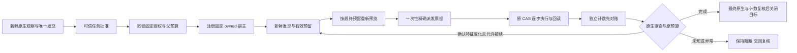

当前为源码候选，未安装到当前聊天，也未新增默认自动动作 MCP 接口。入口为可信嵌入方的 `OwnedGoalScheduler(config_path, host, authority).run(ClearanceTaskSpec(...))`；固定无 UI 后台 typed Blender worker 是当前唯一支持的自动任务宿主。共享窗口与自定义 worker 不能声明相同覆盖能力。

一个稳定的已认证任务事件只能对应一个父目标。嵌入方的 `TrustedTaskAuthority` 回调必须验证目标、原对象身份、原支撑三角形、引擎 build、进程与时钟域，并返回明确的 `TaskApproval`。模型 JSON、观察资格和历史授权记录都不能签发动作权限。Python capability 是可信同进程代码边界，不是对任意 Python 的沙箱或远程证明。

授权索引与父子账本共用原 connector 的锁、原子保存与持久化级别。首次授权固定总预算及开始/截止时间；注册、复审和接续消耗原窗口。同事件的重复请求只返回历史或复核要求，重启与换 ID 不自动重开预算。完成记录只证明记录结束时的目标，不证明后续场景仍保持该状态。

首次执行前的场景须与授权原始证据相同，发现的 revision/fingerprint 须对应同一观察；后续观察须等于上一段已核验场景。原支撑三角形、目标及角色不能随发现而改变。审查使用完整原生 local mesh/pose 与双捕获夹持，仍不宣称原子快照或可发现外部 ABA 编辑。

每个子段先持久预留，再按最终收紧后的请求预览。一次性派发票据精确绑定该请求；已知回执先作独立物理对账，再核验原生终态与接续资格。初始已满足允许零 setter 完成，须有真实零步子回执、独立零计数及最终原生核验，不能伪造移动以满足审查。

只有父账本按时完成、没有未决写入、最终原生证据与上次核验一致、全部计数和路径相符，才能关闭注册目标并提交成功。关闭目标保留 worker 进程及场景，允许另一个明确授权任务；受管理的宿主即使处于空闲或新任务注册窗口，也拒绝缺少授权截止 token 的普通写入。关闭不等于数据刷新到物理磁盘。

未知回执、外部变化、预算停止、计数不一致、到期与关闭回执丢失均不会自动释放目标、重发动作或重开预算。原生 evidence/计数不足时保守停止。显式结束 owned 进程用于资源回收，不清除持久阻断。

当前几何范围仍为有限独立静态箱体、已证明原支撑三角形及世界 Z 平移。早期1→1.5毫米的rounded contact-feature拒绝作为历史证据保留；最新S2候选通过最多4个严格向内的只读提案逐一重证原支撑集合，不放宽原检查，真实新授权一写达到约1.500005毫米。原4→1毫米任务现在一段4写。任务前进额度还须保留原总预算内的回滚槽和返回路径，额度不足在apply前明确停止；已满足目标仍可零写完成。最终释放使用注册时冻结的完整host binding/PID/coverage和物理事实复验。详见[边界与监督合同](ROUNDED_FEATURE_BOUNDARY_CONTRACT.md)。没有通用旋转、扫掠路径或复杂装配保证。真实模型对照试次仍为0，工程验证不能代替模型收益对照。

证据与失败保留：[本轮阶段](../verification/fixes/20261030_v21_goal_scheduler/)。
