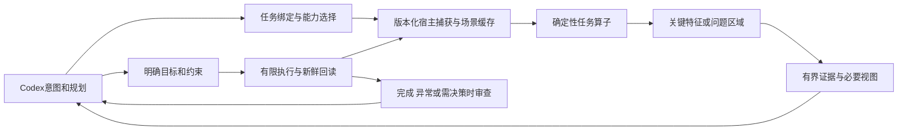

# Human Eye 总体交付路线

更新：2026-10-31。此文件是当前推进顺序的唯一主计划；PROGRESS记录已交付状态，旧路线图和专项方案保留历史与技术细节。提出需求不等于改变优先级。技术负责人负责方案选择、依赖排序、验收和取舍。

## 产品目标与当前判断

Human Eye 的目标是让Codex用更少、与任务更相关的三维证据完成判断与编辑：引擎承担结构化感知、问题定位、按需观察、空间状态和有限局部控制；Codex承担意图、全局规划和必要审查。MCP／Hook是接入层。近期只面向Codex和Blender，其他Agent接入按用户指示暂停。

主链为 **任务→新鲜场景→相关几何／缺陷证据→关键局部观察→Codex判断／规划→受约束执行→实际回读**。人眼式聚焦的作用是锁定关键问题、节约输入；受控“小脑”的作用是减少无必要的模型逐步计算与往返。两者都必须对具体任务证明价值。

当前22fb／78源正式版已完成有限静态刚体、间隙量测、观察缓存、部分任务聚焦及原生图交付；受控owned worker的有限纠偏与多段接续已有工程证据。尚未证明通用模型收益、共享MCP完整自主任务通道或角色模型修复。主瓶颈是任务相关证据和Codex实际消费的整条链，增加单点算子不能自动解决它。

凹陷、裂口、骨骼异常、蒙皮坍缩是明确的目标场景族。它们需要不同数据与判断依据；现有曲率或闭合实体检查不能冒认为这些功能已经完成，也不应因此马上同时建设四套完整专业系统。

## 架构边界

共同部分是身份／版本、任务相关性、空间位置、证据充分度、可见性、预算和回读。专项算子提供间隙、表面变化、拓扑、骨骼或蒙皮证据。沿现有内核增量抽取共性，先用两个任务验证，不先重写全引擎或预建所有未来协议。

普通求值网格读取、原始拓扑、参考模型、骨骼pose和权重是不同来源；按当前里程碑取需要的数据。诊断可用不产生编辑权限，观察缓存不放行动作，未知不能变成正常或成功。新专业域需要独立的只读和修改能力，不能通过放松旧刚体限制接入。

## 里程碑与阶段出口

| 阶段 | 核心交付与理由 | 进入下一阶段的证据 |
| --- | --- | --- |
| M0 基线与方向收口 | 已完成固定22fb交付；本轮统一路线。后续只修阻碍主线的底座问题 | 版本／当前状态清楚、原有量测与动作语义保持；计划不再与历史报告混称 |
| **M1 Codex任务证据闭环（当前唯一功能主线）** | 根据任务定位关键特征并输出有界证据。既有间隙任务作回归锚点，新增一个“只读网格问题定位”任务作扩展样本 | 真实Codex任务→路由→新鲜证据→相关局部→可用判断贯通；正常负例、遮挡、过期与超预算分别核验；不靠根代理手工补算伪装自动完成 |
| M2 有限任务价值验证 | 固定同任务和合理原生工具基线，验证人眼式输入处理实际有用。工程门和模型门分开 | 在不损害必要正确性的条件下，至少证明输入减少或任务质量提高；完整成本及各场景退化有记录。正式模型试验须先绑定模型／提示／usage／费用／匿名评分，未绑定不算完成 |
| M3 扩展可执行任务域 | 先收口Codex上已有有限刚体目标执行，再扩展有参考状态的局部曲面变化和受限修复 | 每个新域先定位再修改；新鲜证据、修改范围、预算、回读和异常停止成立；同拓扑顶点修改与拓扑变更分开，不一次开放任意修复 |
| M4 骨骼与蒙皮专业域 | 读取rest／pose／权重和对应关系，区分姿态错误、坍缩、自相交和正常褶皱，再接受限操作 | 角色约束、正常负例、缺失参考、镜像／奇异情况与独立真值覆盖；缺陷定位与修改效果分别验收 |
| 条件性研究 | GPU算子调度、学习型先验、模型内融合 | GPU以端到端热点／搬运成本为依据；学习以可靠轨迹和影子收益为依据。其它Agent接入继续暂停，未经用户改变范围不自动恢复 |

M1／M2的有限试验不是全部架构完成或普遍收益发布；用途是及时检验主线，避免把所有专项算法做完后才发现输入与实际任务脱节。模型试验尚未具备条件时，可继续工程定位和预算门，不伪造模型效果，也不无限增加无关功能。

## 当前批次：M1 的具体范围

1. **任务与证据绑定。** 明确调用者要查什么、对象／场景版本、关键几何区域及证据不足原因。复用现有V2任务特征和身份机制；旧V1／V2／V3合同保持。
2. **首个新增领域：静态原始网格的只读完整性定位。** 输出边界簇、非流形／退化等可核验结构事实及其位置。合法开口与参考信息参与是否为损伤的判断；没有意图依据时只报候选，不把嘴口／袖口直接判裂缝。选择此域是因为事实可验证、定位结果可驱动共同聚焦，且不依赖完整角色骨骼与权重或新写入通道。
3. **以问题区域驱动视图与输出。** 检查“物体中心可见但问题不可见”“问题中心被挡而关键边缘可见”。保留有限全局上下文，按需提供有界patch／指标／图片。每次原生观察最多两张384平方、原期限及预算继续保持；不以强制增图获取表面收益。
4. **从开发阶段就走Codex接入。** 做出第一个可用只读样本即验证真实消费，不按“先做完凹陷、裂口、骨骼、蒙皮再接Codex”的顺序等待。真实用户消息入口单独核验，脚本模拟不能代替；相关开发可以继续，不反复要求相同消息作为所有阶段的出口。

本批不交付自动焊接／补洞、自由雕刻、骨骼极向量翻转、蒙皮权重修改或学习型小脑。已有受控刚体功能继续可用。下一批由本批实际失败和依赖决定，不因新名词出现就扩大本批范围。

## 验收与收益规则

- **质量优先**：结构事实、位置、精度、范围、unknown及正常负例可独立核验。图片放大、中心可见、检测到边界与任务成功分别计量。
- **输入成本**：同任务／同证据充分度比较实际文本UTF8、PNG、交付图数和按需回查次数；模型token与账单只有实际计量才报告。完整原始几何在引擎内保留，省略与截断显式标记。
- **完整耗时**：包括捕获、扫描、缓存、筛查、渲染、传输、Codex往返、执行和审查。简单场景与困难场景分组，不用大场景平均收益掩盖小场景退化。
- **阈值预先登记**：先固定任务、支持域及基线，在修改与观察候选结果之前冻结质量、输入和成本门。依据具体链路设门，不把旧planner的毫秒门直接当整任务门，不事后放宽拿通过。
- **场景成批验证**：按形状／拓扑／遮挡／尺度／复杂度自动生成和搜索边界，按共同原因归类，只人工复核代表样本。52条专项配方仍是待选规格，不是52项已过测试或全部近期必做项。
- **退出而非无限打磨**：一批过门就转向下一依赖；未过门则修一次明确根因并保留失败。不能在同一无收益方案上不断调整指标。接口／预算／加载稳定后，重复打包重启和日志微优化退出主线。

## 需求与优先级决策

每个新需求先登记用户目标、受影响任务、共性依赖、当前证据、成本／风险和验收方式。由技术负责人决定复用、纳入当前批、排入后续、研究或不采纳，并说明理由。仅当它改变产品目标、暴露当前主线阻断或出现新的收益证据时才调整主顺序；语义澄清本身不等于插队。

近期工作同时只保留一个核心功能交付；必要回归／维护服务于它。每轮汇报说明当前里程碑、本批完成内容、剩余阻断、是否过门和下一步依据，不把单测数、打包数或文档数量当产品进度。工程负责人承担选择和排序，用户提供需求、目标与约束。

当前状态与有限收益见 [PROGRESS](PROGRESS.md)，现有视觉支持域见 [间隙合同](TASK_GAP_NATIVE_CONTRACT.md) 和 [高顶点合同](DENSE_FOCUS_NATIVE_CONTRACT.md)。历史专项路线是技术输入，不再单独决定总推进顺序。
