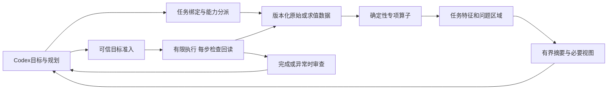

# Human Eye 唯一主计划

更新：2026-11-01，M1-04有限候选功能收口：显式登记、连续任务、精确文字简报及当前Codex手动读取成立；15个程序化代表场景已测。下一项转M1-05的固定候选、质量兼容、数值成本门和安装验收。M1-02旧规模成本失败、真实消息自动入口及完整发布门仍保留。**只有本文件决定当前任务与后续顺序。** [架构分析](ARCHITECTURE_ANALYSIS.md)解释设计依据，[PROGRESS](PROGRESS.md)记录实际交付，接口合同规定支持域；旧路线、专项方案和封存报告只保存历史。提出需求不自动改变排期，技术负责人负责选择、依赖、验收和取舍。

## 一、目标、范围和完成的含义

产品目标：让Codex以更少、可核验且与任务相关的三维证据完成判断和受控编辑。引擎负责几何事实、问题定位、局部观察、场景暂存和有限数值控制；Codex负责语义目标、全局规划、意图判断及必要审查。近期仅面向**Codex＋Blender**，其他Agent接入暂停。

预期特殊价值有三项，须分别证明：

1. 提供普通图像难以给出的源网格尺寸、拓扑及局部变化事实，并准确说明精度、范围和未知。
2. 锁定任务关键区域，减少无用数据和回查，保留必要上下文；图片放大不是任务成功的替代指标。
3. 在明确目标和约束内本地求解、执行、纠偏，减少模型逐步算数与往返；每步检查和真实回读保留。

“完成基础框架”“有限域工程发布”“Codex可用任务”“模型实际收益”“通用复杂资产支持”分别记录。没有一个总百分比能代表它们。通用学习小脑、替换模型视觉编码器和任意资产自动修复不作为近期完成定义。

## 二、已冻结基线与当前瓶颈

正式版：9.7.2+20261031.dense.focus.r1，78运行源、87固定发布文件，build为22fb2523bdbfb68d6e7227ea3df3b4373daa1a76461344bc1755406c5feeec8a。固定MCP、配置新进程和当前聊天身份已核验；本轮分析没有更换安装，也不需要为此重启。

已有有限静态刚体量测、缓存、任务短标、V1/V2/V3原生观察，以及owned worker有限目标执行证据。尚无完整默认Codex自主任务入口、通用缺陷定位或正式模型收益证明，正式模型试次仍为0。

当前候选已形成**任务→正确来源→关键特征→有限证据→手动Codex消费**：原多边形/松散边、九类结构事实、来源位置、patch引用、有限原生图及跨调用预算具备。新非盒体代表场景说明文字域比图片域宽，非平面边界尚不支持局部自然图。当前优先收口固定版本、成本和安装，而不是继续增加简报/账本功能；默认自动任务、复杂资产视觉和模型收益仍须各自证明。小脑和严格流形检查已有可复用实现，不能据缺少产品入口就从零重建算法。

## 三、融合架构决策

- **增量改模块，不整体重写。** 沿LiveSpatialService和既有宿主边界增加任务分派；先用间隙和单对象结构诊断验证共性，避免给所有未来功能预建大平台。
- **读取、诊断、取景、执行分别准入。** 坏网格可以有只读诊断资格，不能因它不满足闭合刚体条件就一概不报告；反过来诊断可读不赋予编辑资格。旧刚体/V1/V2/V3合同保持。
- **原始事实与派生解释分开。** 原始多边形、松散边、索引映射和raw/evaluated来源明确；边界事实、损伤语义、图片自然可见性各自有证据。未知和省略不变成“正常”。
- **共用最小语义。** 任务、来源快照、证据、patch引用、视图和动作回执分别表达；现有task_context仍只是计量关联，不赋予它新的权限含义。
- **本地快环与Codex审查环分开。** 确定性小步求解不每次调用模型；完成、停滞、特征切换、外部编辑、数值不可达、预算或未知触发审查。
- **缓存与账本分开。** 观察派生结果可淘汰，未决动作和原预算不可清空。编辑世代、二进制传输、GPU和学习只在实测依赖成立时引入。

完整模块清单、调用链、缺陷算法可行性与备选方案见[架构分析](ARCHITECTURE_ANALYSIS.md)。本文以下是唯一任务队列。

## 四、总顺序、依赖和阶段出口

| 阶段 | 状态及交付 | 依赖和退出条件 |
| --- | --- | --- |
| M0 基线与治理收口 | **已完成**：22fb基线、唯一路线、架构审查；无新增功能 | 当前版本、历史证据、支持域和执行边界可追溯 |
| **M1 任务证据闭环** | **当前唯一功能主线，新增部分待实现**：既有间隙作回归锚点，新增单对象原始网格结构问题定位，贯通patch观察和Codex | 下表M1-01至M1-05完成，有限支持域的事实/来源/负例/实际消费过门；不能只交一个离线算子 |
| M2-A 有限工程价值门 | 待开始：同任务、合理基线、完整成本及场景退化判断 | M1可用；质量保持，至少有一项可复核输入或任务指标收益，成本在预登记范围；无收益则停止该候选 |
| M2-B 正式模型价值门 | 待绑定：配对模型试验与独立确认集 | 冻结模型/提示/工具与usage/费用/匿名评分后才执行。未绑定保留pending，不能宣称模型大收益；不独自阻塞M3的独立工程工作 |
| M3-A Codex有限刚体任务产品化 | 待开始，复用现有scheduler | 正常排在M1/M2-A有界评估后；技术前置是已有间隙证据、可信任务源、独占宿主与原预算/回读，不依赖新拓扑检测成功。共享GUI不继承owned保证；动作价值另验 |
| M3-B 真实资产规模及几何缺陷门 | 待开始：B1测规模/来源/非盒体失败；B2按结果决定有界自交与近重合候选定位 | B1先测捕获/扫描/取景/传输，再选空间筛选；B2需稳健几何及候选预算，不把拓扑通过当无自交。近重合事实与损伤语义分开 |
| M3-C 参考曲面变化诊断 | 待开始：同拓扑参考优先，凹陷/鼓包的有符号局部变化与patch | 来源、对应关系与尺度域成立；正常凹槽、错参考/错配及尺度负例过门；不直接开启自由修复 |
| M3-D 有限修复操作 | 条件交付：先选一个有明确期望、固定区域、可回读的操作 | 对应诊断有价值、授权/保护区/预算/恢复可验。同拓扑修改与拓扑改写分开；不默认包含焊接、补洞和任意重拓扑 |
| M4 骨骼与蒙皮专业域 | 后续：rest/pose/权重及对应数据→诊断→受限操作 | 前述共同链与来源合同稳定；角色约束及正常负例可获取。先姿态，再蒙皮；开放修改需独立域验收 |
| R 条件研究 | GPU/CPU、学习型先验、模型内融合 | 由完整热点、可靠轨迹或可控模型条件触发；不设为所有阶段前置。其他Agent接入只有用户改变范围才恢复 |

M2-B持续作为“模型提升”结论的必要门；尚未执行时，可以发布范围明确的工程能力，但不能以工程指标替代模型收益。M3-A不是凹陷/裂口检测的前置，凹陷/骨骼也不是收口现有刚体任务的前置。上述先后是有限资源下的交付顺序，不伪称不存在的技术依赖。

M3-A开工先验证可信任务来源与准入绑定，不能把测试回调当默认Codex已具备的能力；没有可靠宿主事件时采用本机受信入口显式登记目标，不由模型参数补造权限。M3-D是条件项：若缺明确修复目标或无法验证恢复，保持只读，不因此阻塞已满足数据依赖的M4诊断工作。条件跳过及依据记录在本计划，不能悄悄放宽支持域。

M1-01即核对现有刚体任务的接入依赖和原生通道可行性，不等到M3才首次发现宿主根本不支持。此项是只读依赖核查，不同时建设第二个功能。若M1某候选经有界验证无收益或长期被宿主能力阻断，记录未完成原因并冻结该候选，可转入已满足自身前置的M3-A；不能伪报M1通过，也不能让新增拓扑任务无限卡住已有控制器交付。

## 五、M1实施任务：先把一个新增任务做完整

| ID | 核心工作 | 对应改动边界 | 必须交付的验收物 |
| --- | --- | --- | --- |
| M1-01 | **合同/来源预检完成**，生产诊断未实装；[合同与预算](MESH_STRUCTURE_EVIDENCE_CONTRACT.md) | 14类独立解析夹具、跨层能力/预算责任、17组原始读取基线及数值门；默认刚体任务入口缺口已核对 | 三个owned Blender进程确认源数据保留；旧四工具和运行源码不变。完整MCP/原生图成本在M1-04先登记后优化，不能以本轮源读取冒充端到端收益 |
| M1-02 | **九类有限事实候选已实现，成本/阶段未过门**：新增精确重复位置、循环/反向等价重复面、共边两面的方向冲突，已有来源索引及位置 | 9类既定功能收口，不继续扩展缺陷种类；非流形边的方向、重复面相关link及域外退化显式未知；公开MCP/Hook未开放 | 39个owned解析场景，107个已知簇评分记录中46簇检出、FP=FN=0；103项完整回答、4项partial。7个预登记未知记录另验（与前者重叠4项），0几何修改；成本失败及发布阻断保留 |
| M1-03 | **首个有限候选功能通过，完整成本/发布未过门**：[问题区域观察合同](PATCH_OBSERVATION_CONTRACT.md) | 新鲜完整边界patch、单对象协议、全场景显示绑定、一个XY平面窗口及独立边缘回放；保持旧V3与执行域 | 6类×6次自动判断及54张原生图通过，18张有用局部图；35条故障/单对象检查，固定worker→私有服务通过。只证明有限平面域，不外推通用复杂资产 |
| M1-04 | **有限候选功能收口，发布成本未过门**：[任务与消费合同](STRUCTURE_TASK_CONTRACT.md) | 四工具只读查询、持久额度、任务生命周期、原生图和逐值可还原简报；15个程序化场景＋当前Codex手动读取 | 字节减少11.3%–16.2%，非平面未知/无图保留；已建立包含启动/登记/传输/关闭的完整脚本基线。真实消息自动登记未验，显式本机入口是当前有限域；不算模型收益 |
| M1-05 | **下一开工项**：有限质量、兼容和发布门 | 冻结当前候选与固定入口；先据本批基线登记数值成本及支持域，再做候选包/隔离安装；包含旧间隙与新增诊断回归 | 发布前成本/故障/兼容与当前Codex入口通过；旧大网格失败不得被小场景覆盖，导入真实资产仍须代表性核对。自动入口若缺宿主证据则保留显式模式及限制，不伪报自动验收 |

M1-02首个可用结果就与M1-04做一次纵向核验，不等全部视觉优化完成才发现接口不通。M1-03若新视角尚未过质量门，可先诚实交付结构事实；但不能据此把M1的任务相关视觉目标标成全部完成。

M1-04不将模型的task/session标签升级为预算身份。每任务最多6次实际观察、2张原生图、16MiB PNG、512KiB诊断JSON、16个引用、180秒；换标签和重启不续期。重复请求只返回历史收据，图片额度不足保留新鲜文字。第二批实现稳定控制配置及本机begin/status/close，查询必须绑定已登记的task_ref，关闭后旧引用拒绝；最多16次登记，不淘汰去重历史，pending需操作者核查。这是有限生命周期支持域，尚未成为当前聊天默认入口。真实消息自动入口需实际宿主来源与重放约束证据，不能靠模拟通过，也不无限等待Hook而阻止显式入口交付。

第三批已完成逐值可还原的文字简报、程序化代表形状和手动Codex读取，停止继续扩展M1-04功能。完整脚本基线约1.06–2.26秒（含独立宿主/MCP启动和检查），不是当前常驻Blender的单次任务时长或性能发布通过；数值成本、外部真实资产代表性、固定包及隔离安装明确留在M1-05验收。本轮转阶段是有限功能收口，不改变旧成本失败或宣称M1整体完成。

M1只交付**结构异常事实与定位**。是否为意外裂口由指定参考/开口规则或后续Codex判断；缺少依据时输出候选。自交和近重合候选归M3-B2，参考曲面归M3-C，骨骼/蒙皮归M4，均不塞入本批。正式安装的原生图保证仍是每调用最多2张384×384及该次原期限；新候选仅对显式登记的结构任务增加跨调用总额，**不将此保证外推到所有旧观察任务或默认产品**。

新结构扫描可有自己的只读工作预算，但不能借普通采集50万顶点上限宣称复杂诊断都能实时完成。首批原生局部观察维持声明的有限域；超出必须明确事实/图片各自可用性。新的规模提升由M3-B处理。

首批也要选少量代表资产核对来源与实际采集可用性，较大规模优化才后置到M3-B。准入取整条链的交集：几何数量、输出字节、图像/射线工作、缓存保留与临时内存、传输和期限逐层检查；不能只测顶点阈值。几何读取不完整时不得省掉未知遮挡物后宣称自然可见；部分图必须标为局部/诊断证据，或停止自然图交付。

## 六、验收如何判断，而不是只数测试

### G0：先登记再修改

冻结基线build、任务/对象/期望、支持域、单位与数值精度、正常负例、已知拒绝、计时范围、成本门、图片/查询预算和输出口径，再看候选结果。未实现功能目前没有可信耗时，**不在本计划凭空写一个毫秒SLA**；M1-01必须先测旧路径和必要的新原始读取基线，产出数值门后才能开始候选优化。不能事后拿旧planner单点0.5ms门替代整个任务门，也不能看到结果后放宽。

### G1：事实、来源与范围

- 注册的解析fixture上，原始索引、关联数、连通簇和分类与独立真值一致；正常负例无错误损伤结论。该100%要求仅针对冻结有限验收集，不是通用准确率宣称。
- **误报、漏报和拒答分别计量。** 先冻结检查类别、元素/连通簇的一对一匹配规则及完整真值。登记域内应检出的每个问题都进入召回分母；返回unknown/unsupported不能当正常或从任务分母删除。另报有效回答覆盖率、域内过度拒绝率和正确域外拒绝率，不能靠全部拒绝换取零误报。
- **事实与损伤语义分开评分。** 合法开口可以有边界事实，不能有无依据的损伤结论。既报某个边界又遗漏另一簇，要记录漏检；索引定位错误、簇误合并/拆分及无关区域报告分别核验。新增检测器没检查的自交等类别显式为not_checked，不能汇总成“模型正常”。
- **预算与截断可见。** 区分扫描完成/扫描中止与结果展示截断，报告已查范围、已发现数量、已交付数量和省略原因；未完成扫描时总问题数保留未知。不得为得到总数强行做超预算全扫描，也不得只返回前几个问题却标全场景检查完成。
- 元素排序、刚体变换和单位变化后，结果按映射一致；近退化报告阈值/尺度，不冒充精确零面积。索引非法、NaN/Inf、分配越界在进入不安全计算前拒绝。
- 同名重建、来源切换、外部修改、丢失映射和过期patch不可复用成当前事实。未采集/未检查/被省略分别标明；缺参考时不猜损伤意图。
- 观察0几何修改，实际宿主图像/选择/相机恢复在声明范围成立；测试器需要核对完整支持域，而非只看函数退出码。

### G2：任务相关视觉

验收对象是“任务特征是否获得足够证据”，不是仅测AABB宽或中央像素。对部分遮挡、极细特征、多簇竞争、画外区域和完全遮挡批量生成样本，固定预算内记录：定位、见证点可见、自然图、诊断图和仍缺证据。既测无收益却增图的误采用，也测已有可见关键边缘却放弃观察的漏采用。有限测试的视图机会真值可由独立离线多视向参考建立，不能拿候选自己的中央射线结果当真值。无法自然看见可以诚实拒绝，不以删除遮挡物或事后换标准获得通过。

### G3：完整成本与收益

比较实际输出文本UTF8、PNG、图数、回查次数及捕获/验证/扫描/缓存/渲染/传输/等待总时长；模型token和费用只有实际测量才填写。新任务的原生基线允许合理的Blender读取、几何计算和图片能力，不能用“只能看全景”或故意全量输出制造弱对手。

简单/复杂、冷/热、缓存命中/失效、首次与后续分组，使用配对交错运行；每组记录中位、尾部和不确定性。固定成本、路由与首次准备全部计入；大场景收益不能抵小场景超门。无需强制10%提升，明确可复核的正收益也可接受；落在噪声内只记无结论，不继续抠到跑分过线。

质量过门但增加开销的正确性修复可以按单独理由接受，必须公开代价，不能称为性能优化。任何额外budget必须另起预登记实验，与原门失败结果同时保留。

### G4：真实接入与发布

源码/算法、owned宿主、固定MCP、当前聊天加载、真实用户Hook、模型实际消费分别记状态。真实消息入口只在相关改动需要时补验一次，不能用手工调用冒充，也不应变成每批反复索要相同消息的仪式。工程可继续推进尚不依赖该入口的部分。

每个完整批次通过后再打包/安装一次；只在真实旧快照/连接不兼容时需要重载。安装保留动作历史、未知状态和原预算，已封存证据不改写。本次文档分析无需重新打包或重新跑同源码全套算法测试。

### G5：模型价值与可执行价值

正式模型试验使用同模型/设置/任务/提示、合理共同工具与原始证据、相同完整预算、随机组间次序、新上下文和匿名结果评分；关闭被试的学习注入/历史提示污染。引擎组拥有不同工具能力，不能宣称模型完全不知道分组。

质量、正确拒绝、失败、unknown与保护区误改分别统计，失败不从分母删除；费用缺失保留null。观察和执行分别做消融：只有紧凑文字、加入任务局部图、加入本地调度分别是否贡献收益。小pilot用于判断是否值得继续，巨大提升需预先登记效应门、样本量与独立确认集。

M3-A还须验证可信任务来源、一次任务原预算、每步回读、未知/丢回执/外部改动/到期、重复请求和回滚槽。不能因为M1可读就开放写入，不能把终态无穿透当路径安全。

## 七、常见与极端场景：按失效机制成批搜索

| 维度 | 必测代表及作用 |
| --- | --- |
| 原始结构 | 正常闭合、合法开口、单/多裂口、孤立顶点、松散边、重复位置不同索引、重复面/方向冲突、非流形边、bow-tie顶点、退化与近退化；已测与not_checked类别分开 |
| 几何与语义 | 盒体仅作回归；非盒薄片/凹形作任务代表。凹陷参考、姿态和蒙皮留到对应域，不能用拓扑通过替代 |
| 可见性 | 问题中心被挡边缘可见、对象中心可见问题被挡、完全遮挡、部分画外、多个候选簇、合法遮挡物 |
| 数值与规模 | 单位变化、大坐标小特征、精度不可达、顶点/面数/连通簇数及序列化字节梯度、各层预算阈值前后、扫描中止/输出截断、局部高复杂度被全场景平均掩盖 |
| 状态与时序 | 改名/删除重建、同尺寸拓扑变化、缓存冷热、外部编辑、旧引用、错误文档、超时和回执缺失 |

用参数化生成器、边界搜索和少量未用于调参的资产确认；按共同根因分类，只人工复核代表样本。原52条专项配方是候选规格，不是52项通过，也不是必须近期全部执行。真实资产需许可明确、输入固定、原始native内容可核对，不能只相信生成脚本声明制造了某缺陷。

## 八、停止规则、变更规则及研究触发

一个候选未过门：保留失败，判断是实现错误、域外输入、依赖缺失还是无收益。对可选性能/收益候选，同一根因完成一个明确修复批次后仍不达门，默认冻结候选、保留已验证旧路径；只有新增证据或用户改变约束才重开。此规则不允许搁置已发布能力的正确性、状态完整性或动作阻断缺陷：必要时停止有问题的能力并优先修复。复杂工作可拆新假设，不可连续挪门限追求“通过”。

新需求登记目标、适用任务、所需数据、当前证据、收益/成本、风险和验收；由技术负责人决定当前纳入、后续、研究或不采纳。只有改变目标、暴露主线阻断或提供新收益证据才改变顺序。用户提“手臂扭结”是在说明目标，不等于要求当天改写骨骼系统。

| 非当前主线项 | 进入条件 | 当前决定 |
| --- | --- | --- |
| 标签/日志微优化 | 阻碍当前任务的正确交付或完整成本门，有具体测量 | 只做阻断修复，不恢复无限专项 |
| 二进制/共享内存 | 端到端搬运热点明确，真实跨进程所有权与恢复方案完整 | 暂缓；不把bytearray视图当产品级零拷贝 |
| 可信编辑版本/增量BVH | 大资产读取/重复构建成为已测热点且版本可靠 | 在M3-B按热点选择，不减少新鲜度保障 |
| CPU/GPU调度 | 包含启动/搬运/同步/回退的同质量收益 | 暂缓泛化调度；逐算子试验，CPU参考保持 |
| 学习小脑 | 稳定任务分布、可靠成功/失败轨迹、影子对照收益 | 先候选排序或残差建议，不改授权/预算/验收 |
| 模型内视觉集成 | 有可控权重/训练与评测条件，价值超过外部链 | 独立研究，不阻塞Codex版 |
| 跨Agent/跨宿主 | 用户重新开放范围，Codex有限产品已验 | 保持暂停 |

## 九、下一次开工与汇报规则

**下一次唯一开工项是M1-04的Codex消费与任务预算**：M1-03首个私有平面边界候选已在冻结场景中自动取得约48像素及10/12边缘对，不再把该成绩停留在oracle相机。先冻结一个单对象诊断任务的输入、unknown/省略输出、patch引用回查、可选原生图和累计查询/图像/期限预算；再接已有MCP只读查询与结果投影。同期登记包含诊断、捕获、消费、传输和宿主启动的分组成本，不能把本批局部帧20–26毫秒写成整个任务耗时。Hook文字、手动MCP和真实消息自动入口分别验收。暂不扩展新缺陷类别、多视角搜索或其他Agent。

这次是M1-03有限功能候选收口，**不是M1-02成本通过或M1发布通过**。M1-04公开查询、真实Codex/Hook、任务累计额度及整体成本/发布门继续保留；私有调用证明传输可行，不等于当前聊天已能使用。保持正式22fb安装，不为大网格失败重开同根因微调，不缩小原分母声明旧门已过。

大网格成本候选已完成一次有依据的优化：复用验证阶段的边面关联，后续中位约99.52→69.54ms，但p95约89.44ms仍高于84.67ms，首次p95约150.29ms也失败。保留两轮失败，不缩小原验收分母或提高门限；冻结同根因微优化，只有新热点/新证据才重新启动。首批其余规模和结构事实可继续做功能验证，但不得据此发布整批或宣称大资产已过门。完整入口的旧间隙成本、OS进程峰值和真实资产规模仍分别验收，Python峰值不替代它们。

每次交付汇报：当前ID、完成的用户可见行为、证据等级、未过门项、原基线是否保持，以及下一项为何满足依赖。阶段过门就前进；任务说明和新增需求不能悄悄创建另一份主计划。架构分析更新时只有本文件的队列可以改变，不让各专项报告的“下一步”自动生效。
