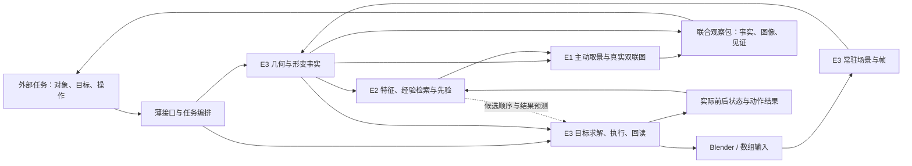

# Human Eye Radical V1：整体引擎架构与模块推进

**当前推进规则已更新：两端独立竞争，六模块实施及验收以 [竞争工作流](RADICAL_V1_COMPETITION_WORKFLOW.md) 为准。**

日期：2026-11-05。集成分支：`codex/aggressive-v1`。已有快速运行时基线：`0e380bc7c135c2d1bb9533e9d9d7a3a4b3377121`。

本文件取代 `3c8a777` 将 F0–F7 当作整体引擎的方案。新依据是用户提供的 [HE-Radical-V1.1 原始规格](RADICAL_V1_SOURCE_SPEC.md)，分析、反例和采用理由见 [规格深度审查](RADICAL_V1_SPEC_REVIEW.md)。附件作为设计输入原样保存，其“完整生产级”“实测 10.5 ms”等措辞不代表本分支已验证结论。

本文保留整体设计初稿；其中统一RadicalSession、学习与通用动作求解仍为拟定；明确平移/Shape Key执行回读已实现。当前human_eye_fast已实现并验收RB-A、RB-B、TD、BC、VG和AO，AO两层采用结果见[主干审查](AO_ROOT_REVIEW.md)，正在推进CF协议/夹具冻结；BC早期主干候选被拒后已按用户要求重开，当前采用经完整比较和补测验收的seed16，见[BC重开审查](BC_REOPEN_REVIEW.md)。实际文件及状态以[验收台账](RADICAL_V1_ACCEPTANCE_LOG.md)为准。旧数组链性能保持[第一版结果](AGGRESSIVE_V1_RESULTS.md)的原测量范围。

## 1. 整体框架：三大引擎，一份常驻状态

采用附件新的三个顶层功能分区。它们不是历史方案中的 core/低 token 桥/Agent 三模块，也不是三个进程。

| 整体引擎 | 对外承担的完整职责 | 第一版已有基础 | 后续必须补齐 |
| --- | --- | --- | --- |
| **E1 人眼主动感知引擎** | 由任务与几何见证决定看哪里、怎样看；交付全景、局部图及空间解释 | VG已验收真实主动视角、剖切与双联PNG，采用主干流式编码 | CF学习与整链编排 |
| **E2 小脑记忆与先验引擎** | 利用历史观察和动作结果，改进视角/候选顺序及结果预测；从实际反馈更新 | 无学习记忆；`FastSession` 缓存不等于学习 | 特征、经验标签和动作条件；会话内环形库；检索与读出学习；增益消融 |
| **E3 几何与动作执行引擎** | 常驻场景、空间/形变事实、动作求解、宿主执行与回读，给出实际残差 | `FastSession`、CSR、AABB/SAT、CLI/JSONL；RB-A/B、TD、BC及明确动作回读已验收；旧BlenderSession仍保持原边界 | 通用动作求解及学习整链接线 |

一个场景级 `RadicalSession`（拟定）持有场景、几何索引、E1 渲染资源和 E2 记忆。保留 `FastSession` 作为 E3 的固定拓扑形变子核。CLI/MCP 是薄入口，输出只在真正跨进程或面向模型时序列化。



反馈是下一次数据流，不要求相互 import。E1 决定视图，E3 宿主适配执行绘制/写入；E2 提供先验，数值事实仍来自 E3。由编排层把结果交回各自所有者。

## 2. 架构与算法的共同原则

- 同进程常驻、连续数组、显式变更、缓存参考量、出口一次编码。保留第一版去除来源哈希、重复 schema 校验、期限/配额、授权账本、隐式重试和保守回退的决定。
- “零防御”不替代算法定义。BVH 下界剪枝、三角形内部判定、坐标变换、g=0 时取景方向、资源释放与求解终止条件都是完成计算本身需要的步骤。
- 普通浮点结果不称数学精确谓词。报告 float64 数值距离及可追问见证；数学未定义量仍按真实语义表达，不伪造有限值。
- Blender RNA 批量读取到预分配数组仍有拷贝；目标是跨模块共享驻留数组，避免后续重复复制。不承诺整条链零拷贝。
- 不为模块化创建微服务、总线、通用工厂或多个会话管理器。模块按完整能力交付，文件在实现时拆分。

## 3. 内部实现单元与现有第一版的融合

附件六个文件是实现单元，不是六个整体引擎。保留其职责，合入一个运行包 `human_eye_fast`，并补上缺少的控制器。

| 附件实现单元 | 本端归属及落点（未实现项仍拟定） | 接入方式 |
| --- | --- | --- |
| `resident_bridge.py` | E3：已实现`resident_bridge.py`及原生`blender_resident_bridge.py` | 稳定多对象米制数组、完整变换、外观和显式更新；旧BlenderSession仍保持原边界 |
| `fast_bvh_clearance.py` | E3：已实现同名文件，SurfaceIndex/surface_distance | 完整窄相、BVH节点对搜索、原始面ID和世界米制见证；采用已达标实施版 |
| `tensor_deform.py` | E3：已实现同名文件，复用`kernels.py`数值核 | 流式跨帧归约、面积/法向/位移和稳定Top-K，保留主伸长完整语义 |
| `raycast_saccade_gpu.py` | E1：已实现同名文件，VGRenderer/prepare/observe | 已验收1024×512真实双联HUD、可见性/剖切及流式无损PNG |
| `cerebellar_flash.py` | E2：同名文件待实施 | 会话持有检索库/学习读出，以真实观察和动作结果监督，不使用全局隐式单例 |
| `fast_affordance_out.py` | 跨引擎：已实现并完成两层验收，列式JSON公开消费 | 数值、图像引用与任务结果一次输出；见证向量不直接当建议动作 |
| **附件缺失：动作控制器** | E3：`control.py` | goal → solve → apply → recapture → residual → feedback |

原 F0/F1/F2/F3/F4/F6 主要成为 E3 内部的数据、宿主、索引、算子、任务和控制职责；F5 对应 E1，F7 是共同入口。E2 是上版遗漏的独立能力，不能把缓存改名代替。

## 4. 我方内部模块数据契约与公开对比口径

这些是实现约定，不增加运行时 schema 验证框架。数组归场景所有，模块借用。稳定拓扑更新可原位改变借用数组内容；拓扑替换后旧数组由已有NumPy引用保持有效，但已不代表当前状态。外观更新可更换描述符。跨帧或异步保留快照须明确复制，当前值重新取得最新描述符。

| 数据 | 必需内容与语义 |
| --- | --- |
| `SceneFrame` | scene/object/frame/topology ID，局部米制顶点、三角索引、local→world 变换、材质关联及变化信息 |
| `ChangeSet` | 顶点索引、变换变化、拓扑替换、外观变化；由调用者声明，不做全数组哈希 |
| `GeometryWitness` | 对象/帧/拓扑/原始面 ID；世界米制 `p_a/p_b`、非负表面距离、表面相交；可选独立实体包含关系；算法与数值语义 |
| `DeformationFacts` | 对应面的 `sigma_max/sigma_min/area_ratio`；局部形变与世界运动摘要分列；完整数值留内存 |
| `ViewPlan` | 目标/见证、相机基、窗口宽度、像素尺寸、裁剪平面、`natural`/`section` 模式及实际投影间隙 |
| `Observation` | 同一帧的事实、见证、视图计划、真实图像或可消费纹理；配置不冒充图片 |
| `ActionSpec` | 明确目标类型、作用对象、世界平移/旋转参数、期望间隙或对齐量；区别于 `p_b-p_a` |
| `ActionOutcome` | 动作 ID、前后帧、实际施加量、回读后的几何事实、目标残差、求解结束原因 |
| `Episode` | 归一化几何、任务、动作、可见性信息；所选视角/动作与实际收益；关联同一次实际结果 |

### 坐标、单位与数值

1. 当前 `BlenderSession` 使用 **mesh-local metres**；附件输出 world float32，未应用 `scale_length`。两者不能按字段名直接拼接。
2. Blender local float32 转局部米制 float64；世界平移乘 `scale_length` 一次：`p_world_m = R @ p_local_m + t_blender * scale_length`。对象线性变换 R 不再乘单位比例。多对象距离使用世界度量。
3. 非均匀缩放不能用“局部距离乘一个比例”处理。刚体变换可复用本地树结构并更新保守世界包围盒；窄相在世界度量计算。非刚体变化 refit/重建。
4. 大世界坐标的几何计算可减共同 pair origin，保持 float64；GPU 用 camera-relative float32。报告还原世界原点。原始 float32 已丢失的细节不能靠后转 float64 恢复。
5. 局部形变与刚体世界运动分开；整体旋转180°不等于面翻转。拓扑/参考替换显式建立新对应，旧面 ID 不跨拓扑复用。

### 几何事实与动作

`surface_distance >= 0`，交叉表面距离为0；相交、闭实体包含、穿透深度是不同量。包含可在表面不相交时发生。第一轮先完成表面距离/相交；未计算的实体关系字段省略，不由距离正负猜测。

`witness_delta = p_b-p_a` 只描述当前见证。对目标间隙 `g_target`，分离且最近特征局部稳定时，`delta_target = (g-g_target)*(p_b-p_a)/g` 可作平移一阶候选；执行后重算。g=0、旋转、相交及非凸目标需对应求解。第一条动作链使用公开可解析的单轴间隙任务，之后扩展求解器。

## 5. 三大引擎的具体采用决定

### E3：保留主伸长，重写距离和状态流

- 保留参考基缓存、解析2×2谱、CSR脏面更新和同面见证。仅算面积会漏掉 `diag(2, 0.5)` 的等面积形变。
- 法向、质心位移、分位数作为补充指标。法向变化不直接命名为翻转；综合排序使用无量纲量，位移除以对象/任务尺度。
- 支持批量、按帧流式和 dirty 更新，不强制每次堆叠 `(T,Nv,3)`；完整事实与 Top-K 呈现分开。
- BVH节点对搜索用包围盒距离作下界，以已知见证作上界；剩余下界不能改进时终止。Top-32 用作种子/处理批宽，不能截断全局最小搜索。
- 叶节点窄相包含三角相交（含共面）、有效点到三角形、边到边；保存正确面 ID 与重心坐标。原型先核对语义，再依据 profiler 将遍历/窄相下沉原生代码。`find_nearest(point)` 不等于 mesh–mesh 全局最近点求解器。

### E1：完成从相机配置到可消费图像的链

- 先用16个正交候选，可增加10个倾斜候选，但按真实投影长度评分。中点与侧点使用网格射线；AABB只作粗筛。26方向最多对应78条三路探测射线。
- 正交投影下，按 `gap_px = width_px * g * sqrt(1-dot(view,w_hat)^2) / view_width_m` 反求窗口，同时保留上下文。不固定宣称“10倍”或任意微间隙都可见。
- 左图保留 natural 上下文；section 右图标注剖切及裁剪位置。全部采样方向被挡只触发尝试剖切，不证明闭壳，也不保证裁剪后可见。
- 真正实现离屏绘制、合成和图像出口。CPU图像消费者的读回/编码/传输计入成本。真实外观任务走宿主材质渲染；首槽 diffuse 色只称基础颜色。
- g=0 时用接触法向、形变方向或任务轴取景，不单位化零向量。

### E2：先让经验可用，再证明学习增益

- 32维几何编码统一字段表：尺寸6、中心方向/包围关系6、间隙/见证方向/法向关系/相交6、协方差谱6、形变/位移摘要8。后续实现需逐维固定统计口径、单位与零值语义；不用帧数冒充形变。尺度按 `L0` 归一化。
- 遮挡/上一轮可见性、目标及候选动作进入额外上下文；同一物体对可以有不同挡板或相反动作。32维特征不承担对象身份，也不唯一识别任意几何。
- 首条经验链保存实际成功视角与像素收益；比较固定顺序、最近邻检索、学习读出。无样本时用确定性默认顺序；随机网络没有已学先验。
- 相机头用 `sin(theta), cos(theta), log(scale)` 等命名字段；显著性头给16桶排序权重；动作头接受动作条件，预测 `delta_gap/L0`，返回时乘L0。取消含糊的31列切片。
- 环形库分离 key/value；各头明确读写映射，只对已有真实标签的头更新。角度不能跨±π直接线性平均。按索引选 Top-K；稀疏激活不自动加速前面的稠密乘法。
- E2只改变搜索/呈现顺序，不改写原始距离、形变极值。先算原始形变，再生成特征与排序先验，消除特征↔形变循环。

## 6. 最小接口与完整循环（拟定）

```text
session.capture(objects, frame, changes) -> SceneFrame
session.observe(task, image_mode) -> Observation
session.step(goal, action=None) -> ActionOutcome
session.learn(outcome_or_view_feedback) -> MemoryUpdate
session.close()
```

`observe`：驻留状态更新 → 距离与原始形变 → 编码/记忆先验 → 见证排序与取景 → 真正绘制 → 联合输出。输入就绪后距离和形变可以独立调度；是否并行由实测决定。宿主/GPU调用服从具体API上下文约束。

`step`：事实+目标 → 求动作 → 宿主施加 → 重新求值/采集 → 重算残差 → 关联Outcome → 记忆更新。收敛、停滞、用户指定迭代数属于算法结束定义，不重建旧权限/预算平台。

## 7. 当前实施方式：两端独立竞争

用户已明确两端各自完成整套引擎，不按架构端/算法端互补，也不跨端合并。六个源码模块、依赖、收益标准和实施对话工作流统一见 [竞争推进与收益验收](RADICAL_V1_COMPETITION_WORKFLOW.md)。本文件继续定义三大功能引擎及数据语义，不再决定两端派工。

主对话负责验收，实施对话负责具体模块。可以在本端创建多个互不冲突的实施对话；至少独立验收一次且收益达标后才推进依赖模块。

## 8. 性能目标与分支比较

`<12ms`保留为**声明规模上的热态观察目标**，不是已有实测。接通真实链后按profiler分配预算；附件8/0.2/2.3ms不直接成为已达标指标。

| 计量边界 | 包含内容 | 报告方式 |
| --- | --- | --- |
| 数值内核 | 已有数组→距离/形变 | 与现有fast及独立批量数学基线比较；面数/帧数/修改率明确 |
| 热态观察 | capture/求值→几何→先验→取景→GPU完成 | 包含的求值/refit/同步逐项注明；不能只测GPU命令入队 |
| 可消费观察 | 上项+readback/编码/传输 | 确实到消费者；纯纹理交付单列 |
| 冷启动 | 启动、首次采集、建树、资源/着色器准备、首次图 | 独立报告，不由热态外推 |
| 动作/模型任务 | 实际执行回读反馈，或外部模型消费 | 成功率、残差、工具轮次、token、总时间分列 |

每批保留设备/软件/输入规模、预热、重复原始样本、中位数与p95、内存和复制字节。几何覆盖独立/连通网格、分离/接触/交叉/包含、边边最近点、尺度/变换；视觉覆盖无遮挡、挡板、投影重叠、微间隙、开孔、闭壳、同色干扰。测试是开发工具，不是每次请求的准入门。

我方分支为 `codex/aggressive-v1`。另一端独立保存完整实现；比较同任务质量、延迟、内存及消费成本，不设置A+B合并组合。具体冻结口径与放行规则见当前竞争工作流。
