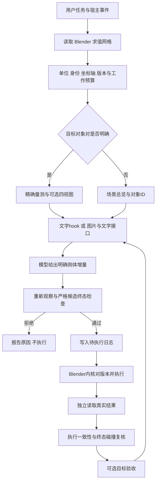

# 三维场景流程深审与第一版优化

2026-10-28 当前聊天重载验收：已实际载入 v19／9.7.2+20261028.support.discovery.r1（a0198acc…／installed_distribution／68 文件），状态健康、目标账本 0，旧配置快照拒绝已解除。当前 MCP 完整发现唯一支撑面，实测间隙仍为 3.1304261516453477 毫米；回填完整 selector 的 1 毫米目标预览只返回单步限幅候选，未移动。人为改错客户端 revision 的预览被拒绝并要求重新观察；没有实际编辑宿主来制造这条负例。独立 Fraction 真值、768×768 原生 PNG 和全 14 Scene 不变均已核对。

真实用户三维回复已在模型该轮工具调用前触发 v19 UserPromptSubmit，自动交付完整几何文字；五组定义保留。本轮还核对了 clearance_segment 预览的 PreToolUse／PostToolUse 去重，不能当作 execute:true 的动作链或 transform 各事件已通过。自动原生图片仍未证明，Hook 为 text_only。先前独立安装私有场景的 12 次移动是另一阶段证据，本聊天本轮零移动。

只读安装 SDK 边界矩阵 12 组／28 次调用／277 项检查通过；凹体、开放 reference、穿透／接触和有限面外一 ULP 明确 unsupported，几何／有理复杂度和过长 revision 返回 unknown，不放宽门。真实多候选截断未覆盖。下一单点候选先检查审计日志大字节／少行时重复整写和轮转，再考虑纯距离观察的对齐按需；两项均未实现，成本对照仍 pending。既有 27.84%—36.71% 文本字节减少不等于端到端或模型提速。工程构建可继续有限验收，整体公开发布门仍为 false。

[当前重载阶段](../verification/fixes/20261028_v19_reload/REPORT.md)、[当前量测与预览核对](../verification/fixes/20261028_v19_reload/CURRENT_VALIDATION.json)、[真实用户文字 Hook 审查](../verification/fixes/20261028_v19_reload/REAL_USER_HOOK_REVIEW.md)、[只读边界矩阵](../verification/fixes/20261028_v19_reload/MATRIX_REVIEW.md)。接口继续见 [精简支撑面发现](SUPPORT_PLANE_DISCOVERY.md)。

当前实际链已覆盖用户空间消息→fresh 量测文字→当前 MCP 原面发现→有界目标预览→人为失效绑定拒绝；没有当前聊天提交动作。内环目标执行的一般能力与当前聊天动作入口验收继续分列。

以下保留此前阶段记录，尤其 v19_activation 的待重启状态仅表示当时阶段；当前状态以上文和本轮重载报告为准。

2026-10-28 最新状态：v19 工程构建 9.7.2+20261028.support.discovery.r1（a0198acc…／68 文件）已离线安装并完成磁盘激活，新注册进程实际验收通过。当前聊天仍为 v16 旧配置快照，返回 stale_configuration_snapshot，需重启后核验；真实新用户 Hook 未通过本版验收。四文件迁移保留五组 Hook、Agent Learning 当前配置与状态，state 仅改配置绑定；磁盘激活不等于宿主信任或当前聊天重载。

显式 query.support_plane_discovery 已实现当前对象对的精简发现，完整 selector 可回填有界执行段。四模板文本字节中位减少 27.8448%—36.7095%，本地服务仍增加约 1.8—8.0 毫秒，不宣称模型或端到端提速；默认 PNG 保持。接口与边界见 [精简支撑面发现](SUPPORT_PLANE_DISCOVERY.md)，[新注册入口结果](../verification/fixes/20261028_v19_activation/REGISTERED_ENTRY_RESULT.json)和[配置保留结果](../verification/fixes/20261028_v19_activation/activation/PRESERVATION.json)。

当前流程：明确对象对→fresh 量测→按需发现原始支撑面→模型给目标／方向／预算→有界局部段→每步全场门检、提交、读回→到目标或停止／审查。模型无需逐步手算增量；局部段没有任意移动权限，任意凹体、连续路径和模型收益仍另验。

以下为此前阶段记录，保留当时版本、命令及验收边界；当前状态以上文及精简支撑面发现说明为准。

日期：2026-10-22。范围是 Blender 中物体的位置、角度和装配关系微调。AI 模型权重训练保留为后续本地模型路线；本轮没有训练、调用其他模型 API 或重新打包。

## 定位与本轮结论

第一版适合定位为：**基于宿主真实网格的三维观测与刚体调整引擎**。宿主自动提供场景事实，模型制定动作，执行边界负责检查，最后依据实际回读验收目标。

本轮补齐了精细调整所需的严格碰撞、未舍入间隙、自适应画布、宿主执行能力声明、文字交付优化及显式目标验收，并在真实 Blender 5.2.1 LTS 的独立场景中验证。它已经能进入有限范围的实战测试：低复杂度、受支持的已知闭合几何和静态独立物体。

这仍不等于完整视觉编码器、通用建模编辑器、连续空间记忆或任意复杂模型支持。尤其需要区分：**执行成功、目标完成、模型理解提升**。本轮验证了前两项在一个已知装配夹具中的闭环，没有证明第三项的普遍提升。

## 当前真实流程



| 阶段 | 现有实现与作用 | 必须保留的边界 |
|---|---|---|
| 自动触发 | 当前 Codex 已验证提示前、目标动作前和动作后 hooks；宿主回调还能接统一适配器 | 提示提交前不等于每次内部模型推理前；其他执行工具不自动受控 |
| 场景采集 | 读取真实依赖图求值网格、单位、世界坐标、对象原点和局部轴；覆盖可求值隐藏网格 | 依据完整宿主几何，不是从图片重建不可见物体 |
| 对象选择 | 显式 ID、配置名称、唯一活动焦点与唯一剩余参考 | 多对象语义不明确时返回总览，需要进一步确定对象对 |
| 观测 | 输出目标对与其他对象关系、未舍入间隙、有效性、版本、可选 PNG | 图像不能保证每个对象可见；原生图片与自动文字交付分开验收 |
| 模型规划 | 模型指定世界米制平移、XYZ 欧拉角度数 | 当前不接受顶点编辑、缩放、材质、修改器或一般轨迹指令 |
| 动作检查 | 新快照、观测身份和版本核对；候选终态对所有其他网格严格检查 | 不认证中途运动路径，不自动改写模型动作 |
| 执行与回读 | 先持久记录待处理状态，再在 Blender 内核对并执行；读取真实结果复检 | 不确定执行会隔离，不允许自动重试或删除状态绕过 |
| 目标验收 | 可选 `goal` 在实际回读上判断间隙、位置和接触姿态 | 调用方目标不自动等同于人类原始意图；目标验收本身不替代全场碰撞门 |

## 本轮发现并修复的问题

### 1. 显示齐平容差曾进入执行门

旧探针会将 0.1 毫米附近的间隙或重叠显示为齐平。原执行门复用这个结果，导致候选终态实际穿入 10–50 微米时仍可能放行。独立复现保留于审查目录。

现在执行前和实际回读后都使用独立于显示齐平规则的严格几何分类，当前算法碰撞容差为 `1e-9 m`。模型收到的 `signed_clearance_m` 也改用未舍入测量；原显示值另行标记，显示对齐标签不作为执行依据。距离计算包含完整面和边特征，不信任不完整的边提示来省略特征。

`1e-9 m` 是计算中的分类阈值，**不表示 Blender 或现实设备达到纳米精度**。Blender 有限精度回读仍按明确的位姿误差界检查；即使位姿误差在界内，实际终态穿透也会被拒绝。第一版实战使用正间隙与显式公差，不承诺任意尺度的绝对零间隙接触。

### 2. 固定画布不适用于任意世界位置和尺度

旧画布在物体平移到约 3 米时可能已有空正交视图，超过固定世界坐标范围则直接无图。新画布保持世界米制顶点原样，按包围范围设置相机、视野及远裁剪：

- Q1：全场景 XY 俯视正交图。
- Q2：全场景 XZ 正视正交图。
- Q3：全场景透视图。
- Q4：所选对象对或单目标的聚焦透视图。

元数据包含相机矩阵、正交比例尺、透视目标平面比例、实际深度像素、范围和目标 ID。图像不叠加旧控制器的动作处方或齐平结论。局部图明确标记为对象对聚焦，尚未实现任意接触点的自动微观扫视；不能因四宫格存在就宣称完整人眼机制已完成。

### 3. 能观察的场景不一定能执行

求值后的修改器网格可以读取，但安全刚体执行范围更窄。过去某些不支持场景会先得到允许预览，到真正执行才抛异常，并进入不确定执行隔离。

新连接器将 `host_execution` 能力与具体拒绝原因加入版本化快照；执行门在写入前拒绝不支持状态。父子依赖、约束、动画、形变、锁定、非均匀或异常坐标框架等限制与低层写入规则共用同一检查逻辑。

为兼容尚未重载的旧连接器，直接 `BlenderSceneHost` 的能力元数据默认关闭；新 MCP 连接器与后台 worker 显式开启。低层写入限制始终存在，不因元数据关闭而放宽。

### 4. 自动触发中存在无用工作

已确定对象对的一次 live 观察原来会读取两次全场景，现在复用刚取得的可信快照；实际动作检查和执行后仍重新读取。

文字 hooks 现在传入 `include_image=False`，跳过渲染和 PNG 编码。图文模式进入缓存键，不能把文字缓存误当作已生成图片，也不影响动作检查或版本失效。

本机双盒样例各采样 8 次、排除首轮后，当前文字路径中位耗时约 2.91 ms，图文路径约 26.88 ms。这里只测本地观测计算，不含 Blender 采集、进程启动、模型、网络或计费，不能推广为所有场景的加速比。

### 5. 执行验证不等于目标完成

保留兼容字段 `verified`，并明确提供 `execution_verified`。新增可选 `goal`，可由原有 `human_eye_scene_observe` 和 `human_eye_transform` 接受；工具仍为三项。

```json
{
  "action": {
    "focal_id": "实际零件ID",
    "reference_id": "实际基座ID",
    "translation": [0, 0, -0.008]
  },
  "goal": {
    "target_clearance_m": 0.002,
    "clearance_tolerance_m": 0.000002,
    "max_contact_normal_angle_deg": 0.01,
    "max_tangent_yaw_mismatch_deg": 0.01
  }
}
```

这是接口形状示例；实际动作须根据真实场景决定。目标还可以包含 `target_focal_pivot_world_m` 与 `position_tolerance_m`。省略目标 ID 时绑定当前对象对；冲突 ID、无目标、非法数值、缺少配套公差均拒绝。

结果用 `task_succeeded`、`goal_evaluation` 和 `goal_verification` 单独报告。一个动作可以执行验证成功而目标尚未达成；未提供目标时不声明完成。可选评估器异常不把已经成功的执行变成可重试写入。

目标测量复用引擎几何，并标记 `ground_truth_independent=False`。本轮另以夹具实际世界顶点、原点和独立变换算式核对结果，不能把两种证据混成独立通用几何真值。

### 6. 输入数量上限不足以约束计算成本

部分旧几何内核会建立顶点×面、边×边及 SAT 方向投影数组。顶点未超限不意味着工作量或内存可承受。

现在在数组转换前检查原始顶点、面及边提示数量，并在几何内核前增加保守工作预算。超限返回未知或拒绝，不自动简化网格后声称无碰撞。预算基于完整三角面估算，避免稀疏或重复边提示改变测距结果或绕过限制。它是准入策略，不是整个进程的峰值内存保证。

## 真实 Blender 微调结果

使用新建独立场景，原用户场景没有参加变换。测试坐标约为 `[12,-7,3] m`，包含基座、初始偏航 17° 的零件和第三个障碍物。

| 测试 | 实际结果 |
|---|---|
| 远离原点的观察 | 输出真实 768×768 四视图 |
| 候选穿透 50 微米 | 预览和内部执行门均拒绝，真实场景未变 |
| 第三物体终态碰撞 | 拒绝，真实场景未变 |
| 零增量 | 不制造宿主动作或新版本 |
| 第一步居中、消除 17° 偏航、靠近至约 10 mm | 执行通过；最终 2 mm 目标尚未完成，正确返回未完成 |
| 第二步再靠近 8 mm | 实际间隙 **2.0001866 mm**，目标误差约 **0.1866 µm**；位置与姿态目标通过 |
| 目标接口 | 服务使用实际回读验收；MCP JSON-RPC handler 的目标观察也与真实场景一致 |
| 清理 | 原场景、网格、选择和活动对象恢复，临时场景删除，未保存原文件 |

最终验收共 24 项通过。动作计划由当前会话明确提供，属于单个已知夹具的联调，不是双盲测试或模型效果对比；数值结果也不代表任意 Blender 模型都达到同样精度。

最新回归、源码哈希和保护检查见 [验收汇总](../verification/fixes/20261022_v1_3d/acceptance_summary.json)，真实场景证据见 [run_03](../verification/fixes/20261022_v1_3d/run_03/blender_v1_acceptance.json)。第一次受限环境无法建立本机连接的失败记录及恢复结果保留在 `run_01`，未覆盖为成功。

## 第一版可以交付什么，后续补什么

| 能力 | 第一版状态 |
|---|---|
| 已知完整网格、明确对象对的观测 | 已实现；受几何支持与工作预算限制 |
| 静态独立物体的平移、旋转和正间隙装配微调 | 已实现并做单夹具实测 |
| 自动文字观测、受控执行和实际回读 | 当前 Codex 宿主已有真实证据；其他 agent 分别验收 |
| 显式间隙、位置、姿态目标验收 | 新服务与接口已接入；目标仍须与人类任务核对 |
| 空间暂存 | 当前 live 路径保存当前版本、观测、权限和待处理日志；不是多帧空间历史 |
| 连续记忆、遮挡跟踪、部分观测融合 | 后续工作；旧 scratchpad 不能直接当作 live 路径已完成 |
| 接触点主动扫视、完整人眼机制 | 部分几何/渲染组件存在，尚缺统一策略及多场景效果证明 |
| 高复杂度或凹形开放网格的通用调整 | 未交付；不能用不受认证的降采样代替真实碰撞保证 |
| 顶点/拓扑/修改器编辑与缩放 | 未纳入本版刚体协议 |
| 运动路径与物理仿真保证 | 未实现，当前只检查终态 |
| GPU/CPU 混合调度、模型内部融合 | 后续路线，本轮没有加入 GPU 后端 |

下一阶段应使用真实待调整模型的副本，先做场景能力预检，再选明确的间隙、位置和角度任务。记录模型首个原始动作、拒绝次数、最终任务误差及耗时，分别统计模型与引擎作用。多场景盲测沿用此前约定，在新对话中开展。

## 源码生效与运行状态

本轮通过新启动的 Python 服务验收，版本标记为 `implementation_revision="v1-3d-20261022"`。当前会话已驻留的 MCP 服务探测未含此标记，仍需由宿主重新加载服务，才能使用新 schema 和已加载模块。配置文件没有改写，agent-learning 继续关闭；不要通过删除空间状态或改写信任哈希来完成升级。

旧发行包、23 个冻结实验源码和历史验收证据保留。源码优化完成与运行中服务是否已重载必须分别确认。
