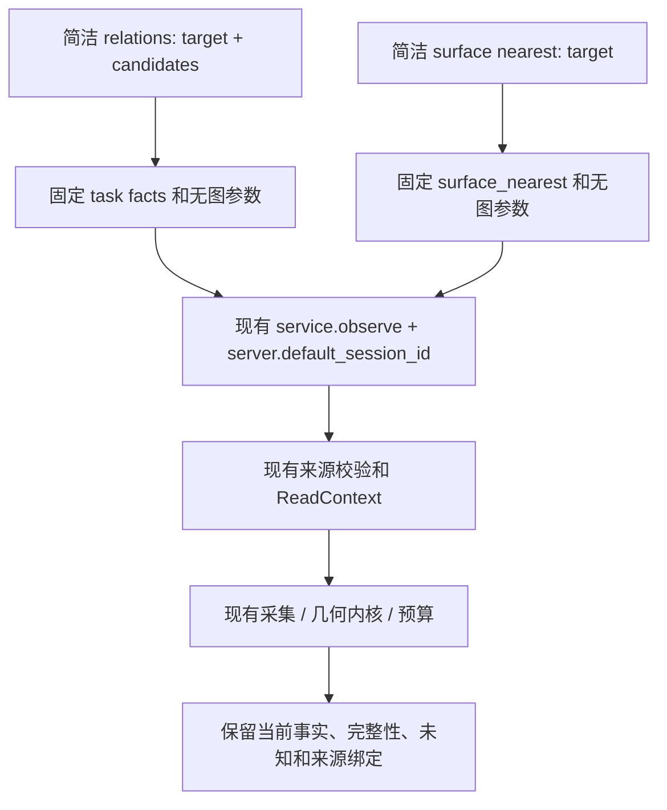

# M1-TASK-ENTRY-001 架构只读复查

本复查的实现基线为 `d341bb68a4747d1076d5e332789bee1d5f217cd7`，实际产品基线为 `df016079`、137源、canonical `3fc2651e…`。以下行号指该基线；工作树中的候选实现可能同步增加行数，应以符号名定位。

只读检查了代码、适用AGENTS及旧负收益摘要。仅发现 `C:/Users/Administrator/.codex/AGENTS.md`，内容为空。本复查不修改产品，不运行测试、服务、Blender、消费者或几何求解。

## 方向与最小实现

现有服务已具有两种所需求解能力，问题主要在M1公开合同。首版不需要新路由器、调度器、会话注册表、M3预算或几何算法。

1. 复用现有 `SPATIAL_TASK_TOOLS_SCHEMA` 中的 `human_eye_spatial_relations`。它已将target/candidates映射成固定的`closed_solid_relation`和`surface_proximity`，可选aabb；模型无需选择mode或requested_facts。
2. 在同一简洁目录增加一个名称明确的全场**表面**最近工具，例如`human_eye_surface_nearest`。公开参数只有`target: {name|id}`，一个完整调用例子可用`{"target":{"name":"Bracket"}}`，不包含答案、候选或私有样本信息。
3. 内部映射到既有`query={"mode":"surface_nearest","objects":[target]}`、`include_image=false`，沿现有server默认session。不要让模型填写session_id、include_image、mode或requested_facts。
4. 现有`spatial_task_only`配置足以承载简洁任务目录；普通目录保留旧scene_observe和写入口的兼容行为。简洁目录不再同时列出同义scene_observe别名。无需同时公开两套同义接口或新增通用profile系统。
5. 公共Native fallback保持不变，不能在M1包装器中自动替模型求解、重试或补答案。

基线定位：[live_spatial_mcp.py](C:/Users/Administrator/.codex/worktrees/m4-single-pass-acquisition/hefe/human_eye_plugin/live_spatial_mcp.py) 的`SPATIAL_TASK_TOOLS_SCHEMA`（269）、`_spatial_task_query`（282）、`_validate_arguments`（321）、`LiveSpatialMCPServer`（714）。

## 目录隔离必须同时覆盖dispatch

基线`_dispatch_tool`（779）使用`(name == 'human_eye_spatial_relations') != self.spatial_task_only`隔离两种模式。加第二个简洁工具后，这个单名称判断不再充分：它会拒绝S中的nearest；若只扩参数白名单，又可能让普通模式接受未公开工具。

最小修正是依据**当前模式实际公开工具名称集合**检查dispatch，再验证参数。`tools/list`、dispatch、参数白名单三者应一致。S仅接受本目录两种任务，普通模式维持兼容目录；未知名字和写工具在S中均应明确拒绝，不落入`else: service.status()`兜底。

同时登记新名称的trace操作（`request_trace`，727）：它是`mcp.observe`且无图。不能留下`mcp.invalid`或将新工具的图像请求记为未知。实际JSON-RPC ID和trace来源沿原机制，不接受模型字段充当执行身份。

## 默认session与动作语义

`LiveSpatialMCPServer.__init__`为每个持久server生成一次`mcp-UUID`，也接受可信宿主提供的default；现有observe/transform省略session时共享这一默认值。新M1读应沿用它，不另造固定全局session、隐式动作session或按target派生session。

[live_service.py](C:/Users/Administrator/.codex/worktrees/m4-single-pass-acquisition/hefe/human_eye_plugin/live_service.py) 的`observe`（1038）在进入旧`_locked`/runtime/action流程前，将task和surface_nearest分别交给`_observe_task`（1342）及`_observe_surface_nearest`（1280）。这两条路径使用独立ReadContext和只读observation_scope；`_observation_scope`（550）只限定只读重连事务，并不创建动作授权。

因此不需要改服务签名或动作账本。新工具应复用同一路径，不能为默认session“方便”而初始化/清空旧runtime.sessions、改inflight、续授权、移动对象或保存文件。相同session标识只是现有请求关联方式，不是缓存主键，也不把读证据变成动作许可。

现有`test_process_default_session_is_stable_across_observe_and_transform`（`verification/test_live_spatial_mcp.py:116`）值得保留。`verification/test_task_query.py:306`的`test_does_not_reuse_prior_write_prepare_context`却期待task读后清空旧runtime.sessions；这一断言看起来与当前独立ReadContext路径不符，需对照已知obsolete失败基线，不能为使其通过而改变动作状态。本复查没有运行它，也不声称这是本批新增失败。

## 缓存和来源保持原合同

[read_context.py](C:/Users/Administrator/.codex/worktrees/m4-single-pass-acquisition/hefe/human_eye_plugin/read_context.py) 已实现：

- `capture_key`（10）：instance_id、epoch、revision、selection_key；缺少有效token时不进行跨调用复用。
- `activate`（40）：按捕获generation失效，按入口、token和实际selection分开；最近8种selection，不借session重用。
- `result`（69）：每selection最近16个结果、按完整query取值，返回深拷贝，保留partial/unknown，不缓存异常。

服务`_read_source_identity`（347）另按运行源码SHA、host实例和production_mode管理读代际；变化会清读缓存。host的`capture_task_scene`、`capture_nearest_candidates`仍负责当前对象、document epoch/revision、selection和来源绑定。

M1不再添加按对象名、session、工具名或上次回答建立的第二套cache，不覆盖这些已有source/epoch/revision/selection边界。name与id应交由原selector验证及真实捕获绑定，不模糊匹配、不自动选第一个、不从旧目录补缺失目标，也不在M1规范化后跨对象实例合并缓存。

## 输出与期限

nearest直接沿原`surface_nearest_result`和`_tool_result`，保留result_kind、scope、coverage、unresolved、best_known、测量备注、source/host/runtime binding及execution_authority=false。complete才是全局结论；partial只能报告best-known，unknown不能改成complete。含义为无符号表面最近距离，不是最近分离件、穿透深度或移动距离。

`_project_spatial_relations`（552）是已有relations表示转换。当前实现对非`task-query-set-v1`直接原样返回，因此不能认定它现在会丢nearest事实；设计上仍应只用于relations，nearest不扩大其语义。首版不再增加brief、字段压缩或新的事实摘要，既有relations表示不必重做。

映射完成后继续通过同一`_call_tool`、service.observe及结果编码通路，保留原请求预算、来源检查、`before_task_publication`和stdio写前期限检查。不能改result_kind绕过这类检查，不能直接调用M3内核或返回缓存对象而跳过真实采集。

## 必要定向回归主张

| 验证项 | 应证明的事实 |
| --- | --- |
| 目录与名字gate | 普通目录兼容；S目录无同义别名；列出的工具可调用；S拒绝写工具/旧别名/未知名；普通模式不接受隐藏S工具。 |
| 首次参数 | relations只需target/candidates；nearest只需target；额外mode/facts/session/image参数不能偷偷改变映射；请求字典不被修改。 |
| 004/005反例 | nearest_witness不再由简洁relations让模型填写；新nearest无需显式session_id；旧scene_observe原参数拒绝行为仍兼容。 |
| 结果等价 | 同一旧装配/全场场景，以同default_session_id、无图和相同query比较既有路径与新M1；geometry事实、unknown、覆盖和来源一致，允许真实trace相关字段不同。 |
| 目标解析 | name/id均走原selector；缺失/歧义/非法字段严格保留原出口，不猜对象；包含UTF-8 byte上限，不放松旧边界。 |
| 部分结果 | complete/partial/unknown的状态、nearest与best-known区分、未解决候选及单位不变；不把只遍历全部候选当全部解决。 |
| session与动作隔离 | 同server default稳定、不同server默认不同；显式旧session仍被保留；新只读前后旧动作state/journal/inflight不被M1写入或清空。 |
| cache与来源 | source/host/epoch/revision/selection变化不复用旧结果；缺版本token不跨调用命中；绑定字段及候选范围保留；调用者修改返回对象不污染后续结果。 |
| 预算与只读 | 内核/候选/字节/期限保持原值；映射不渲染、不触发动作，不绕过发布期限；不引入重试或消费者补样。 |

无需为首版机械重跑全部历史矩阵。旧题仅用于本地等价回归，不继续刷模型分数；新消费者、未见场景及独立答案/评分冻结属于候选提交后的根深审工作流。

## 旧负收益仍有效

已读 `D:/hefe/verification/fixes/20261103_spatial_perception_ab001/admin/SUMMARY.txt`。该AB是固定56ed427 SDK辅助链，包含从共同图和目录发现目标/邻件、实际见证及严格ANSWER_SCHEMA。它记录A/B完整墙钟547.556/721.432秒、顶层工具8/23、工具文字121176/211734字节；两组最终几何关系正确，但自动引用匹配A3/3、B0/3，负收益及原失败成本全部保留。

M1目标明确的几何调用简化，只能检验“工具选择和参数能否自然正确”以及随后任务成本。它没有处理那次完整视觉目标发现、图像收件、引用编码到严格答案格式的全部链路。即使本批后续27个未见几何样本达标，也不能据此宣称旧AB负收益、完整视觉定位或整个产品档位目标已经解决；本批不额外重跑旧AB、不扩成视觉模块。

本复查只提供设计约束和定向回归主张，不代表候选已实现或验收通过。
