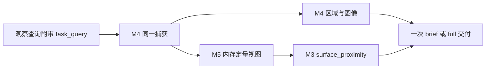

# M5 同状态观察与测量闭环

2026-11-16。本批完成一次本地只读闭环，将原有观察与定量两个公开请求合并为一次。固定六个主工程槽、两个 task-only 控制槽以及资格和真实状态控制全部完成。实施侧冻结门限通过，候选已在隔离安装中验证，管理员独立复审待完成。

## 固定版本与任务

基线交付为 `bc177d231329dac630b4d02a161076b2b9fb50e3`，A 产品为 `c309d7e4302518cd5f7d1c3966e7c7fa338ea128`。主资产 SHA256 为 `2d7c48f01665588bd7cfc93280ea50b559f4dc08196738c504ea56c88c75a164`。主任务观察 M4_Far_00 的区域和当前图像，同时测整个对象到 M4_Near 的 surface_proximity。

| 版本 | 产品源码提交 | 141 源聚合 SHA256 | 隔离安装 |
| --- | --- | --- | --- |
| A | c309d7e4302518cd5f7d1c3966e7c7fa338ea128 | 776b0f0914e116fece16d2b3875ee16ffebf4896a7e394861287ffaa6fe025be | D:/he_m4_target_002/B/product |
| B 首版 | 162b523cc727df0d6b975415508296693f6c2cd4 | 95e61fa0b44b94b6edfb55e22359bd5d7e748b32bcb7168c3611cf8c7311a311 | D:/he_m5_observe_measure_001/B_initial/product |
| B 最终版 | ccb608aa83de4b0e6671da89e0c8f387bd3f800e | 7d2d4352f462c64a46e6fccf447c6f030c08b96e95517a3b2b6776ed50b69a6a | D:/he_m5_observe_measure_001/B/product |

最终 wheel SHA256 为 `b63f2fa196fdf74e40e0a0902c402806109893373ea2cbf71dad0fc9f0c3b801`。正式冻结提交为 `31124af898a35dee84504d3101003629bd185ec1`。首版、唯一一次优化及最终安装分别保留。

## 接线与来源

观察查询可选附带 `query.task_query`，使用现有 legacy task 的 mode、objects、requested_facts。主任务只请求 surface_proximity。默认 brief 和 full 都实际交付顶层 task_result，其中最近点和方向位于 facts.surface_proximity.value.nearest_witness。

父捕获保留 target_observation_meshes 来源声明。内部派生视图使用 observation_task_objects，绑定父摘要、真实 object_id、instance、完整原始源面范围和有序世界几何摘要。图像 geometry 标识通过观察对象索引映回真实对象。场景代按 instance_id、epoch、revision 核对，选择范围及派生 fingerprint 有各自的值。

缺少定量对象时，先补读所缺对象并核对场景代、文档和实例，再生成图像及测量。无法同源合用时给出具体原因。普通 task-only 沿原直接求解路径。

## 首版事实与唯一优化

A 资格实测确认，第二次定量捕获已命中 M2 资源，新增 to_mesh、三角化、世界变换和资源顶点转发均为 0。它仍有一次实际 host 调用，原记录的 host.capture 窗口为 54.948 毫秒。

B 首版已能只用一次公开请求完成两类结果，定量新增详细捕获与 raster 都为 0，M3 求解一次。首版还对两个已有对象重复构造几何标识，其 task_source_prepare 为 7.1598 毫秒。

本批唯一优化在 active_observation_host 与 live_service 中复用同次 M4 已算出的标识。私有 callback 只传标识 tuple，并沿已有 ReadContext 缓存保存。最终公开结果保持字典，源面验证和定量规范化继续执行。

| 资格单样本诊断 | 首版 | 最终版 |
| --- | ---: | ---: |
| 额外几何解析 | 2 | 0 |
| 已有标识复用 | 0 | 2 |
| 有序原始几何摘要 | 2 | 2 |
| 定量规范化 | 1 | 1 |
| M3 surface pair 求解 | 1 | 1 |
| source prepare 毫秒 | 7.1598 | 0.2216 |
| source finalize 毫秒 | 包含于原 prepare | 0.0282 |

这些阶段值用于定位剩余工作。完整收益取自下方独立正式槽。19748 字节为定量网格 V/F/E 的表示量，其中 V/F 为 13284 字节，边数组为 6464 字节。数组分配、复制次数和瞬时内存仍未测量。

## 来源与质量验收

先封存六主槽、两个 task-only 槽及三组配对质量，再解锁正式时间排名。主任务 6/6、task-only 2/2、配对质量 3/3 均通过。三组 A/B 的完整观察事实、六向分类、相机、选视、RGB、深度、对象归属、源面及 patch owner 逐项相同。主场景保持两支持区域、一完整见证、一未知区域。

独立距离为 `2138893713/2147483648` 米，实际数值为 0.9959999998100102。见证分别位于当前两对象原始三角表面，A→B 方向为负 X。检查允许合法的非唯一最近点，并核对原 M3 发布位移残差。

最终 B 三个主槽均实际执行 M3 一次，定量补采集 0、追加 raster 0、额外几何解析 0、已有标识复用 2。task-only 两槽均只走普通 task，图片和 raster 为 0。

## 真实状态控制

一个独立未保存副本内执行五个公开请求，覆盖初始 brief、初始 full、缺失对象、矩阵变更及恢复。

| 状态 | 实际距离米 | 完整区域 / 未知 | 来源代 |
| --- | ---: | --- | --- |
| 初始 brief / full | 0.9959999998100102 | 1 / 1 | revision 1 |
| 补读 M4_Far_11 | 10.04987562112089 | 原观察 1 / 1 | revision 1 |
| 目标世界 X 增加 0.25 | 1.2459999998100102 | 2 / 0 | revision 2 |
| 恢复 | 0.9959999998100102 | 1 / 1 | revision 3 |

缺失分支实际只补读 Far11 的 512 个面，其观察索引和图像 geometry 标识均为 null。初始 full 的数值、见证和来源确实通过公开响应交付。变更后取得 SCENE 与 LEFT 两张图。恢复后全部图像缓冲与初始逐元素相同，来源代已更新，旧绑定继续失效。

两个 matrix setter 仅由测试副本驱动执行。293 个目标世界点、实际矩阵及全场恢复指纹均核验，产品 setter 为 0，原文件未保存。非共面折面、面序变化、等距离坐标变化、同名与实例变化等另有离线来源控制。

## 正式完整工程成本

固定顺序为 A1/B1/B2/A2/A3/B3，之后为两个 task-only 控制。全部 fresh owned 会话，正式一次，无外层重试或补样。

| 配对 | A 业务毫秒 | B 业务毫秒 | B/A | A 完整会话毫秒 | B 完整会话毫秒 | B/A |
| --- | ---: | ---: | ---: | ---: | ---: | ---: |
| 1 | 854.9460 | 743.0600 | 0.869131 | 2858.0002 | 2595.0943 | 0.908011 |
| 2 | 843.9172 | 748.7462 | 0.887227 | 2806.8676 | 2740.9884 | 0.976529 |
| 3 | 913.2515 | 756.7633 | 0.828647 | 2850.1383 | 2655.9564 | 0.931869 |

业务配对比值中位为 0.869131，缩短 13.09%，三对均更快。完整会话配对比值中位为 0.931869，缩短 6.81%。两项均通过 1.05 门限，业务另达到预先单列的 10% 工程时间收益标准。

| 主任务三槽合计 | A | B |
| --- | ---: | ---: |
| 公开业务调用 | 6 | 3 |
| M3 pair 求解 | 3 | 3 |
| raster / 图像交付块 | 3 / 3 | 3 / 3 |
| 转发网格资源 | 18 | 18 |
| 转发顶点 / 面 | 3498 / 6156 | 3498 / 6156 |
| 公开文本 UTF-8 字节 | 23136 | 27138 |
| 实际 stdio RX 字节 | 42366 | 46314 |

公开文本增加 17.30%，实际 stdio RX 增加 9.32%，附项同时提供了父捕获、对象实例及完整源面关联。调用数量、工程时间和传输字节分别保留。A 已有的网格复用仍归计于 M2。本批减少一次公开请求与 host 命令，并消除额外标识解析。

task-only A/B 的业务时间分别为 243.4098 和 186.8951 毫秒，完整会话为 2201.9604 和 1986.9695 毫秒。这一对用于路径诊断。

业务窗覆盖连续的原始客户端调用，A 两次调用之间没有额外 QA 解析。完整会话包含检查、启动、所有交付、保存验证、关闭及 RESULT 发布。server、transport、业务及完整时界分别报告，publication 标记自身写入另列。注册至正式启动为 3554.476 秒，正式批为 20.888 秒，正式结束至根成本决策为 820.291 秒，最终封存另有账本。

## 预算与审计保留

全批 12 次 owned，资格及状态 4 次、正式及 task-only 8 次。实际 raster 为 13 次，资格与状态 7 次、正式 6 次。未知和待结算预算均为 0。模型消费者、付费 API 均为 0。所有公开请求保持原 30 秒预算，owned 生命周期为原 600 秒。

12 个 MCP 与 Blender 的实际退出、句柄、reader、管道和恢复证明均通过。12 条通用 worker close 事件的 unknown 状态独立保留，具体关闭回复及实际进程回收另外核验。

准备期间的回调 mock 接口适配、独立 checker 字段与 full-frame 白名单适配、成本检查器业务失败出口修正均留有初稿和原因。root 首次状态启动额外加了 -I，导入阶段因缺少脚本目录退出，尚未启动 Blender；随后按登记的启动方式执行，真实状态会话仍为一次。原题、几何真值和正式门限保留。

最终定向纯检查 52 项，旧 task/brief 及同断言 service fixture 回归 46 项，成本公式合成检查 37 项通过。原始 service mock 的两次回调参数错误也保留。独立运行审计完成 19585 项，三版各 141 源、26 个历史保护项、8046 个旧清单成员和全部运行原件通过核对。

Agent Learning 当前聊天仍待 host 绑定，登记待同步。协调者和审查代理的模型费用、内存峰值与复制次数未计量。工程对照只覆盖当前固定资产、任务及安装，模型实际消费、自然路由和更多真实曲面资产仍需后续证据。当前检查者有产品或 harness 作者关联，管理员独立复审将另行保存。

## 唯一下一建议

管理员复审后，按当前同状态闭环安排一次固定完整模型任务验收，检查 Codex 是否正确使用一条公开响应中的区域、距离、见证与来源。M6 感知候选沿既有来源和源面引用衔接。本批固定候选和工程验收资料收口。
