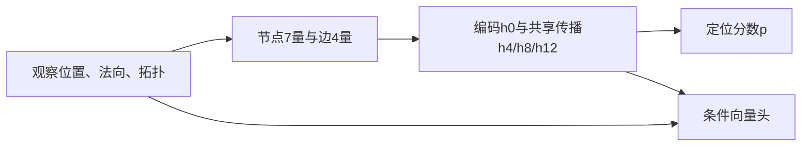

# M6-SHAPE-OBSERVE-001 观察诊断

2026-11-15。基线 `36694d0e3730a60b0611376b017f978f809a79c0`，合同 `bc86c84f6019457a3a2d75ee8cdbf7f5a1d00653`，事前计划与六证据冻结提交 `a655121005a8474cc055e1b4e7cba61e3d8c588d`。最终提交及一次回报收据在提交后本地HANDOFF.json。新增交付集中于本批目录。

**诊断完成，两个检索筛选分支均未通过，原局部凹陷学习候选继续关闭。** 唯一建议方向为建立部署时可获得的编辑任务条件及修改/保留标注对照。完整观察是否足够、当前学习目标是否合适仍有待区分。

## 数据流与实现核查

固定开发231例、Armadillo117例，共348观察。四开发成员仍为同一未知上游组，19对重叠patch的既有事实继续适用。Armadillo为一个验证对象。人工扰动前的参考形状只说明本批施加了什么变化，艺术满意度及部署时参考的可得性未知。

真实原方程先在完整观察源网格计算法向及邻接统计，再取保存context。节点7量为归一化半径、signed Laplacian、normal variation、mean edge、log degree、allowed、fixed。边4量为归一化边长平方、法向点积及两端法向与边向量点积。原18个训练标准化量处理节点前5项和边4项。定位头接收标量编码后的初态及12步共享消息隐藏状态，原位置/法向向量另外参与条件修正向量。R0覆盖局部13维摘要，完整图消息包含额外的节点邻接关系。

原拓扑和法向函数被复用，按原features.observe同序方程重算348观察的cast前值。四项保存数值输入与origin/scale全部精确一致。逐个六输入的名称、shape、dtype和完整字节散列均保存，精确重复输入组0、标签或目标冲突0。10767个支持点全部在float32位置及节点前5项保留相对同patch正常例的差异，float32目标全零的支持点0。目标float64与保存目标float32最大绝对差约1.186e-7。该核查覆盖具体提取和转换路径，近似可辨识性仍需其他证据。[输入审计](C:/Users/Administrator/.codex/worktrees/m6-model-selection/hefe/verification/m6_shape_observe_001/INPUT_AUDIT.json) [只读复核](C:/Users/Administrator/.codex/worktrees/m6-model-selection/hefe/verification/m6_shape_observe_001/AUDIT_REVIEW.json)

配对origin变化均0，观察scale/正常scale范围约0.98045–1.01474。原本正常自由点与固定点的原坐标保持原样，其归一化位置仍可随观察尺度变化。审计分别保存原坐标变化、各自归一化frame变化、float32舍入量及原网络标准化后的节点/边差异。共同参考frame只另列几何位移归因，未在该frame重算可用描述。

全部支持点到输入固定点均可达，最大10跳，超过K12的点数0。到标签正常点的距离也逐点保存。拓扑覆盖已确认，实际信息利用方式继续由检索和冻结响应检查。

## 标签位移与目标能量

位移和能量分别采用每个观察尺度下的float64位移范数及平方和。三段仅用于解释标签，不改变二元支持标签。固定旧tau为0.7364127039909363。

| 子集 | 位移区间 | 支持点 | 目标平方和占比 | 原tau选中支持点 |
| --- | --- | --- | --- | --- |
| development_center | (0,.02] | 1282 | 0.010355% | 10 |
| development_center | (.02,.10] | 1563 | 0.555434% | 13 |
| development_center | (.10,+inf) | 3197 | 99.434211% | 106 |
| validation_center | (0,.02] | 648 | 0.007720% | 0 |
| validation_center | (.02,.10] | 800 | 0.466006% | 0 |
| validation_center | (.10,+inf) | 1897 | 99.526274% | 0 |
| validation_offcenter | (0,.02] | 335 | 0.021716% | 0 |
| validation_offcenter | (.02,.10] | 399 | 1.233514% | 0 |
| validation_offcenter | (.10,+inf) | 646 | 98.744770% | 0 |

小位移段约占19%–24%的支持点，目标平方和占比约0.008%–0.022%。验证强位移仍全部漏检，其目标能量占各组约98.7%–99.5%。微小标签无法单独解释验证全部不动。

## 固定参考检索

R0为节点前5量、出边4量均值及总体标准差，共13维。R1加context内2/4/8跳曲率样与法向变化的6个固定多尺度量，共19维。原保存float32位置/法向提升float64后计算，参考形状和目标只参与诊断标签。

每例按自由点源ID排序，使用事前floor公式取64点，共22272点。开发14784参考点，四个开发查询池各排除本成员整个文件，验证仅查全部开发。各允许池独立拟合均值和总体标准差，std下限1e-6。R0/R1无效描述均0。实际query块64行，上限128，float64标准化欧氏距离，k5，并列严格按distance、case_id、source_vertex_id排序。每点全部5邻居、标签、距离和索引均保存。[逐点数值](C:/Users/Administrator/.codex/worktrees/m6-model-selection/hefe/verification/m6_shape_observe_001/RETRIEVAL_POINTS.npz) [逐例及参考池](C:/Users/Administrator/.codex/worktrees/m6-model-selection/hefe/verification/m6_shape_observe_001/RETRIEVAL_RESULTS.json)

下表在相同查询点比较R0、R1与冻结p。每凹陷例先算AUC和同分分组AP，patch内凹陷例等权，最后patch等权。

| 子集 | R0 AUC / AP | R1 AUC / AP | 冻结p AUC / AP |
| --- | --- | --- | --- |
| development | 0.53130 / 0.14596 | 0.55673 / 0.16876 | 0.69877 / 0.30513 |
| validation_center | 0.54091 / 0.24805 | 0.65711 / 0.42063 | 0.71862 / 0.41268 |
| validation_offcenter | 0.55524 / 0.12545 | 0.56386 / 0.16058 | 0.75123 / 0.25593 |

开发、中心、偏心采样支持点分别1212、684、285，采样目标能量覆盖约20.525%、20.198%、22.254%。开发个别病例采样能量覆盖为0。全支持有效病例189/198、54/54、54/54，有效patch为33、9、9。指标均来自相同有限采样点，空分母和每例覆盖率完整保留。

强位移另采用强支持点大于0.10与正常自由点比较，弱支持点排除并记录分母。这是本批PLAN事前明确的强位移统计解释。以下括号为有效patch数。

| 子集 | R0强位移AUC | R1强位移AUC | 冻结p强位移AUC |
| --- | --- | --- | --- |
| development | 0.55870 (32) | 0.59612 (32) | 0.69430 (32) |
| validation_center | 0.57001 (9) | 0.72022 (9) | 0.74221 (9) |
| validation_offcenter | 0.59075 (9) | 0.57067 (9) | 0.79626 (9) |

强位移有效病例144/198、53/54、47/54。R1中心有提升，偏心强位移AUC低于R0，预设双组一致性条件失败。正常控制AUC/AP为空，分数尾部另列。参考标签索引在此作为诊断，其准备和检索成本单列。R0与R1的局部摘要仍不能刻画所有可用观察信息。

R1的2/4/8跳球实际点数开发分别7–74、24–206、115–406，验证14–27、49–82、135–290。球均在保存context内，完整源网格被截去的邻居数未测。

## 六个预选几何证据及冻结响应

证据选择先于新检索。四开发成员各取正常控制中旧p最高自由点，验证中心/偏心各取目标平方和最大例中的最大位移点。六点在五近邻内的最近反标签距离如下，无反标签时保留空项。

| 证据观察 | 源顶点 | 最近反标签距离 R0 / R1 |
| --- | --- | --- |
| Yanyite_patch_07/sample_00 | 4759 | 72.87471 / 72.95868 |
| Richie_patch_01/sample_00 | 18772 | 无 / 无 |
| Chipow_patch_03/sample_00 | 7065 | 26.41787 / 26.60344 |
| Yunhex_patch_05/sample_00 | 8766 | 1.56221 / 1.78090 |
| Stanford_Armadillo_patch_03/sample_06 | 172749 | 1.48781 / 3.09408 |
| Stanford_Armadillo_patch_03/sample_12 | 168689 | 0.75837 / 1.12154 |

10/12个描述见证查询的五近邻含反标签。Yanyite与Chipow两正常点对应反标签距离很大，几何近似性尚未确证。验证见证的反标签来自未扰动正常控制，实际图同时展示了局部表面外观与有限摘要的歧义。这些证据的完整输入身份均不同。六例及图中标签表达人工扰动，与自然凹曲的审美判断仍有距离。[见证邻居](C:/Users/Administrator/.codex/worktrees/m6-model-selection/hefe/verification/m6_shape_observe_001/WITNESS_RETRIEVAL.json) [几何元数据](C:/Users/Administrator/.codex/worktrees/m6-model-selection/hefe/verification/m6_shape_observe_001/GEOMETRY_EVIDENCE.json)

7个唯一观察完成7次冻结前向，重复正常配对复用结果。原u、z、p、硬输出及保存候选回放一致，12次layer_norm调用被核对，h0/4/8/12响应逐点保存。两验证见证的损坏/正常分数分别约0.62469/0.57596和0.47588/0.31800，均低于旧tau。两点隐藏状态对扰动有响应，范数趋势对传播病理的因果解释尚无结论。原权重与18项标准化散列保持。[冻结追踪](C:/Users/Administrator/.codex/worktrees/m6-model-selection/hefe/verification/m6_shape_observe_001/FROZEN_TRACE.json)

图按真实三角形深度绘制，每观察/正常对照使用同相机，全部面板共享观察中位边长单位显示尺度。跨源参考法向被对齐到同一局部观察方向，旋转矩阵在私有元数据。root及辅助审查均实际看图通过。

## 成本、限制与一个后续方向

主要worker外层wall为输入审计47.6136秒、参考检索18.6544秒、冻结追踪5.6601秒、渲染2.3138秒。输入重建中拓扑准备13.4106秒、全源动态特征24.6663秒。检索主体读取0.9113秒、描述准备1.9218秒、参考池准备0.0220秒、采样查询14.5877秒、见证查询0.00369秒、指标0.6430秒、保存0.2062秒。完整进程树与外层监视器CPU、峰值、汇总及独立核验成本记录另见COSTS。阶段嵌套范围分别列出，最终自查询后的写盘/退出及研究交互、费用存在缺测。[完整成本](C:/Users/Administrator/.codex/worktrees/m6-model-selection/hefe/verification/m6_shape_observe_001/COSTS.json)

本批复用已锁环境，训练更新0、门限搜索0、新修复0、Bunny数组和评分0、Google/付费API0、共享GUI与产品动作0。公开源物理单位未确认，几何误差统一用观察尺度，接触与完整产品验收保持unknown。四开发成员同上游、派生例相关、有限64点采样及一个验证来源限制继续适用。

事前R0分支要求两验证组宏AUC均至少0.80且各高于冻结p至少0.05，本轮失败。R1分支要求两组宏AUC均至少0.80、较R0至少高0.05、AP不降并在强位移与几何证据同向，本轮数值和强位移方向均失败。输入与标签提取未发现具体错误，当前证据适用最后一档。学习目标与完整输入的可辨识性仍未区分。

**唯一后续建议**为优先建立部署时可获得的编辑任务条件及其修改/保留标注对照，明确哪些自然凹曲应保留、哪些偏离应恢复，再决定下一项研究。该建议需要规划独立复核及下一任务立项，当前批到此结束。原未扰动参考的部署可得性需另有证据。

## 交付核验

独立算术检查348观察、22272查询、222720邻居及35组汇总，最大差约1.42e-14。24次重复top5核对来自12个既有查询点，新增查询点0。1531项相关输入/权重/门限及四原始资产按旧清单核对，136个旧公共文件字节保持。六个阶段均首试完成，失败0。六阶段监控main窗口wall合计76.5422秒，worker进程树CPU67.46875秒，外层controller生命周期查询CPU另10.015625秒。预选、身份核对、额外只读审查与合成QA另列，完整研究总成本仍有缺测。

[独立数值核验](C:/Users/Administrator/.codex/worktrees/m6-model-selection/hefe/verification/m6_shape_observe_001/INDEPENDENT_VERIFY.json) [复用输入身份](C:/Users/Administrator/.codex/worktrees/m6-model-selection/hefe/verification/m6_shape_observe_001/REUSED_INPUTS.json)

交付元数据核验首次将渲染状态字段误判为统一前缀，已按实际rendered_actual_geometry状态及共享尺度/相机标志修正。该次断言与缺测成本单列于DELIVERY_AUDIT_LOG，科学阶段重跑0。
